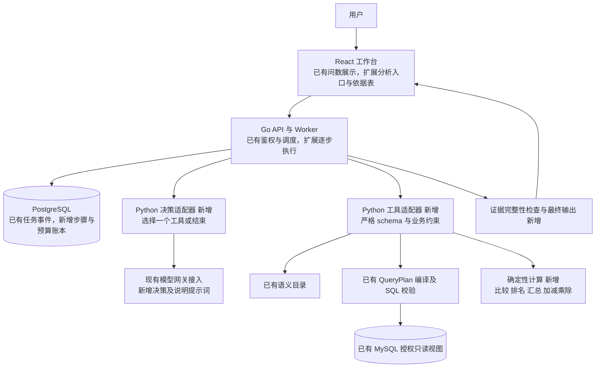
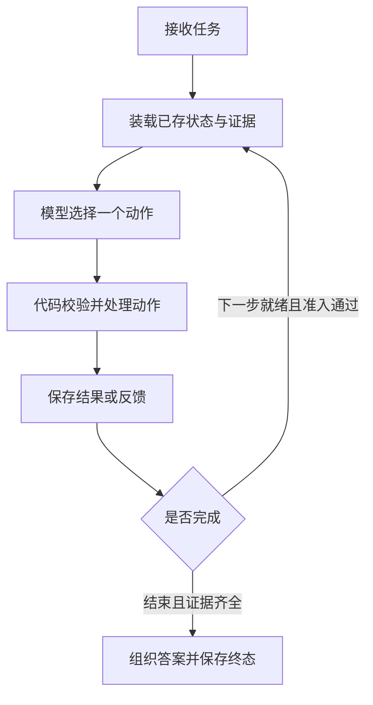
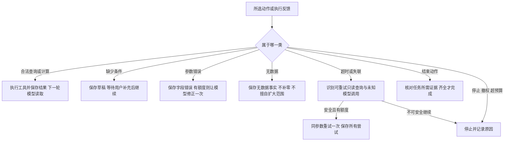
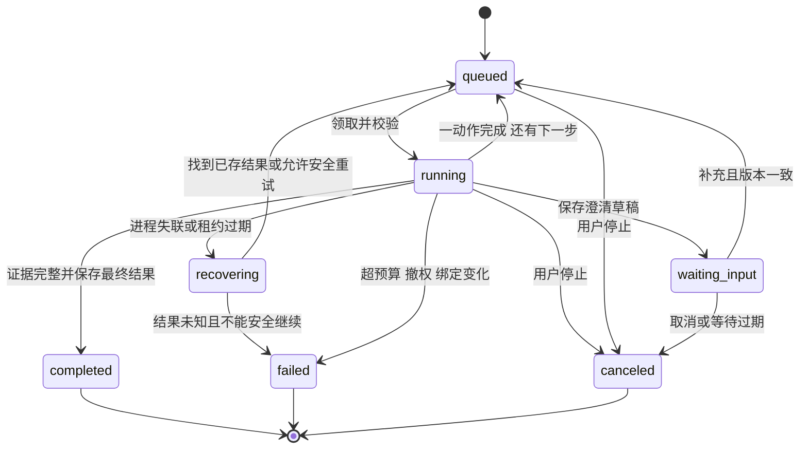

# nl2sql_agent 有限经营分析助手技术方案

日期：2026-10-17。状态：方案已获用户确认并进入实现；首版代码及本地验证已完成，等待代码与测试结果的人工验收。下面“已有/待实现”用于保留扩展前基线与原设计的区分；当前完成情况、实现调整及剩余验收见[实现与验证记录](business-analysis-implementation.md)。历史交互图保留为原设计快照。

本轮修订：明确 query_metrics 的复用边界，增加结果汇总/四则运算的受限计算设计，并将执行流程拆成主循环、反馈分类和具体任务示例。

现状核对基线：`1e09178c9455a394609d0fc7353ff80992e7d7f9`。下文的“已有”表示该版本源码中存在；线上部署状态另以部署验收记录为准。本地原有 `.github/rulesets/master-pr-only.json` 修改不属于本方案。

在现有 Go API、Python 查询服务、React 工作台和双数据库内增加一种有限分析任务。一个模型逐步选择工具，代码执行授权查询与比较计算，Go 持久化每一步并限制执行预算。首版沿用现有调度基础，不新增项目、常驻服务或多 Agent。

## 1 需求规格与首版边界

### 1.1 核心任务

> 比较两个时间段各州的 GMV，找出下降最大的三个州，核查订单量和客单价变化，并给出数据依据。

完整成功包含：明确两个时间段及比较方向、覆盖授权范围内的州、计算 GMV 差值与变化率、对下降州稳定排名、核查所选州的有效订单量与客单价、附上可追溯的指标口径和结果引用。任一必需项缺失，不计为完整任务成功。

原问题没有给出具体时间，“下降最大”也可能指金额或比例，应先澄清。首版不暗中选择默认排名方式。用户可通过表单显式选择“按下降金额”，该选择作为硬约束。明确的验收问题例如：

> 比较 2018 年 6 月与 7 月各州 GMV，按 GMV 下降金额取前三，核查这些州的有效订单量和客单价变化。

对应基期 A 为 `[2018-06-01, 2018-07-01)`，报告期 B 为 `[2018-07-01, 2018-08-01)`，差值统一为 B−A。界面同时展示区间、天数、分析基准与排名依据。

### 1.2 待实现范围

| 项目 | 首版约束 |
| --- | --- |
| 入口 | 工作台显式选择“经营分析”；普通问数及受控多轮继续走原入口 |
| 数据域 | Olist 订单粒度授权视图 `metric_orders`，只用现有州维度和合法筛选 |
| 指标 | 分析任务只支持 `gmv`、`orders`、`aov`；原问数六指标保持原范围 |
| 时间 | 两期比较使用两个明确区间，Top N 汇总使用一个明确区间；均左闭右开、各不超过 366 天、不得超过固定分析基准次日 |
| 比较 | 同指标、同维度、同筛选、同口径、同数据版本的两期比较；首版不支持重叠区间 |
| 排名 | GMV 下降金额或下降率，Top N 为 1–10；方向和口径必须明确 |
| 核查 | 所选州的有效订单量、客单价及样本完整性；允许读取结果后补查 |
| Top N 汇总 | 同一期 GMV 从高到低的前 N 个州，汇总所选州 GMV/有效订单量；组合客单价按总 GMV / 总有效订单量重算 |
| 输出 | 结构化依据表、描述性结论、限制说明和步骤记录 |
| 边界 | 不做因果归因、预测、自动经营决策、自由 SQL、新 JOIN、品类分析或外部搜索 |

两期天数不同可以比较原始总量，但必须提示天数差异，不自动改成日均。用户要求日均、同期天数对齐或重叠窗口时先说明首版边界，不悄悄替换统计方法。未来扩展应另行定义口径。

模型决定下一步，不代表可以任意行动。系统开放六类受限工具及一个结束动作；所有参数、权限、预算和完成条件均由代码检查。请求“证明营销导致下降”只能完成用户明确接受的描述性核查，不能将相关变化写成原因。

## 2 已有能力与待实现能力

| 能力 | 项目已有部分与源码依据 | 本次待实现部分 |
| --- | --- | --- |
| 账号与授权 | Go 账号、租户、角色、指标授权及结果撤权检查：[server.go](../internal/api/server.go) | 分析任务及其所有中间结果按完整指标依赖集合检查 |
| 指标语义 | 六指标目录、单位、定义和版本：[catalog.json](../agent/runtime/catalog.json)、[catalog.py](../agent/runtime/catalog.py) | 向模型开放经过授权裁剪的业务目录工具，不暴露 SQL 公式 |
| 结构化查询 | `QueryPlan`、参数化编译、结果 v2：[plan.py](../agent/runtime/plan.py) | 接收已验证 QueryPlan 的工具适配器，避免每次工具查询再次自然语言解析 |
| 数学计算 | SQL 层已有 SUM、计数及目录定义的比例/均值；现有返回值不提供任意结果后处理工具 | 新增 `calculate`，按证据引用完成汇总、加减乘除及变化率；禁止任意表达式或代码 |
| SQL 安全 | AST 白名单、单视图只读账号、10 秒 SQL 上限、1000 组上限：[app.py](../agent/runtime/app.py)、[security.py](../agent/runtime/security.py) | 每次工具执行复用这些检查，补充分析级同口径与完整覆盖校验 |
| 模型接入 | 规则完整命中则零模型调用，陌生表达单次模型兜底；通过网关 HTTP JSON：[app.py](../agent/runtime/app.py)、[model_transport.py](../agent/runtime/model_transport.py) | 决策及说明生成协议、结果摘要输入、逐次模型调用用量与失败处理 |
| 受控多轮 | 成功计划与澄清草稿分存、request_id 幂等、会话版本：[multiturn.py](../agent/runtime/multiturn.py)、[conversations.go](../internal/store/conversations.go) | 保存跨步骤分析上下文；现有多轮不会读取结果行决定补查 |
| 调度与恢复 | outbox、60 秒租约、执行版本隔离、整次重试最多 3 次及 5 分钟限制：[store.go](../internal/store/store.go)、[worker.go](../internal/api/worker.go) | 按动作领取和保存检查点；将正常下一步与失败重试分开计数 |
| 持久化与展示 | PostgreSQL 任务、事件、attempt 遥测；SSE 续传、停止及历史：[迁移](../internal/store/migrations/)、[Conversation.tsx](../web/src/Conversation.tsx) | 分析步骤、观察结果、证据依赖、等待补充及恢复状态；新的比较表 |
| 质量与统计 | 独立问数、多轮题集、CSV oracle、运行汇总：[evals](../evals/)、[质量方案](quality-operations-design.md) | 独立完整分析任务集、工具调用判分、故障注入、延迟和费用对照 |
| 费用预算 | 已记录 Token 和未知用量；跨实例费用硬配额仍未实现 | 本分析模式的调用前预留、未知用量占额及预算账本；不宣称全站配额已完成 |

**现有多轮是“继承和修改查询条件”，本次新增的是“观察结果后决定下一步”。已有任务恢复按整次请求重试，本次要新增步骤级恢复。** 原有文档中出现的 LangGraph、Redis/Celery、报告对象存储属于历史演进设想，不代表已经接入，也不是本次必需依赖。

## 3 总体架构

交互版：[初版架构快照](../.archify/architecture-business-assistant-20261017-003203/business-assistant.html)。下图补入本轮 calculate 扩展；“已有”可直接复用，“扩展”表示原模块需改造，“新增”均待实现；所有待实现链路都属于目标方案。



### 3.1 Go 和 Python 的职责

Go 是运行状态的唯一写入方：接纳任务、领取动作、刷新权限、预留预算、保存模型决策、分发工具、保存结果、推进状态、生成 SSE 事件。新增 Python 接口保持无状态，不直接持有平台 PostgreSQL 写权限。

Python 决策适配器每次只请求一个动作；工具适配器复用目录、QueryPlan 校验、编译、安全检查及只读执行，再增加 Decimal 比较工具。模型接收当前任务规格、已授权目录摘要、已完成证据摘要和剩余预算，不接收凭据、自由 SQL 或完整聊天历史。

Go 内部采用“决策调用一次、工具调用一次”的小步骤，各自独立持久化。原有 35 秒 HTTP 超时和 60 秒租约可作为每个动作的边界，不能把 180 秒分析循环塞进一个旧 `/internal/query` 请求。现有 worker 的三次 attempt 上限必须按 `task_kind` 分流：分析任务的正常推进不算失败重试，旧问数仍保留原语义。

### 3.2 框架选择

首版采用 Go 显式状态机及 PostgreSQL 步骤账本。项目已有任务调度、授权和持久事件，单模型、串行工具的范围可以复用这些能力；引入第二套状态写入方会增加恢复、取消和版本一致性的维护成本。这是基于本项目的设计判断。

LangGraph 的 checkpointer 可以持久化图运行状态，内存 saver 不能跨进程重启保存状态，见[官方持久化说明](https://docs.langchain.com/oss/python/langgraph/persistence)。若后续业务出现复杂分支、子图或专门的 Python 编排维护需求，可在相同工具和评测协议下替换决策编排。届时必须明确状态唯一归属及 Go/Python 的取消、权限和预算协议；框架名称不作为能力或效果验收条件。

## 4 工具与决策协议

### 4.1 受限动作集合

| 工具或动作 | 模型可传入参数 | 代码负责的约束与结果 |
| --- | --- | --- |
| `lookup_metrics` | 指标 ID 列表、用途枚举 | 只返回已授权名称、定义、单位、口径版本、维度与比较限制 |
| `query_metrics` | 一个 QueryPlan | 不允许 SQL/DSN/租户字段；指标只限首版三项；编译、授权、执行后返回 result_ref |
| `compare_periods` | 基期/报告期 result_ref、指标、dimension | 引用必须属于本 run、已成功且同口径；完成对齐、差值、变化率和质量标记 |
| `rank_declines` | 比较结果引用、absolute/rate、N | 只排名 delta<0 的可比较州，同值按州代码升序；输出 selection_ref |
| `calculate` | 操作枚举、可信结果/标量引用、指标及行范围 | Decimal 汇总与加减乘除/变化率；校验可加性、单位、范围、NULL 和零分母；输出 scalar_ref |
| `request_clarification` | 缺失字段枚举、简短问题、受限草稿 | Go 校验后持久化并等待用户；不能替模型执行查询或虚构条件 |
| `finish` | evidence_refs、待说明的 finding 类型 | 完成条件由代码检查；引用不足返回证据缺失观察，不直接生成成功答案 |

同一轮恰好一个动作，不允许并行工具包、动态工具名、代码执行、公式字符串或模型自报计算值。首版以结构化 JSON 动作为协议，不依赖网关支持原生 function calling；沿用网关接入，新增严格的判别联合 schema。工具选择可以自由变化，权限和有效动作集合由当前状态决定。

```json
{
  "schema_version": 1,
  "action": "query_metrics",
  "arguments": {
    "plan": {
      "version": 1,
      "metrics": ["gmv"],
      "dimensions": ["state"],
      "time_range": {"start": "2018-06-01", "end_exclusive": "2018-07-01"},
      "filters": [],
      "order_by": [{"field": "state", "direction": "asc"}],
      "top_n": null
    }
  },
  "purpose_code": "baseline_gmv"
}
```

`purpose_code` 是受限操作说明，不保存模型思维链。Go 注入 `run_id/action_id/execution_version` 及可信身份；模型不能指定。查询结果除原有 v2 指标信息外，新增 `result_ref`、数据版本、目录摘要、结果哈希、范围覆盖标记、查询时间和质量标记。完整 SQL/参数只供有权限用户展开依据，不进入模型上下文或普通日志。

工具观察统一包含 `status`、`error_code`、`retryable`、`result_ref`、`summary`、`missing_fields`。例如 `status=invalid_arguments` 时返回字段路径及合法范围，不将数据库异常原文交给模型。对于 `no_data` 仍可存在一个合法成功执行的结果引用；业务无数据与系统失败分开。

### 4.2 查询覆盖与模型可见结果

全州排名的两个输入查询必须返回授权范围内所有匹配州，`top_n=null`。分别查询两期 Top 3 再比较会遗漏真实下降州，代码应拒绝将该结果用于全范围排名。允许先按州查询三指标各一期，直接复用已有订单量和客单价，不强制再补查以展示“多步”。

一次 GMV 查询最多 27 个州，模型可读取这些汇总行；确定性工具始终读取完整持久结果。后续核查查询只能保留原筛选并收窄到 selection_ref 中的州，不能删除原有州排除、订单状态或金额条件。Go 验证查询对应任务需求，Python 验证计划合法性。

结果引用只用于内部证据关联，不能跨租户、用户或 run 使用。返回模型的工具文本按数据处理，不能成为新系统指令；工具名与参数均通过代码白名单验证。

### 4.3 query_metrics 复用边界

**复用已有 QueryPlan 参数结构和执行能力，新增直接接收计划的工具入口。** 模型传入的是 `arguments.plan`，不是现有 `/internal/query` 的请求体。

| 层次 | 已有内容 | 待实现改动 |
| --- | --- | --- |
| 模型参数 | `QueryPlan` 已有 version、metrics、dimensions、time_range、filters、order_by、top_n | 直接作为工具 plan 的 schema；本模式增加指标范围、日期跨度及任务一致性检查，不复制第二份 QueryPlan |
| 外部入口 | `/internal/query` 的 `QueryRequest.input` 是 question 及手动约束，`run_query` 会先执行规则/LLM 解析 | `query_metrics` 直接验证 plan，不再把它转成自然语言调用旧解析器 |
| 查询内核 | `compile_plan`、`validate_sql`、`execute`、`normalize_result` 均已存在 | 从现有调用链提取共享的“已验证计划执行”函数，由旧入口及新工具共同调用 |
| 身份与结果 | 可信 tenant/role、数据源选择、授权指标、结果 v2 已存在 | Go 注入身份、run/action/version；新增 result_ref、覆盖标记及依赖，不让模型传身份或数据库配置 |

依据为 [QueryPlan](../agent/runtime/plan.py)、[QueryRequest 与 run_query](../agent/runtime/app.py)。旧接口行为不变，工具本身目前未实现；现有计划虽支持排序和 Top N，但不能直接输出这些州的合计。

### 4.4 calculate 受限计算工具

`compare_periods` 和 `rank_declines` 本来就是确定性数学工具，但用途仅限两期变化和下降排名。结果汇总属于原方案遗漏，新增 `calculate` 补齐；不开放 Python eval、脚本、自由公式或任意 SQL。

| 操作 | 输入与规则 |
| --- | --- |
| `sum` | 一个结果列及明确行范围；只允许可加指标 gmv/orders，按互斥州分组求和 |
| `add` / `subtract` | 两个已存标量引用；单位相同，加法只允许可加指标且要求订单覆盖集合不重叠，减法必须符合已确认的差额/对比需求 |
| `multiply` / `divide` | 两个已存标量引用；按预定义单位规则校验，例如金额/订单量得到客单价；不接受模型自造数字或公式 |
| `percent_change` | 语义一致的基期/报告期标量引用；代码计算变化率，基期为 0 时返回 NULL 与 zero_baseline |

首版单位组合只允许同口径 BRL/BRL 得到无量纲比例、BRL/orders 得到 BRL/单，以及 BRL/单 × orders 得到 BRL；其余组合拒绝。生成客单价时金额与订单量必须来自同一时间、同一筛选及同一选中州集合，不能仅凭单位相容就相除；不能通过 add 绕过 aov 不可相加的规则。所有操作需符合任务已确认的业务意图。现有比较工具复用同一计算内核，避免两处变化率或 NULL 规则漂移。

输入使用本 run 的不可变结果引用、指标 ID 和限定的选择范围；模型不传数值数组。输出为新的 scalar_ref，包含 Decimal 值、单位、参与州集合、时间/筛选/口径、输入证据哈希、质量标记和完整指标依赖，可继续作为下一次计算的输入。

`sum` 必须声明 `scope=returned_groups` 或 `scope=selection`，后者同时引用已有 selection_ref。组合维度可能产生重复订单时拒绝汇总，不能凭显示名称去重。NULL 不默认为 0；空结果返回 no_data，任一选中州金额缺失时完整总额返回 NULL，可另附明确标注的已知小计。`aov`、取消率及其他均值/比例不能直接求和，也不能简单平均。

### 4.5 Top N 州合计如何执行

用户问题：“2018 年 7 月 GMV 前 3 的州，合计 GMV/销售额是多少？”这里“州”指巴西州，“GMV/销售额”先作为一个金额概念识别；若销售额是否含运费、是否同有效订单口径不明确，应先澄清。若斜杠表达两个不同指标相除，必须先定义并授权分母指标，现有目录没有独立 sales 指标，不能自动将其当成 GMV 或返回比值 1。

对于明确的“前 3 州 GMV 合计”，流程是：**一次按州查询并按 GMV 降序取 3 → 对返回的 3 个州 GMV 求和 → 给出州明细及所选州合计**。GMV 同值时沿用现有州代码升序，严格取 N 个，不自动扩大为并列全选。

查询工具参数示例，result_ref R1 由 Go 在成功持久化后生成：

```json
{
  "plan": {
    "version": 1,
    "metrics": ["gmv"],
    "dimensions": ["state"],
    "time_range": {"start": "2018-07-01", "end_exclusive": "2018-08-01"},
    "filters": [],
    "order_by": [{"field": "gmv", "direction": "desc"}],
    "top_n": 3
  }
}
```

随后 `calculate` 的操作参数为：

```json
{
  "op": "sum",
  "input": {"result_ref": "R1", "metric": "gmv"},
  "scope": "returned_groups"
}
```

如 R1 为 SP=100、RJ=80、MG=60，则工具计算合计 240 BRL，并记录范围只含这三个州；这些是合成示例。此时 `top_n=3` 是用户明确选择范围，可以汇总；结果的 truncated 标志表示未包含其他州，不能据此声称全州合计。它与“两期全州下降排名之前不得预先取 Top N”是不同任务语义。

为了保证前 N 名本身可靠，需核对授权候选州及 GMV 完整性。现有 `NULL` 排在末尾，仅看返回三行无法证明被排除的州没有未知金额。工具适配器需增加目录驱动的候选完整性检查：有数据的候选州存在 NULL GMV 时，不宣称确定的全范围前 N，返回质量不足或明确的“可比较州前 N”，后者须符合用户接受的范围。该检查及覆盖元数据均待实现；需要额外 SQL 时也计入总调用和延迟。数据源已具有经验证的同范围完整性证明时可复用。

如果 R1 已保存同一期完整州结果，可直接在代码选择前 N 再汇总，不重查数据库。如果要求这些州的整体客单价，优先首次同查 gmv/orders；否则仅对 R1 选出的州补查一次。保持原筛选，通过 `sum(gmv)`、`sum(orders)` 后 `divide` 重算，或用同范围无分组查询返回既有 aov；不能把各州客单价直接求和或平均。若同时要求占全州 GMV 的比例，再查询同口径全范围 GMV 作为分母，不能用 Top N 本身当分母。

## 5 执行流程与反馈处理

先看正常执行主循环：**模型选一步 → 代码执行 → 保存观察 → 再决定下一步**。直到模型请求结束且代码确认依据齐全，才输出答案。图中的执行控制、计算工具和步骤存储均待实现；授权查询基础复用现有能力。

[正常主流程图](../.archify/workflow-analysis-loop-20261017-012611/analysis-loop.html)展示成功与继续执行；[失败处理图](../.archify/workflow-analysis-failures-20261017-015918/analysis-failures.html)展示等待、修正、重试、终止；[恢复与数据不足图](../.archify/workflow-analysis-recovery-20261017-015918/analysis-recovery.html)展示检查点复用、未知执行及未完成处理。下图和反馈表说明各分支，交付检查见[方案验证记录](business-analysis-design-validation.md)。



“代码校验并处理动作”包含下面的反馈分类。装载状态时检查权限、数据版本及剩余预算；未通过时保存失败终态，不调用模型。中断恢复也从装载状态进入，直接复用已完成步骤。



例如 Top N 合计的实际动作顺序很短：`query_metrics → calculate(sum) → finish`；两期下降核查则是多次查询与比较。主循环一致，变化的是模型选出的动作。完成检查也按任务类型选择：Top N 汇总检查排名范围及合计，比较任务检查两期排名及 orders/aov 核查，不能要求所有任务都执行两期比较。

### 5.1 参考执行轨迹

用户确认日期及“下降金额”后，一条合理轨迹如下。轨迹用于说明能力，不是硬编码的执行脚本。

| 动作 | 依据和产物 |
| --- | --- |
| 1 查询指标目录 | 明确 GMV、有效订单量、客单价的共同口径 |
| 2 查询基期各州 GMV | 无 Top N，保存 result A |
| 3 查询报告期各州 GMV | 相同筛选及数据版本，保存 result B |
| 4 比较两期 | 代码生成所有可比较州的差值、变化率和质量标记 |
| 5 排名下降州 | 按下降金额取最多三州，保存 selection |
| 6 和 7 补查所选州两期 orders/aov | 模型读取排名后决定核查范围；已有三指标结果时复用，省略补查 |
| 8 比较核查指标 | 代码生成订单量与客单价的两期证据 |
| 9 结束并组织说明 | 证据完整性通过后，模型生成受限 finding，代码填充数字与引用 |

为减少额外调用，目录工具结果可以在当前 run 内复用。本轨迹共九个动作，每次模型决策只选一个动作，位于第 8 节的十次决策上限内。若一开始已查询三指标，则直接复用结果，减少补查；测试同时覆盖“先 GMV 后补查”和“两期一次取齐三指标”的合法路径。

### 5.2 错误分类与处理

| 反馈 | 系统处理 | 允许模型做什么 |
| --- | --- | --- |
| `missing_conditions` | 保存缺失槽位和已确认条件，转 waiting_input；不执行 SQL | 请求日期、排名口径或具体筛选的澄清 |
| `no_data` | 查询成功但无匹配订单；保留完整范围和样本信息 | 结束并说明无数据，或查询原问题内尚缺的合法依据；不得擅自扩大时间/州范围 |
| `invalid_arguments` | schema/引用/口径不匹配，不执行工具；同一错误最多修正一次 | 根据字段错误修正参数，不能改变已确认业务条件 |
| `sql_timeout` / 临时数据库连接失败 | 只读同参数调用可重试一次，仍计查询次数、时间和预算；再次失败即停止 | 解释受阻；不能自动删除条件或改统计方法 |
| `model_timeout` / 响应丢失 | 若请求已经发出而用量不明则记 unknown 并保留预留；首版自动停止 | 用户另行选择继续前展示费用不确定性 |
| 模型格式错误或截断 | 未产生工具调用；最多一次有预算的格式修复 | 按相同任务上下文重新输出一个合法动作 |
| `permission_denied` / `binding_changed` | 立即终止；不重试、不降级数据源、不展示旧依据 | 仅返回安全原因 |
| `result_limit` / `unsupported` | 明确能力边界；不能使用截断结果完成排名 | 说明需要缩小或变更任务，待用户明确后另建任务 |
| `budget_exhausted` / `canceled` | 停止新调用，保存已有依据与未完成项 | 不得宣称完整任务成功 |

一次参数修正与一次格式修复共用一个“模型修复”名额，防止叠加重试。SQL 传输失败且执行结果不明时，按第 7 节的 unknown 策略处理，不能直接套用普通超时重试。

### 5.3 失败后具体去哪里

**失败由代码分类，模型只处理允许修正的反馈。** 主图中的“代码处理动作”和“保存观察”任何一步都可能中断；不能仅在执行成功后才记录状态，也不能把所有错误都交给模型决定重试。

| 情况 | 下一步与恢复入口 | 不能继续的条件 |
| --- | --- | --- |
| 日期、排名口径等缺失 | 转 waiting_input，保存已确认条件；收到补充后重新装载状态并核对版本 | 补充超过 2 轮则 failed/clarification_limit；等待超过 24 小时则 canceled/input_expired |
| 模型参数或 JSON 格式错误 | 不执行工具；保存字段级错误，在相同任务约束下再让模型选择一次 | 全 run 的模型修复名额已用、再次无效或预算不足则 failed |
| 可识别的 SQL 超时/临时连接失败 | 在代码确认同参数只读重试安全后，预留预算、短暂退避，再执行原工具；不必重新调用模型 | 全 run 只允许一次 SQL 重试；再次失败、权限/数据版本变化、认证/配置错误则 failed |
| 模型请求已发出，但响应或用量未知 | 记 unknown_execution，保留用量/费用预留，结束为 failed | 不自动重发模型请求；新任务继续也不能抹去原 unknown 成本 |
| 权限撤销、数据绑定变化、预算耗尽或用户停止 | 阻止新 dispatch 并取消当前 HTTP；保存安全错误原因 | 前三者 failed，用户停止 canceled；迟到结果不得推进任务，撤权结果不可展示 |
| 无匹配数据 | 保存 no_data 观察，说明哪一期/哪些州没有数据，不补 0，不扩大范围 | 没有合法补查且无法满足必需证据时，返回无法完成比较/汇总；不计完整分析成功 |
| 模型要求 finish，但证据不全 | 返回 missing_evidence，模型可在剩余额度内补查 | 相同观察版本连续两次提出同一无效动作，则 failed/no_progress；否则仍受总预算约束 |
| PostgreSQL 保存结果或预算失败 | 停止后续工具，暂不发布完成事件；数据库恢复后从最后已提交检查点核对 | 无法持久化时不能承诺终态已经保存；外部调用是否已完成不明时转 unknown，按第 7.3 节处理 |

所有自动重试只在 Go 这一层统一控制，关闭适配器/SDK 的隐式重试，避免外层一次、内层多次放大调用。SQL 重试、格式修复和恢复重试均累计进原 run 的步数、调用次数、耗时及预算，不因重启清零。

失败后的用户可见结果包含：终态与原因、已经完成的步骤、在当前权限下可展示的依据、尚未完成的要求，以及是否可以等待补充/另建任务。部分依据用 partial=true 标记，不能显示“完整分析已完成”；错误提示由安全模板生成，不额外调用模型解释错误。

例如：两个时期的 GMV 已查完并完成排名，补查 orders/aov 第一次 SQL 超时，代码在预算允许下重试一次；若第二次仍失败，任务为 failed，展示“GMV 排名已完成，订单量与客单价核查未完成”。若中途服务重启且排名已落库，恢复时复用该排名；如果只知道查询已发出却没有可靠回执，则按 unknown 规则处理，不能当作从未执行。

## 6 确定性计算与结果解释

### 6.1 口径与计算公式

现有 GMV 为有效订单商品金额合计，不含运费；有效订单排除 canceled/unavailable；客单价为同口径 GMV / 有效订单量。有效订单金额缺失时 GMV 与客单价为 NULL。沿用 [现有指标定义](../agent/runtime/catalog.json)，不为分析模式另造口径。

代码对州键做两期外连接，保留原始值、样本数和匹配订单数。只有两期都具备可用值且覆盖完整的州进入排名；缺期或 NULL 不补零，并单列“不可比较州”。如果存在不可比较州，结论必须限定为“可比较州中”，不得声称覆盖所有州。

- `delta = value_B - value_A`；下降金额为 `-delta`，只纳入 delta<0。
- `change_rate = delta / value_A × 100%`，基期非零时计算；Decimal 保留至少 28 位计算精度。
- 基期为 0 时变化率为 NULL，标记 `zero_baseline`；两期均为 0 时差值为 0，变化率仍为 NULL。
- GMV 为 NULL 不参加 GMV 排名；两期有效值均为 0 的州不属于下降州。
- 按下降金额排序：delta 升序，再按州代码升序。按下降率排序：rate 升序，再按州代码升序。
- 不足三州下降时只给实际数量；没有下降时明确说明，不拿上升州补齐。

计算使用未展示舍入的 Decimal 值。金额显示两位小数、比例显示两位小数，排序在舍入前完成；整数计数精确比较。客单价数据库除法存在有限精度，核对 `GMV≈orders×aov` 使用与查询精度一致的容差，并由订单数传播舍入误差，不能直接断言精确相等。

样本和匹配行必须分别检查：查询无匹配订单为 no_data，有匹配订单但全被有效订单口径排除可以是 orders=0，GMV 是否为 NULL 仍按既有口径返回；金额缺失为数据质量问题。不能仅凭返回 rows 非空或 sample=0 判断所有指标均为 0。

### 6.2 依据表与结论

以下为合成示例，不是 Olist 实测值：

| 州 | 基期 GMV | 报告期 GMV | 差值 | 变化率 | 订单量 A→B | 客单价 A→B |
| --- | ---: | ---: | ---: | ---: | ---: | ---: |
| SP | 100000.00 | 72000.00 | -28000.00 | -28.00% | 1000→800 | 100.00→90.00 |

可以写：“SP 的 GMV 减少 28000.00 BRL；有效订单量下降 20.00%，客单价下降 10.00%，两项变化与 GMV 的乘法关系一致。”不能写“客单价下降导致 GMV 下跌”或“促销失败造成下降”。订单量与客单价仅描述构成变化；首版不分摊因果贡献率，也不把 -20% 与 -10% 相加当作 -28%。

结果协议建议新增 `analysis_result_version=1`，不冒充现有 `result_version=2`。包括任务规格、排名口径、比较表、核查表、不可比较州、覆盖说明、证据引用、完成项与未完成项。每项结论引用 result_ref、州、指标及字段；代码按引用读取数值生成表格和数值片段。

模型只选择受限 finding 类型，例如 `gmv_declined`、`orders_declined`、`aov_declined`、`insufficient_data`，以及对应证据引用、呈现顺序与受限连接词。首版由代码模板展开最终句子，避免自由说明引入新数字或因果判断。代码限制 finding 与实际数值方向一致，拒绝不支持的因果类型或无效引用。验证失败时降级为确定性表格及模板说明，记录 `narrative_fallback=true`；只要全部业务依据仍齐全，可记数据任务完成，说明质量另报。

## 7 状态存储与中断恢复

### 7.1 状态与新增数据

首版新增 `tasks.kind=analysis`，保留原任务的租户/所有者、outbox、event、execution_version；新增一对一 `analysis_runs`，普通会话不自动继承该分析状态。用户从问数转入分析时，显示并确认复制的结构化条件，不能以聊天全文代替任务规格。

| 表或字段 | 待实现内容 |
| --- | --- |
| `analysis_runs` | task_id、不可变 spec 及版本、status、current_action、state_version、绑定/目录/数据版本、缺失槽位、累计活跃耗时和各项预算 |
| `analysis_steps` | run_id、action_id、序号、类型、规范化输入及哈希、依赖引用、planned/running/succeeded/failed/unknown、result_ref、错误码、开始结束时间 |
| `analysis_step_attempts` | action_id、attempt_no、execution_version、请求标识、用量/耗时、重试原因；保存每一次外部调用 |
| `analysis_artifacts` | run_id、result_ref、结果 JSON、哈希、完整指标依赖、目录/数据版本和覆盖标记 |
| `analysis_budget_ledger` | 每次调用的预留、结算、unknown 占额和价格版本；唯一 reservation_id，预算变更事务化 |
| 既有 `task_attempts` | 继续记录 worker 领取执行，新增阶段/动作关联；不能用其单行遥测覆盖整条分析的多个模型请求 |

租户与 run/task 的复合外键保证引用归属；`(run_id, action_id)`、`(action_id, attempt_no)` 唯一；接纳/补充的 `(tenant_id, user_id, request_id)` 唯一。同 request_id 同内容返回原结果，异内容返回 409。`state_version` 用于乐观锁，`execution_version` 用于隔离旧 worker，二者不混用。

迁移使用下一个空闲编号，当前为 004；不改写已应用的 001–003。运行账号仅授新增表必要 DML，DDL 仍走迁移账号。



`tasks.status` 仍用既有六种状态；`analysis_runs` 的 queued/running/waiting_input 分别映射 pending/querying/needs_clarification，recovering 在任务层保持 pending，通过事件呈现恢复原因。正常动作结束不提前将 outbox 标记 delivered。等待时任务保持 needs_clarification、草稿保存在 analysis_runs 并释放活跃执行槽，补充时重新入队；终态才封存整个 run。前端需要按任务 kind 渲染，不能把分析澄清写进现有 QueryPlan 草稿字段。

### 7.2 一步的提交顺序

1. Go 锁定 run，核对最新身份、任务状态、绑定、版本和预算；先保存 planned 动作及预算预留，再提交事务。
2. 领取该动作并发出一次外部调用；同一 run 同时最多一个动作。决策输出本身也作为步骤结果保存，恢复后不得重新询问模型改变已存动作。
3. 返回后再核对权限及 fencing 版本；在同一事务保存结果 artifact、step 终态、检查点、用量结算与 SSE 事件。
4. 下一轮只读取已提交检查点。只有完整结果已经持久化，才允许依赖它调用下一工具。

执行去重键包含 run_id、工具类型、规范化参数、依赖 artifact 哈希、目录/数据版本、工具代码版本及权限绑定。相同 run 内已成功的同键调用直接返回已有 result_ref，计为缓存命中；不跨用户共享查询缓存。

### 7.3 恢复边界

| 中断位置 | 恢复规则 |
| --- | --- |
| 动作已保存但尚未发出 | 在原 action_id 下继续，不新建逻辑动作 |
| 结果及检查点已事务提交 | 直接复用；已完成查询、比较、排名和模型决策均不重做 |
| 已取得查询结果但落库前崩溃 | 可能只剩 running/unknown；原执行可已完成，不能假定未执行 |
| 只读查询结果 unknown | 先等待旧租约及调用上界失效、确认数据版本未变；仅按一次恢复重试配额执行同参数只读查询，否则停止 |
| 模型请求已发送但结果 unknown | 保留预留及未知费用，不自动再次调用；首版结束为 failed/unknown_execution，保留可见的已存依据 |
| 停止后迟到响应 | 不得推进状态或写入可见 artifact；只允许原 attempt 的安全遥测补记 |
| 恢复时权限、目录、数据或执行代码版本变化 | 停止并要求新建任务，避免混用新旧口径和结果 |

保证是“已持久完成的动作不重复”，并非网络调用的 exactly-once。PostgreSQL 和 MySQL/模型网关之间没有统一事务；崩溃窗口内的只读查询可能重复执行，模型可能已经计费。所有此类重试和未知消耗保留在账本，不能标成零成本。

现有 context binding 并非数据库快照。首版 Olist 导入数据采用发布期间不可变约束，新增可信 `dataset_revision`（导入数据清单哈希）并在每步核对，配合变更数据时阻止旧 run 继续。长任务跨多个 MySQL 连接不能假称同一事务快照；若未来接实时数据，必须另做不可变快照/截止版本机制后再开放跨步比较。

## 8 步数 重试与预算

以下是待确认的首版默认值，不是现有系统能力或性能实测。所有计数跨 worker 重启、补充与重试累计，不能因进入下一 attempt 清零。

| 项目 | 建议默认上限与行为 |
| --- | --- |
| 模型决策调用 | 10 次，包含格式/参数修复；最终说明另计 1 次，总模型请求最多 11 次 |
| 逻辑工具动作 | 12 次，目录/查询/计算/比较/排名/澄清均计数；每次实际 dispatch 另行累计 |
| 实际 SQL 调用 | 最多 6 次，包含完整性探测、失败、超时及恢复重试；主查询常见为 1、2 或 4 次，额外探测单列 |
| 自动重试 | 全 run 最多 1 次 SQL 重试；模型修复最多 1 次；unknown 模型请求不自动重试 |
| 模型输入与输出 | 单次输入最多 6000 Token，决策输出最多 1024，说明最多 1200；输入过大先确定性裁剪，不能任意截断原始条件 |
| run Token 预算 | 输入加最大输出预留合计不超过 30000；每次按实际已知用量结算，未知保持占额 |
| 费用预算 | 管理端配置币种、价格版本和金额上限；无有效价格时禁用分析模式，普通问数按原策略运行 |
| 耗时 | 累计活跃执行 180 秒；每动作总耗时需受 Go 35 秒 deadline 约束，单模型 20 秒、SQL 10 秒沿用 |
| 澄清 | 最多 2 轮，等待最长 24 小时；等待不计活跃耗时，恢复不重置预算 |
| 并发 | 每用户最多 1 个活跃任务，沿用现有全局容量控制；每 run 串行，初次发布另将分析活跃上限配置为 2 |

第 5.1 节九动作轨迹包含 finish，需要九次决策，可落在本节上限内，并留出一次修复空间。先取三指标的实现仍应减少不必要调用，预算宽度不能成为强制多查的理由。

调用前在 PostgreSQL 原子预留 `预计输入 Token + 最大输出 Token` 和对应费用；可信 tokenizer 与模型映射需随部署固定，未知映射拒绝启用硬预算。账本只覆盖本应用发出的请求；实际供应商账单可能受缓存、路由及计价变化影响，应显示“预算估算”及价格版本，不能声称等同最终账单。用量不明时不返还预留；有限重试也必须重新预留。

完成检查前应留出一次最终说明预算；不足时使用确定性模板。达到上限返回明确的未完成状态、已完成证据和剩余项，不将局部表格计为完整任务成功。取消和权限失效先阻断后续 dispatch，再取消当前 HTTP；不承诺立即中止已送达的 MySQL 查询或模型计费。

## 9 API 与界面兼容设计

以下接口均为待新增，沿用同源 Cookie、CSRF、服务间密钥和所有权校验。

| 接口 | 用途 |
| --- | --- |
| `POST /api/analysis-runs` | question、明确约束和 request_id；服务端固定身份、分析基准和初始预算，返回 202 及 run/task/version |
| `GET /api/analysis-runs/{id}` | 状态、已确认条件、步骤摘要、依据、剩余预算、未完成项 |
| `POST /api/analysis-runs/{id}/answers` | request_id、expected_version、当前缺失槽位的补充；重复幂等，陈旧版本 409 |
| `POST /api/analysis-runs/{id}/resume` | 仅对可恢复且尚非终态的 run 进行版本检查并入队；不重置计数 |
| 既有 task events/cancel | 按分析 kind 扩展事件过滤和状态处理；SSE 仍使用递增 seq 续传 |
| `/internal/analysis/decide` | Go 提交可信快照，Python 返回一个动作及遥测 |
| `/internal/analysis/tool` | Go 提交已验证动作和依赖结果，Python 返回结构化工具观察 |
| `/internal/analysis/render` | Go 提交通过检查的证据，返回受限 finding 与说明遥测 |

新界面展示两期条件、排名方法、执行步骤、等待补充、比较/核查表、数据质量与证据展开。只展示操作及结果摘要，不展示模型内部思维链。无数据、部分完成、系统失败、预算耗尽与用户停止分别显示。

权限检查覆盖创建、每步 dispatch、接收结果、历史/列表/详情、artifact、SSE 和取消。派生结果的 `metrics_used` 由代码取依赖并集生成；不能只校验最终 GMV 标题而漏掉 orders/aov。任一依赖指标被撤销时整份分析结果与中间依据不可见，SSE 历史重放也不能泄漏；普通日志只留安全标识、状态、耗时和错误码。

分析 artifacts 和详细步骤建议保留 30 天，用户问题及结果仍按现有任务保留策略处理。清理只处理终态 run，事务维护引用完整性；过期后显示“依据已过期”，不凭摘要重建查询或伪造可恢复状态。备份与恢复覆盖新增表、预算账本和数据版本映射。

## 10 独立评测与价值验证

### 10.1 新建任务集

在 `evals/analysis/` 建立独立任务定义、原始订单夹具、标注协议、CSV oracle、轨迹判分和报告器。现在该目录与新任务集均未实现；已有问数/多轮题集继续用于回归，不能当作分析能力实测。

建议先制作 80 个任务组，按完整意图组分开发 40 / 隐藏验收 40；同组表达、数据变体、澄清轮和故障变体必须同分区。数量是规划，不代表已有人审题集。

| 互斥主类别 | 任务数 | 要验证的行为 |
| --- | ---: | --- |
| 完整常规分析 | 24 | 12 组两期下降核查；12 组 Top N 汇总/组合客单价/占比，检查完整引用 |
| 表达与明确筛选 | 12 | 陌生表达、州排除、状态/金额条件及参数保留 |
| 澄清后可完成 | 12 | 日期、方向、下降口径缺失；预定义用户补充后完整完成 |
| 数值与覆盖边界 | 12 | 无数据、缺期、NULL、真实零、并列、不到三州、基期零、Top N 候选金额缺失及比例误汇总 |
| 故障与恢复 | 12 | 参数修复、超时、落库前后宕机、迟到响应和预算耗尽 |
| 权限与范围 | 8 | 撤权、跨租户引用、未支持维度及因果诱导 |

每项标注包括业务意图、预期条件、用户补充脚本、允许行为/终态、独立预期数据、必需证据、允许的等价工具路径和必要外部调用数下界。人工复核后方可标记 human_reviewed；验收错误用于调优后转回归，并补充新的隐藏任务。

oracle 仅从原始 CSV 构造订单事实和两期聚合，不导入运行时编译器、比较代码或指标 SQL 公式。排名并列、NULL、样本和条件分别核对；金额和计数精确匹配，除法使用明确误差限，排名使用未舍入值。

新增计算验收必须覆盖：Top N 选中州合计与全州总额不混用、sum(aov) 被拒绝、整体 aov 按总金额/总订单量重算、比值分母为零、跨 run 引用、重叠覆盖集合相加、同单位但日期/筛选错误，以及被 Top N 排除的候选州金额未知。完整任务成功条件按任务类型标注，不能用输出一个有效标量替代业务任务成功。

### 10.2 对照实验

| 组别 | 配置 | 回答的问题 |
| --- | --- | --- |
| A 现有单步问数 | 冻结当前 commit、原解析和一次查询能力；输入相同完整任务 | 当前产品能完整完成多少复杂任务 |
| B 本次有限助手 | 模型逐步选工具、确定性计算、状态和反馈策略 | 新方案的任务成功与成本变化 |
| C 固定编排消融 | 共用 B 的工具、计算、存储和模型配置，固定查询/核查路径 | 自适应工具选择是否优于固定流程 |

另跑原有单步及多轮回归，检查新增模式是否降低已有能力。A 不具备两期比较时应记录明确能力拒绝；拒绝不算复杂支持任务成功，不能通过人工把问题拆成四个问数再替 A 汇总。若额外提供人工拆解参照，必须单列人为干预成本，不能混入 A 主结果。

同任务使用相同数据/身份/模型配置及预定义补充脚本；A/B/C 交错执行以降低时段影响，真实模型至少三轮，失败重跑保留首次结果和全部用量。mock 只证明控制协议，不能作为真实模型成功率。报告记录代码、数据/题集哈希、模型标识、提示词、目录、工具和价格版本，以及供应商具体模型版本是否可确定。

### 10.3 统计定义

| 指标 | 计算方式 |
| --- | --- |
| 完整任务成功率 主指标 | 全部必需业务项、数值、条件和引用均正确的任务数 / 支持且预期可完成任务数；超时、错误拒答和预算耗尽留在分母 |
| 全任务行为符合率 | 实际行为/终态符合标注的任务数 / 全部任务数；将预期停止和拒绝单列，不能混入主成功率 |
| 工具参数正确率 | 语义及 schema 均正确的模型工具提议数 / 全部工具提议数；错误提议即使被拦截也计错，另报实际 dispatch 的正确率 |
| 多余调用 | 与标注的允许等价路径相比，无新增证据的重复/无关调用数；另报工具、SQL、模型请求数和缓存命中，恢复重试单列但仍计总成本 |
| 延迟 | 从受理到终态的 P50/P95 及样本数；分别报告包含用户等待的总耗时和扣除等待的系统耗时，失败耗时单列 |
| 成本 | 每任务全部尝试的已知 Token、未知调用数、估算费用、每个完整成功任务的总实验费用；不只统计最终成功尝试 |
| 恢复正确性 | 已持久成功动作复用率、重复实际 SQL 次数、旧版本写入次数、恢复后结果与未中断参照的一致性 |
| 依据与解释 | 数值/排名一致率、引用有效率、无依据断言数、因果越界数；自由说明再由人工抽检 |

展示分子、分母、按类别结果及样本量；A/B 报配对成功差异及置信区间。未知费用不能按 0 合计，报告已知下界及预留上界；若无法估计上界则明确 unknown，不给出看似精确的全量成本。

建议确认后的发布门槛：隐藏验收支持任务完整成功率 ≥85%，全任务行为符合率 ≥90%，工具提议参数正确率 ≥95%；越权泄漏、未持久化却宣称完成、旧 worker 改写、数值伪造及因果越界均为 0。安全/恢复故障注入用例必须全过。延迟暂以固定部署并发下支持任务系统耗时 P95≤90 秒为试点目标；费用使用事先配置的预算，不凭空指定供应商价格。

这些均为待确认目标。只有实测 B 相对 A 带来完整成功率提升，并相对 C 展现可说明的补查、纠错或调用节省，才能将“自适应分析”作为已验证成果；若 C 已够用，应保留固定流程作为更低维护成本选项。

## 11 开发分期 验证与上线

| 阶段 | 交付及验证 | 人工确认节点 |
| --- | --- | --- |
| S0 需求与方案 | 确认首版范围、排名歧义、无数据/NULL 处理、预算、数据不可变约束及评测门槛 | 本方案先供需求及技术方案审阅；未确认不进入业务代码 |
| S1 确定性工具 | QueryPlan 直连适配、结果引用、calculate、比较/排名、候选完整性检查和证据表；独立夹具及真实 MySQL/CSV 核对 | 展示代码和验证结果，确认口径及边界 |
| S2 状态与执行控制 | 新迁移、逐步领取、预算账本、澄清/停止、幂等和恢复；真实 PostgreSQL 与宕机注入 | 确认恢复语义、未知调用与权限控制 |
| S3 模型与界面 | 决策协议、反馈回路、受限 finding、React 分析入口；mock 契约、真实小样本及浏览器验收 | 确认代码、界面及测试结果 |
| S4 独立评测与交付 | 人审隐藏任务集、A/B/C 对照、完整成本/失败报告和旧功能回归 | 确认完整代码与评测结果后，再单独决定部署 |

每批改动均在新分支验证后提交 commit。验证覆盖 Python 工具契约与独立 oracle、Go 数据库并发/撤权/租约、前端类型/构建和浏览器行为；复用 `scripts/verify.ps1` 执行原有回归。新增真实模型评测显式启用并先配置预算，不在方案阶段触发真实调用或更改线上环境。

上线继续使用现有 ECS Compose，新增 feature flag `ANALYSIS_ENABLED`，默认关闭。先执行新迁移及最小表授权，再升级 Python/Go/web 同一兼容版本；内部协议版本不一致时关闭分析入口。保留旧表和 v1/v2 历史读取，不批量转换任务；迁移采用向后兼容的新增字段/表，回滚关闭新入口且暂停分析 dispatch，旧问数继续服务。

试点从分析并发 2 开始，压测 SQL 次数、PostgreSQL 写入量和模型耗时后再调整。上线验收须检查重启恢复、双库备份还原、未知预算占额、撤权后的 SSE/历史遮蔽、取消迟到响应及旧问数性能。发布、推送和远端部署不属于本次方案交付。

## 12 关键设计决定与验收清单

- 复用原项目、订单视图、指标口径、Go 调度与双数据库；新增能力集中在逐步决策、比较工具、证据及状态恢复。
- 模型选下一步并组织解释；代码完成全部数值计算、权限、预算及完成条件检查。
- 结果不完整、不可比较、因果证据不足均有明确输出边界；不让模型补数字或补原因。
- 已落库步骤复用，未知外部调用保留不确定性；不承诺分布式 exactly-once。
- 以独立完整任务、工具语义、额外调用、延迟和全部成本验收；框架与 Agent 数量不作为成果。

需求和技术方案审阅重点为第 1、6、7、8、10 节。用户已确认继续实现；当前交付仍须通过代码与测试结果的人工验收，自动验证通过不等同于真实模型效果或线上发布验收通过。
