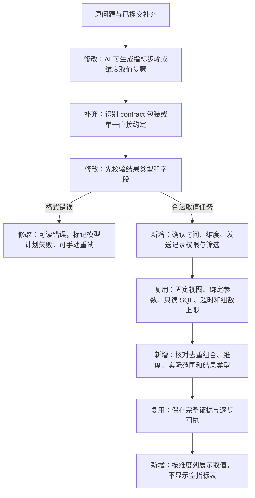

# 维度取值查询与模型计划错误处理

2026-10-20。用户在询问“分发记录一共有哪些 app”，并补充 2026-08-01 至 2026-09-15 后再次遇到失败。模型给出的约定含空指标和 0 小时观察窗口，旧代码直接显示了内部校验错误。

## 行为与范围

这类请求仍属于“明确条件取数”，不是第三种任务类型。新增通用的维度取值步骤，查询指定发送期间和筛选范围内实际出现的应用、模板、厂商、通道、日期等已发布维度；最多两个维度、1000 组，返回去重组合。

取值不计算回执指标，因此 `observation_hours` 为 `null`。0 小时仍无效；指标取数与开放分析仍要求原有合法观察时长，不能因新增此能力而使用空指标或缺省观察窗口。

首版维度取值结果不转入依赖指标计划的树形追问会话；更换查询需求可新建任务，避免展示不能使用的会话按钮。

## 流程变化



## 新增实体与约定例子

`ValuesPlan` 是程序执行一次维度取值所需的条件：维度、发送范围、筛选。它不包含 SQL、指标或回执窗口。`query_values` 是完整步骤计划中的一种操作，程序据此编译查询。

```json
{
  "task_type": "query",
  "question": "分发记录一共有哪些 app？",
  "scope": {
    "periods": {"current": {"start": "2026-08-01T00:00:00+08:00", "end_exclusive": "2026-09-15T00:00:00+08:00"}},
    "filters": [],
    "observation_hours": null
  },
  "result_requirements": {"kind": "dimension_values", "metrics": [], "dimensions": ["app_id"], "period_names": ["current"]},
  "execution_plan": {
    "steps": [{"id": "A", "op": "query_values", "period": "current", "dimensions": ["app_id"]}],
    "outputs": [{"step": "A", "metrics": [], "dimensions": ["app_id"]}]
  }
}
```

`result_requirements.kind` 区分指标结果和维度取值结果，默认仍为指标。只有明确的取值结果允许空指标；程序必须确认输出步骤也是取值步骤，不能用它替代用户要求的指标。返回的 `result_kind=dimension_values` 用于展示对应维度列。

## 执行控制

- 发送记录的维度值也属于数据，要求具备 `sent` 权限；证据中的 `metrics_used` 保留这个依赖，撤权后不能读取历史结果。
- 时间必须带时区、开始早于结束，并位于发布范围内；不默认查询全期，也不补造回执观察时长。
- 维度只来自既有目录；筛选继承任务约定，不接收任意表、列、函数或 SQL。筛选值一律绑定参数。
- 整日查询使用已校验的精确日汇总；非整日查询使用明细视图。两者均受相同的 10 秒数据库截止、15 秒客户端截止、1000 组及 512 KiB 上限约束，取值步骤计入 SQL 预算。
- 结果必须成功且完整，维度与最终要求一致，实际计划和期间一致，组合不可重复；超过上限拒绝作为完整结果保存。
- 模型返回约定或完整计划的格式错误，保存 `model_plan_fields`，只向用户显示稳定中文信息，不暴露内部校验堆栈和第三方文档链接。旧任务若已调用模型、尚未接纳计划且 SQL 为零，也可以手动重新解析，已补充日期不丢失。
- 模型可能直接返回约定对象，省略 `contract` 包装。程序仅在存在 `task_type`、`question`、`scope` 且所有顶层字段均属于约定时接纳，随后仍执行同一套字段、权限和步骤检查；混有追问、SQL 或其他顶层内容时拒绝。原问题使用服务端保存值，不能被模型改写。

## 验证

以真实 PostgreSQL 和模拟模型核对原始发送表的去重结果、两轮补充、整日/非整日路径、应用筛选、截止边界、撤权、参数注入、第 1001 组拒绝、无效模型计划的错误提示与重试。原指标、开放分析和完整计划专项同时回归；真实模型验证按用户已明确授权进行。

本地首轮专项 96 项通过，184.02 秒；补充旧失败展示和与截图同长度的上下文后，取值、模型协议及重试专项 43 项通过，75.98 秒。两次范围有重叠，不能相加当作不同用例数。前端 TypeScript/Vite 构建通过。

首次授权的发布后重试返回合法 JSON，但缺少 `contract` 包装，任务在 SQL 前以 `model_envelope` 失败。用户补充授权最多两次调用后，第一次诊断消耗 1978 Token，重现了该结构：直接约定含完整时间、`kind=dimension_values`、`app_id` 和 `query_values`。仅为定位记录这一次模型响应，保存在应用服务器的受限文件中，不启用网关全局正文采样。

最终提交 `eba12ad` 的本地专项 25 项通过，服务器专项 30 项通过；除取值和重试外，服务器还核对了原指标 API/Worker 与独立原始数据结果。第二次补充授权调用通过真实页面重试成功，任务 `89686548` 返回 `app_1`、`app_2`、`app_3`，时间范围保留为 `[2026-08-01,2026-09-15)`，与原始发送表一致。模型 1 次、SQL 1 次，实际查询约 61 毫秒；该耗时仅代表本次取值请求，不能作为任意 1000 万条扫描的性能保证。验收记录见 [完整证据](evidence/model-recovery-20261020.json)和[页面截图](evidence/model-values-success-20261020.jpg)。
