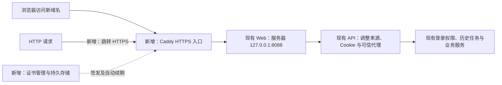

# 域名 HTTPS 接入规格与技术方案

2026-10-21：用户已确认需求与技术方案，并授权继续实施。

## 需求及验收标准

- 唯一正式浏览器入口为 `https://nl2sql-agent.linhengyi.xyz`，A 记录为 `8.155.128.79`；HTTP 自动跳转 HTTPS，使用浏览器信任的证书并自动续期。
- 登录页与各工作台底部展示用户提供的 `粤ICP备2026161349号`，链接到 `https://beian.miit.gov.cn/`。
- 保留现有登录、租户权限、历史任务与实时进度。域名切换后重新登录；`localhost:8088` 仅供回环健康检查，不再作为浏览器登录入口。
- 不开放数据库、API、Worker 端口，不修改任务证据、模型配置与调用预算。用已有任务验收，不产生模型调用。

## 流程及变化

`127.0.0.1` 指远程服务器自身；公网加密连接在 Caddy 终止，后续 HTTP 只在同一服务器内部传递。

| 新增组件 | 定义及例子 | 用途 |
| --- | --- | --- |
| Caddy 入口 | 宿主 systemd 服务，配置为 `deploy/Caddyfile` | 接收该域名的请求、处理 HTTPS、转发及即时事件流 |
| 证书存储 | Caddy 服务账号专属数据目录，保存该域名证书、私钥和签发账号 | 持久保存证书并自动续期，禁止提交 Git 或导出本机 |
| 备案页脚 | `SiteFooter` 组件，文字为用户给定的备案号 | 在登录和工作台页面共用同一备案查询链接 |

不新增业务数据实体或数据库迁移。

## 发布和回退

1. 创建独立 Git 分支，保存已确认规格；保留用户原有未提交改动。
2. 类型检查并构建前端，只生成本次需要的 Web 镜像；通过 `WEB_TAG` 独立指定前端版本（未设置时仍使用 `APP_TAG`），API 和 Worker 沿用现有已验证镜像。
3. 在服务器受限部署目录保存当前环境、Web 镜像引用及入口配置。检查活动任务，待无活动任务后短暂停止入口和 API。
4. 安装官方 Caddy 软件包；加载配置前先校验。确认 TCP 80/443 可从公网到达，原 8088 保持回环绑定。
5. 设置 `PUBLIC_ORIGIN=https://nl2sql-agent.linhengyi.xyz`、`COOKIE_SECURE=true`。按发布后的实际 Web 地址与宿主网关设置精确 `/32` 可信代理；Caddy 覆盖公网传入的代理链。重建 Web 后必须重新核对地址并刷新 API 的可信代理配置。
6. 启动并验证 Caddy、API、Web；确认 Worker、数据库、历史任务及配置保持预期。
7. 失败时停止公网入口，恢复之前的环境和 Web 镜像，重建 API/Web 并验证回环健康。不删除数据或证书目录，不回退数据库。

## 验证范围

前端类型检查和构建；Caddy 配置检查；公网证书链及主机名验证；HTTP 跳转；备案页脚桌面/窄屏显示及链接；安全 Cookie；登录、退出、未登录与跨来源拒绝；可信代理身份与伪造头防护；读取已有历史任务及实时事件流。证书续期检查管理状态、持久目录和开机启动，真实到期续期仍需运行观察。

官方依据：[Caddy 安装](https://caddyserver.com/docs/install)、[自动 HTTPS](https://caddyserver.com/docs/automatic-https)、[代理与事件流](https://caddyserver.com/docs/caddyfile/directives/reverse_proxy)。
