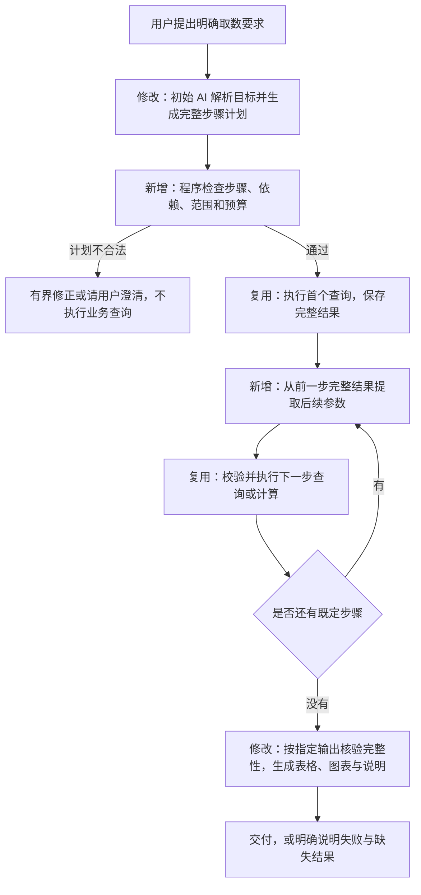

# 明确条件取数：解析之后能否由代码闭环

日期：2026-10-19。状态：调研结论，尚未实施通用多步骤计划执行器。

## 1. 结论

可以。在数据和工具已支持、用户要求明确、初始解析结果完整的条件下，查询、前后步骤的参数传递、计算、完成检查、结果展示和失败处理都可以由代码执行。没有必要因为 B 依赖 A 的结果，就再请求一次模型。

关键条件是：初始解析必须把用户要求转成完整的可执行说明。只提取“时间和指标”，却没有说明如何选组、如何引用前一步结果、最后交付什么，不能保证后续代码自动补出业务意图。

不必枚举所有业务问题。可以定义少量可组合的基础操作，由程序执行组合后的步骤。对于步骤较复杂的明确取数，建议让模型在初始解析阶段一次生成完整计划，而不是每一步执行前再次决定计划。

## 2. 现有项目已具备什么证据

| 证据位置 | 实际行为 | 能说明什么 |
| --- | --- | --- |
| `agent/platform_app/graph.py:65` | 固定策略且规格已存在时，选择 `fixed_decide`，不再选择模型动作 | 当前项目已存在解析后不依赖逐轮模型决策的路径 |
| `agent/runtime/analysis_api.py:299` | 模型只解析完整规格或追问，首个动作由 `next_action` 生成 | 初始语言理解和后续动作调度可以分离 |
| `agent/runtime/push_analysis.py:180` | 代码依次补齐查询、比较、下降选择、报告 | 推送三类旧任务可以由代码控制全过程 |
| `agent/runtime/analysis_fixed.py:5` | 根据已保存证据确定下一步，包括合计、整体客单价和占比 | 多步计算依赖不需要逐步请求模型 |
| `agent/runtime/analysis.py:275` | 使用结果引用取数，校验范围、单位、分母和重叠，再计算 | 代码能处理前一步结果作为后一步输入，并检查计算合法性 |
| `agent/platform_app/ledger.py` | 记录额度和调用回执，复用成功结果、处理未知与失败 | 调度与恢复控制也不要求模型作决定 |

以上路径当前仍围绕少量固定目标编写，不能据此宣称所有明确问题都已具备通用执行能力。

## 3. 现场验证

使用本机独立 PostgreSQL 测试实例，每个集成测试创建并清理自己的临时数据库，不访问线上数据库，不请求真实模型。

| 验证 | 结果 | 验证范围 |
| --- | --- | --- |
| `test_push.py::test_persisted_graph_fixed_protocol_and_permission_revalidation` | 3 passed | 推送汇总、设备汇总、两期比较均完成；已给结构化规格时模型调用数为 0，撤权后无法读取 |
| `test_python_platform.py::test_fixed_strategy_parses_spec_without_agent_tool_choice` | 1 passed | 模拟一次初始模型解析，后续 7 个工具动作完成；测试禁止调用逐步模型决策函数 |
| `test_analysis.py` 中独立计算、引用和完整性相关用例 | 14 passed，12 deselected | 加权计算、完整候选、空样本、非法运算、引用校验及多步计算链；未执行其余 HTTP 协议用例 |

集成测试共 4 passed，计算等选定用例 14 passed。初始解析使用模拟返回，只证明程序流程能闭环，不证明真实模型能稳定理解所有自然语言。

测试使用当前工作区。上一轮已产生但未提交的模板字段及结果大小限制修改仍保留；本轮没有修改固定调度或计算实现，也没有继续开放分析改造。

## 4. A → B → C 的依赖是否必须由模型处理

需要区分“结果值依赖”和“调查决策依赖”。

| 情况 | 例子 | 是否需要后续模型决策 |
| --- | --- | --- |
| 参数由前一步取出 | 查出三个通道 ID，再用这三个 ID 查询厂商分布 | 不需要，代码读取结果列并绑定为查询参数 |
| 计算使用前一步结果 | 对选中通道求和，再用总分子/总分母计算比率 | 不需要，代码按定义计算 |
| 已明确的判断规则 | 无样本就停止；分母为零不计算 | 不需要，程序按规则处理 |
| 需要重新判断调查方向 | 看到通道差异后，决定查厂商、文案还是发送时段 | 属于开放调查，可以由模型选择 |
| 缺失业务含义 | 未说明“异常”标准，也没有已发布标准 | 先澄清；逐步调用模型不能代替定义标准 |

依赖前一步的数值，不等于依赖模型判断。前面直接建议复杂步骤逐轮用 AI，区分得不够细；明确步骤与引用可以提前表达时，优先采用代码执行。

## 5. 为什么不需要穷尽业务题型

旧实现是“固定目标 → 专门的下一步规则”。新增一个目标容易再增加一条业务分支，因此会显得必须枚举所有业务问题。

建议改为“有限基础操作 → 可以组合的执行步骤”。基础操作包括：查询指标、按值筛选、排序、取前 N、从已有结果取出筛选值、汇总、比较、比率计算及展示。

这些操作仍需明确支持和校验，不支持的计算不能靠模型发明；但“先排序后取组再查趋势”等组合不必分别建立业务题型。

新增的逻辑实体是“多步骤取数计划”：一份有限、无循环的结构化步骤说明，每一步有编号、操作、参数及依赖。用途是让程序知道先执行什么，以及后续参数从哪里来。它不保存模型隐藏推理。

例如用户明确要求：“查出最近 7 天到达率最低的 3 个通道，再查看这几个通道按厂商、按日的发送与到达率。”

计划示意如下，字段名仅用于说明，当前还没有这套通用格式：

```json
{
  "steps": [
    {"id": "A", "op": "query", "dimensions": ["channel"], "metrics": ["sent", "delivery_rate"]},
    {"id": "B", "op": "sort_limit", "input": "A", "metric": "delivery_rate", "direction": "asc", "limit": 3},
    {"id": "C", "op": "query", "dimensions": ["manufacturer", "day"], "metrics": ["sent", "delivery_rate"],
      "filters_from": [{"field": "channel", "step": "B", "column": "channel"}]}
  ],
  "outputs": ["C"]
}
```

实际计划还必须包含任务固定的应用、明确时间、观察窗口和完整口径，程序负责保留这些约束。这里只展示步骤依赖；不把缺少这些约束的片段直接执行。

B 由代码对 A 的完整结果排序并选组；C 执行前，代码读取 B 的通道列，校验值和范围，再绑定到 SQL 参数。无样本的排序和完整性按已发布规则处理，不让模型临时改口径。

## 6. 推荐流程及相对旧流程的变化



执行阶段不再调用模型决定下一步。计划中若出现循环引用、未定义步骤、非法字段、越权条件、无上限展开、错误单位或缺少输出，程序应拒绝。

后续参数展开后仍重新检查：上一步可能返回空集合、过多值或不可用样本。不能只在计划开始时检查一次，就无条件执行后续步骤。

## 7. 当前不足和实施边界

当前没有通用多步骤计划、结果列到后续筛选的通用引用、依赖顺序检查及组合输出校验。需要新增这些能力；不能只把现有固定目标配置成任意目标就宣称支持。

“全流程代码闭环”以受控查询、可计算操作和确定的展示要求为边界：

- 对明确取数，表格、趋势图、数值差值及固定口径说明可由代码生成。若另需自由撰写长篇业务解释，那是额外的文字生成需求，不是查询执行必须再次调用模型。
- 对“分析原因”等开放目标，调查方向通常没有预先确定，继续使用开放任务流程；不强行将其包装为已固定的完整计划。
- 对不存在的数据和新计算能力，程序返回能力缺口；不能让每一步的模型替程序补造能力。
- 通用计划执行仍受权限、数据版本、结果大小、次数、时间和费用限制，不开放任意 SQL 或任意代码。

建议实现方向：明确取数采用“初始 AI 生成有限完整计划，代码执行并校验”；开放分析采用“模型依据中间结果逐步选择动作，代码检查并执行”。本轮为调研，不恢复编码。
