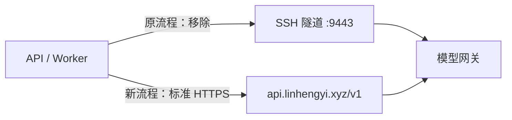

# 模型网关域名切换规格与技术方案

2026-10-21：用户分别确认需求及技术方案，并授权实施。仅调整远程应用部署。

## 需求与验收

- API、Worker 均改用 `https://api.linhengyi.xyz/v1`；模型生成路径为 `/v1/chat/completions`。
- 沿用现有应用 Key、逻辑模型、调用预算和超时设置。新域名需要有效的公有 HTTPS 证书，不允许关闭证书校验。
- 验证 DNS、TLS、只读接口鉴权、运行配置、应用健康及历史读取。真实模型生成请求为零，因此不宣称生成效果已验收。
- 不新增业务实体，不更改数据库结构、任务、证据或已有调用用量。

## 流程变化

新域名已核对解析到 `47.113.231.252`。应用已有 HTTPS 域名直连能力，无需修改业务代码或模型请求格式。

## 实施方案

1. 创建隔离分支；保留用户已有未提交改动。远程 Compose 删除旧 `gateway` 服务、API/Worker 对其的启动依赖、连接覆盖和私有 CA 挂载。
2. 运行现有网关传输与配置回归，以及候选 Compose 检查；使用现有镜像提前验证新域名只读鉴权与真实 TLS 校验，不发送生成请求。
3. 在服务器受限目录保存旧环境、发布入口和容器基线。确认无活动任务，暂停入口及 API，复核任务状态，再停 Worker。
4. 修改远程 `LLM_BASE_URL`，清除仅用于旧远程隧道的环境项。API/Worker 沿用原镜像重建；Web 沿用原镜像和配置，仅按地址变化刷新 Nginx 与 API 可信代理。
5. 核对 API/Worker 的实际环境、标准 CA、目标域名、只读鉴权与应用健康，确认原 Key/模型/预算及业务表摘要不变。验证通过后停止并移除本项目专用的旧隧道容器，保留恢复所需的受限密钥材料及旧发布目录。
6. 任一发布校验失败，使用原目录的 Compose 和保存的环境恢复旧隧道及 API/Worker，刷新 Web 代理并验证原健康入口；不删除数据库或证据。

Windows 本地的 SSH 网关覆盖配置与通用隧道传输支持仍有独立使用场景，不属于本次退役范围。私有凭据、证书私钥和完整业务数据不导出本机或写入 Git。
