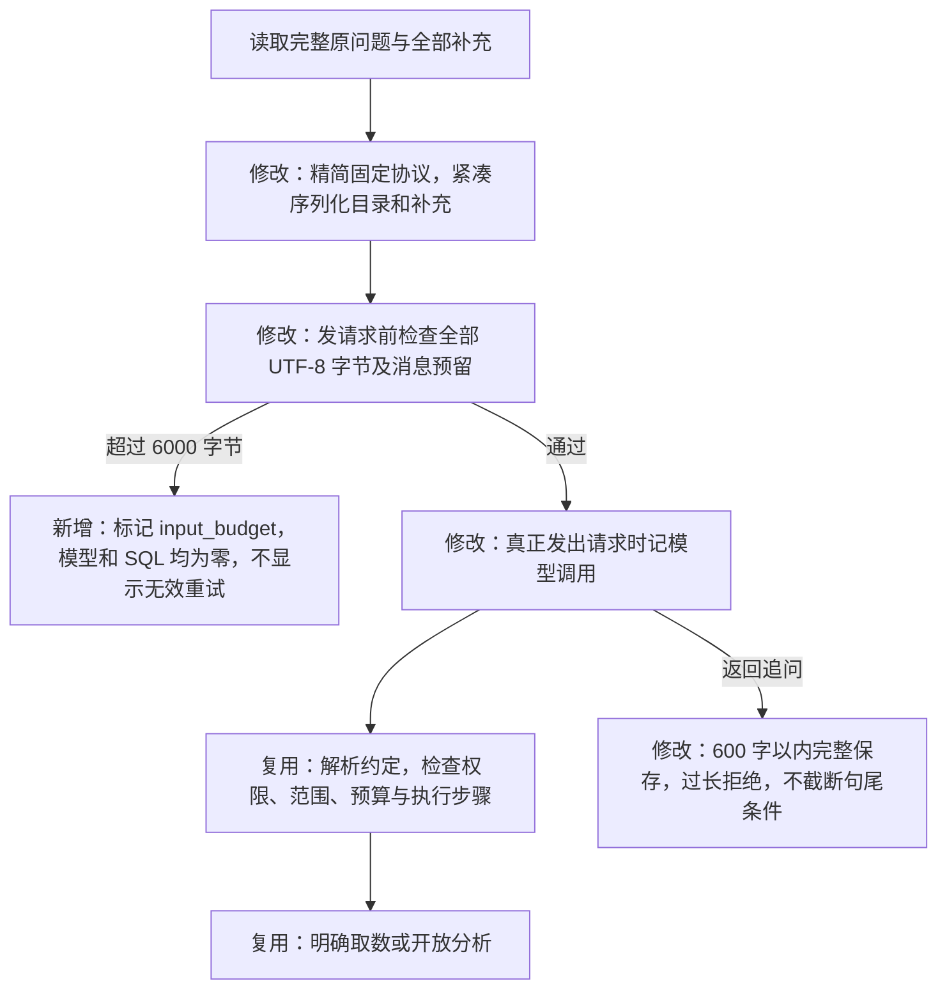
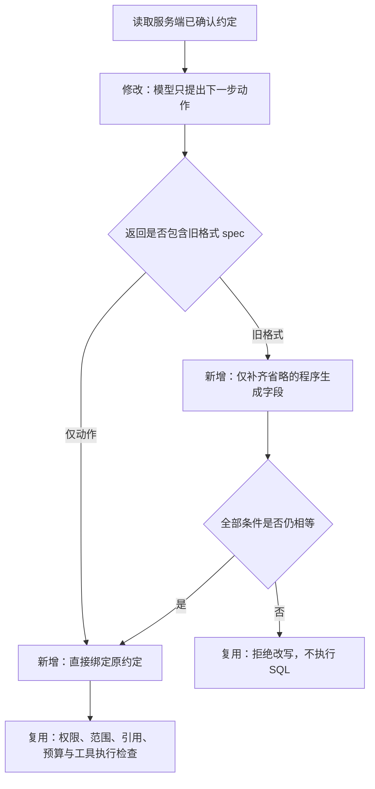

# 初始问题与两轮补充的输入预算修复

2026-10-20。任务 `9e188480` 在确认两轮条件后，固定协议、目录、原问题及补充合计 6140 字节，超过 6000 字节限制。模型尚未收到请求，但旧代码已先记录模型调用一次，导致错误展示重试入口。这不是模型上下文溢出，也不是用户条件丢失。

## 修改后的流程

`initial_messages` 只构造初始模型的两条消息。`INPUT_BUDGET=6000` 和 `MESSAGE_OVERHEAD=256` 分别是既有输入字节上限及消息结构预留，用于保守约束费用与请求大小；它们不是模型上下文容量或精确 Token 数。冻结预算、真实用量结算及开放分析每轮输入限制不变。

固定说明改为精简协议；授权指标保留标识与中文名称，单位仍由程序目录和结果产物决定。原问题、助手追问及用户回答原样保留，只移除 JSON 排版空白；不调用额外模型压缩，不丢弃早期条件。截图问题的总输入降到 4910 字节。允许接收的用户文本仍有长度上限；极长输入超限时明确停止，不保证所有字段的最大长度同时填满仍能请求模型。

初始追问最多完整保留 600 字，防止旧版 200 字截断日期或范围。超出时以模型字段错误拒绝；用户不会确认一段被程序截去条件的追问。已保存的旧任务不改写，旧版误计的模型失败仍可在升级后手动新建重试，完整继承两轮补充；新版本纯输入超限使用 `input_budget`，不会再被当作模型失败重复重试。

## 验证

本地真实 PostgreSQL 配合模拟模型 39 项通过（137.99 秒），覆盖截图文本完整传入、6000/6001 字节边界、零外部调用计量、完整追问与过长拒绝、维度取值、重试、开放任务分流与恢复。输入前后逐项对照已完成，无真实模型调用。

用户另外允许对截图问题做一次完整服务器验收，最多 10 次模型调用，沿用既有费用上限；发布与真实任务结果在验证后补充。

## 完整验收中发现的后续协议问题

输入修复版本 `455ee9a` 在服务器专项 44 项通过后发布。真实任务 `4556a3e9` 已保留应用、两个期间及 24 小时观察范围，成功转为开放分析；随后两次模型动作均被“不能修改已确认约定”拦截，SQL 为零，累计使用模型 3 次。协议存在明确冲突：服务端补充调查权限，却要求模型省略这些字段，原来的整对象相等检查会把缺省字段误判为改条件。

修正为：已确认约定保存在服务端，后续模型优先仅返回 `{"action":{"action":"query_metrics","arguments":{"period":"current","metrics":["delivery_rate","click_rate"]}}}`。程序绑定原约定，不要求模型反复抄写；兼容旧 `spec` 格式时，仅补齐省略的程序生成权限与目录版本。显式改权限、版本、日期、目标或回答事项仍拒绝。模型返回 `spec:null` 也不能清除已确认条件。

本题用户明确确认的是两个自然月，长度分别不同。开放分析可在两期不重叠、相同筛选与观察口径、且只请求已发布比率时比较各期比率，并说明日期结构与季节性仍未消除；计数、时延和明确取数固定计划的等长限制不变。程序不为了通过检查而改写用户日期。最终报告继承所有引用证据中的限制说明。

分析决策阶段已发送模型请求、经一次有限修正仍发生参数或条件错误时，也允许用户手动重试；工具阶段错误仍不能冒充模型失败重试。旧任务的消耗与失败证据保留。此次完整验收剩余最多 7 次模型调用，继续计入总共 10 次授权上限，不因新建重试记录重置本次验收额度。
