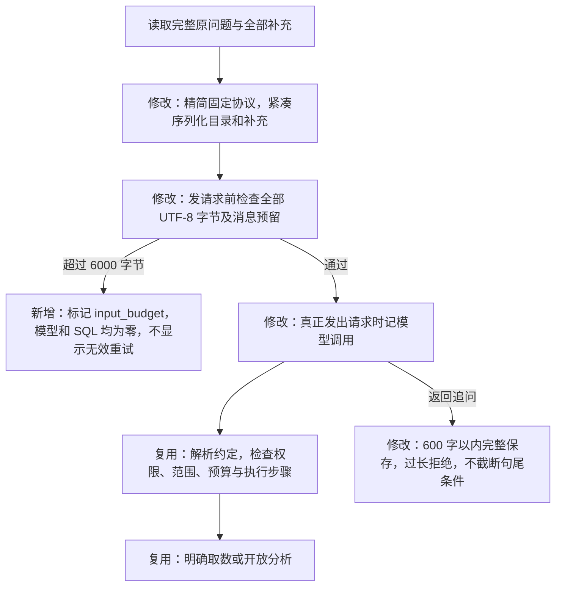
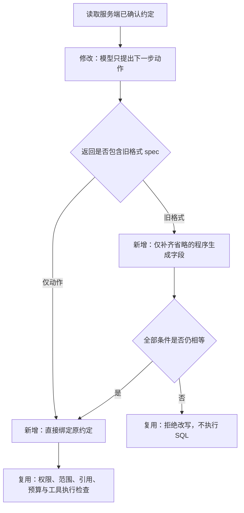
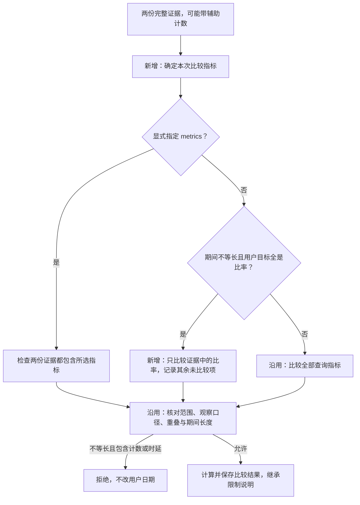

# 初始问题与两轮补充的输入预算修复

2026-10-20。任务 `9e188480` 在确认两轮条件后，固定协议、目录、原问题及补充合计 6140 字节，超过 6000 字节限制。模型尚未收到请求，但旧代码已先记录模型调用一次，导致错误展示重试入口。这不是模型上下文溢出，也不是用户条件丢失。

## 修改后的流程

`initial_messages` 只构造初始模型的两条消息。`INPUT_BUDGET=6000` 和 `MESSAGE_OVERHEAD=256` 分别是既有输入字节上限及消息结构预留，用于保守约束费用与请求大小；它们不是模型上下文容量或精确 Token 数。冻结预算、真实用量结算及开放分析每轮输入限制不变。

固定说明改为精简协议；授权指标保留标识与中文名称，单位仍由程序目录和结果产物决定。原问题、助手追问及用户回答原样保留，只移除 JSON 排版空白；不调用额外模型压缩，不丢弃早期条件。截图问题的总输入降到 4910 字节。允许接收的用户文本仍有长度上限；极长输入超限时明确停止，不保证所有字段的最大长度同时填满仍能请求模型。

初始追问最多完整保留 600 字，防止旧版 200 字截断日期或范围。超出时以模型字段错误拒绝；用户不会确认一段被程序截去条件的追问。已保存的旧任务不改写，旧版误计的模型失败仍可在升级后手动新建重试，完整继承两轮补充；新版本纯输入超限使用 `input_budget`，不会再被当作模型失败重复重试。

## 验证

本地真实 PostgreSQL 配合模拟模型 39 项通过（137.99 秒），覆盖截图文本完整传入、6000/6001 字节边界、零外部调用计量、完整追问与过长拒绝、维度取值、重试、开放任务分流与恢复。输入前后逐项对照已完成，无真实模型调用。

用户另外允许对截图问题做一次完整服务器验收，最多 10 次模型调用，沿用既有费用上限；发布与真实任务结果在验证后补充。

## 完整验收中发现的后续协议问题

输入修复版本 `455ee9a` 在服务器专项 44 项通过后发布。真实任务 `4556a3e9` 已保留应用、两个期间及 24 小时观察范围，成功转为开放分析；随后两次模型动作均被“不能修改已确认约定”拦截，SQL 为零，累计使用模型 3 次。协议存在明确冲突：服务端补充调查权限，却要求模型省略这些字段，原来的整对象相等检查会把缺省字段误判为改条件。

修正为：已确认约定保存在服务端，后续模型优先仅返回 `{"action":{"action":"query_metrics","arguments":{"period":"current","metrics":["delivery_rate","click_rate"]}}}`。程序绑定原约定，不要求模型反复抄写；兼容旧 `spec` 格式时，仅补齐省略的程序生成权限与目录版本。显式改权限、版本、日期、目标或回答事项仍拒绝。模型返回 `spec:null` 也不能清除已确认条件。

本题用户明确确认的是两个自然月，长度分别不同。开放分析可在两期不重叠、相同筛选与观察口径、且只请求已发布比率时比较各期比率，并说明日期结构与季节性仍未消除；计数、时延和明确取数固定计划的等长限制不变。程序不为了通过检查而改写用户日期。最终报告继承所有引用证据中的限制说明。

分析决策阶段已发送模型请求、经一次有限修正仍发生参数或条件错误时，也允许用户手动重试；工具阶段错误仍不能冒充模型失败重试。旧任务的消耗与失败证据保留。此次完整验收剩余最多 7 次模型调用，继续计入总共 10 次授权上限，不因新建重试记录重置本次验收额度。

后续版本 `3749e9e` 的服务器 71 项专项通过。真实重试 `81f67258` 取得两期完整数据，但模型在基期查询中重复提交了已继承的同一 `app_3` 条件；旧检查按列表逐项比较，把逻辑相同的筛选误判为不同范围。该任务模型 5 次、SQL 2 次，连同前次累计模型 8 次；未超过授权 10 次。保留失败和两份原始证据，不重写为成功。

修正筛选等价判断：条件为 AND 关系，完全相同的重复条件、条件顺序及 IN 值顺序不改变范围；查询执行前去除完全相同的重复条件，比较和完成覆盖检查也识别旧证据中的等价表示。不同应用、不同操作符或额外条件仍不等价，不合并部分相交的筛选集合，不扩大用户范围。使用已有证据的统计复算不需要模型或重新扫描大表。

## 最终发布与验证边界

`f56ec5b` 已部署到私有服务器。本地及服务器重复筛选专项分别 50 项通过；镜像内 104 份后端源文件与该提交逐字节一致，运行与验证依赖一致。发布前备份已保留，数据库容器、历史任务与应用配置不变。以上各轮测试集合有重叠，不能相加作为总测试数。

使用失败任务留下的两份完整证据，在禁网、无模型、无新增 SQL 的环境中重放新版比较逻辑，并以原始分子、分母独立复算：到达率从 49.0781% 变为 45.5102%，下降 3.5679 个百分点；点击率从 4.1814% 变为 3.8642%，下降 0.3172 个百分点。两个期间长度不同，只比较批次比率，仍保留日期结构、季节性及回执覆盖等限制。

这证明本题确有下降、新版能比较重复条件表示的原有证据；不证明完整原因调查已成功。真实流程仍停在旧版本的比较失败记录，原记录不改写。授权最多 10 次的验收已使用 8 次；后续完整重跑所需额度正在另行确认，尚未继续调用。

可审计记录见 [修复与部署证据](evidence/initial-context-recovery-20261020.json)。[AI Agent 面试稿](interview-agent-update.html) 分别列出功能实现、程序验证、真实个案和未完成项，避免沿用早期版本成绩。

## 辅助计数与实际比较指标分开

用户追加授权最多 8 次模型调用后的首个任务 `c05b96f0` 使用 4 次、执行两次 SQL。模型查询比率时一并取出发送量、到达量、点击量，然后将整份结果用于比较两个不等长自然月。程序正确拒绝计数比较，但工具缺少直接选定比较指标的方式，模型有限修正后重复同一动作而停止。追加授权尚余 4 次，失败记录保留。

比较参数新增可选 `metrics`，表示本次实际比较的指标，不是权限或用户目标变更。例如 `{"baseline_ref":"e1","current_ref":"e2","metrics":["delivery_rate","click_rate"]}` 可从带有辅助计数的完整证据中选择两项比率；每个所选指标必须同时存在于两份证据。比率拆解只检查其指定的 `metric`。输入证据的范围、全部查询指标和观察口径仍须一致，原始证据不改写。

如果用户目标含发送量，程序不会自动丢掉这个目标来通过检查；如果明确选择计数进行不等长比较，仍拒绝。比较产物新增 `excluded_comparison_metrics`，例如 `["sent","clicked"]`，用于说明输入中存在但未比较的辅助指标；报告继承该限制。它不是删掉查询结果或把计数变成日均值。

## 后续状态

最终部署已更新到 `e08764c`，追加授权剩余的 4 次调用已用于真实任务 `9c570df9`，与前次合计 8 次，未超授权。末次完成两期查询、比较及一次读取后按验收调用上限停止，不能算完整原因调查验收成功。其真实产物重建下一轮输入通过，并已修复读取预览被裁空、改变页大小绕过重复检查的问题，服务器 56 项专项通过。最新完整记录见 [读取循环与步骤说明](observation-progress-and-step-descriptions.md) 和 [部署证据](evidence/observation-progress-recovery-20261020.json)；本文前述额度和版本均是对应阶段记录。
