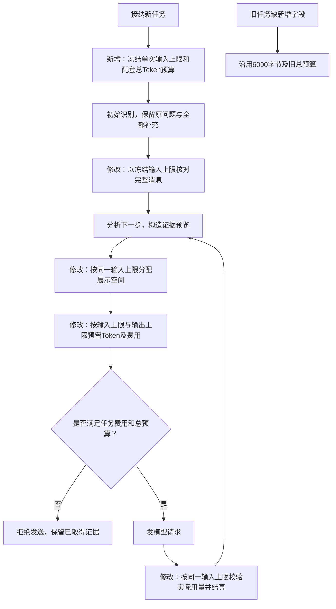
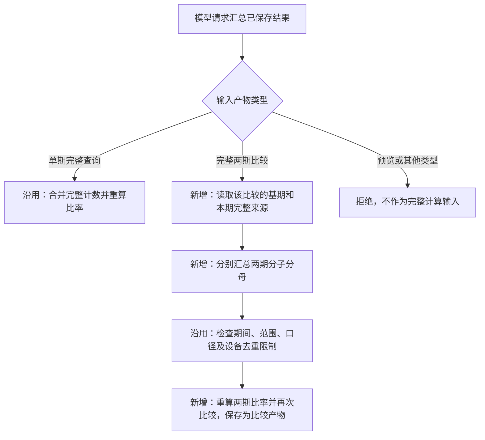

# 正常分析任务的模型输入预算

## 目标与验收范围

任务 `99d88467` 只消耗16694个已知 Token，仍因单次输入6000字节装不下证据索引和最近读取行而停止。此次调整用于明确取数、两轮补充、两期比较、按渠道/厂商/模板分组、读取排序结果及多轮下钻等常见场景；不保证模型一定选对调查方向，也不取消数据结果、权限、SQL次数与时长限制。

新任务默认每次输入32768字节（32 KiB，包含消息预留），任务总Token预算400000；模型输出上限、调用次数及费用上限保持原值。单次输入采用UTF-8字节上界约束，不把32KiB说成32K实际Token。最多10次调用、每次最多4096输出Token时，总预留上界为368640，小于400000。实际用量和价格仍按已冻结策略结算。

## 统一的配置与冻结

新增 `max_input_bytes`：任务接纳时冻结的单次输入字节上限。例如32768表示该任务每次完整系统说明、用户条件、证据展示和消息预留合计不能超过32768字节。环境配置名为 `ANALYSIS_MAX_INPUT_BYTES`，允许1024至65536。它不代表模型上下文容量，不改变网关月额度。

已保存的旧策略没有该字段时按原6000字节解释，避免升级后悄悄放大在途任务的费用预留。新任务由当前环境默认32768；手动重试仍创建新任务并冻结当前预算，原任务及消耗保留。内层查询请求使用 `initial_max_input_bytes` 携带同一冻结值，后续分析快照使用 `max_input_bytes`，两者不是由模型填写。

最近读取至少保留一行、所有证据编号可追溯、放不下时明确停止的规则继续生效。大结果不全部塞给模型，不通过删除用户条件、用模型压缩数据或关闭预算来凑成功。单次费用预留增加，但任务费用上限不提高；低费用上限仍可能在调用前合理停止。

## 验证方式

1. 离线重放失败任务的真实受限产物：旧预算拒绝，新预算可构造有效输入，最近读取的行、原行号与全部证据索引保留。
2. 冻结常见场景：简单取数、两轮长补充、两期整体/分组比较、多个方向的证据与多轮读取；核对32KiB边界、超限零发送、预留和实际结算一致、旧任务兼容。
3. 使用模拟模型验证完整程序链和恢复；随后发布到服务器，检查历史任务和配置仅按预期变化。
4. 用户另行授权最多10次真实调用，限截图同一问题、已确认条件和原模型网关，不提高费用上限或网关月额度；真实验收结果单独记录，不把程序测试代替模型效果。

## 真实验收暴露的工具衔接问题

任务 `f9cd8474` 使用完本轮授权的10次调用，完成4次SQL及两期整体、厂商与失败原因调查，实际输入已超过原6000字节且正常返回。但最后模型要求把“按厂商和失败原因比较”的结果合并为“按失败原因比较”，原汇总工具只接受单期查询，因类型不匹配停止。因此本轮完整原因调查仍未通过真实验收，原失败任务保留。

同一个 `aggregate_metrics` 工具补齐两期比较输入，不新增任务题型或自由SQL。程序从比较产物记录的两份完整来源取数，分别合并两期分子、分母，再重新计算比率及变化；不能将各厂商的比率或差值相加。例如两厂商各自点击率都未变化，但发送占比改变时，整体比率仍可能从82%变为50%，程序应计算为下降32个百分点，不能将组内差值相加得到零。

新增 `aggregation_source` 是汇总后比较产物中的来源字段，例如原比较结果的完整编号，用于追溯此次汇总从哪份比较发起；`sources` 继续指向完整两期查询，以便再次汇总时仍从完整计数计算。缺任一来源、引用预览、新增原结果不存在的维度、跨应用设备去重、权限撤回仍被拒绝。该修复先用保存的真实产物离线重放，期间不新增模型调用，也不将原任务改为成功。
