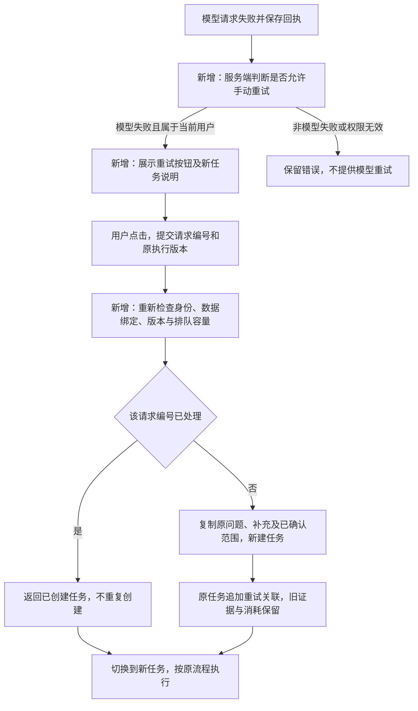

# 模型失败诊断与手动重试

2026-10-20，用户报告模型调用失败，并明确要求增加重试按钮。

## 需求与诊断

推送统一入口的明确取数和开放分析，在模型失败后提供“重试模型请求”。点击后新建任务，沿用原问题、已提交补充和已确认分析范围；不重新编辑问题，不清空旧任务的失败回执、证据或用量。数据、SQL、权限失败不展示此按钮。

截图任务在意图解析时收到 429，尚未执行 SQL。只读网关审计显示，共用应用的月 Token 上限为 1000000；诊断时已用 986017、未结算预留 8527，可用 5456。失败请求需要预留 9146，故被拒绝。较小的两次连通性探针成功，不能据此认为完整请求已恢复。额度不自动增加，不删除或释放未知预留；需由用户决定额度配置。

完整提示重放最初被自动审批拒绝，随后改用网关计量和拒绝记录完成诊断。用户后续明确同意提高额度并允许原问题、系统提示和数据目录上下文的一次真实验证；按该授权通过官方网关管理 API 将月额度改为 2000000，配置版本 32。费用预算仍为 40000000 微货币单位，其余策略字段不变；管理 API 自动推进缓存版本。不删除用量或未知预留。

## 实现流程

## 保存与检查

- `retry`：服务端返回的重试状态，例如 `{available:true,execution_version:1,error_code:"model_quota"}`。用于展示按钮，客户端不能用它绕过服务端检查。
- `POST /api/tasks/{id}/retry`：只接收随机请求编号和原执行版本，不接收替换问题、数据源、权限或额度。失败任务的创建者才能调用。
- 原任务追加一条 `manual_retry` 事件，保存请求编号和新任务编号。复用现有事件表，不新增存储表；同一编号重发返回同一新任务。
- 明确取数保留原始输入、全部已提交补充及补充轮数。开放分析从最后确认的约定重新调查，旧证据留在原任务；未确认的范围变更不带入新任务。
- 当前权限与数据绑定仍须有效，正在执行、已完成或 SQL 失败任务不能借此重新开始。按钮提交期间禁用，响应丢失后复用同一请求编号。
- 网关明确返回 `insufficient_quota` 时，提示检查额度；其他 429 保持频率受限分类，不把未知用量推定为零。

## 验收

真实 PostgreSQL 加模拟模型专项 10 项通过：失败后手动重试成功、保留补充、重复请求不重复创建、身份/权限/版本/队列检查、分析范围保留、原费用与证据不变。重试功能提交 `7f9c544` 的完整后端回归为 492 项通过、3 项跳过，314.56 秒；跳过原有两项缺少 PG 备份工具的测试和一项缺少完整 Olist 数据的核对。后续维度取值及返回格式兼容改动使用下述专项验证，不能把这次全量结果作为后续提交的全量回归成绩。

前端构建通过。隔离浏览器验证了按钮出现、提交期间禁用、切换新任务；服务端仅收到一条重试请求，原任务仍失败。

最终代码版本 `eba12ad` 已部署。该版本本地取值与重试专项 25 项通过（93.05 秒），服务器取值、重试、原指标 API/Worker 和独立原始数据核对专项 30 项通过（171.09 秒）。候选镜像 101 个后端文件逐字节匹配提交；切换保留配置、原任务行及数据库容器，并保存回滚配置和平台备份。

用户补充授权最多两次真实调用，实际使用两次：一次定位直接约定返回，一次从失败任务 `d474648c` 点击重试验收。新任务 `89686548` 完成，保留原问题及 `2026-08-01 至 2026-09-15` 补充；查询结束不含，返回 `app_1`、`app_2`、`app_3`，与原始发送表独立核对一致。新任务模型 1 次、SQL 1 次，未自动重发；原失败任务与消耗保留，证据可独立读取。费用预算保持原值，正文采样仍关闭。

证据见 [验收记录](evidence/model-recovery-20261020.json)、[重试按钮截图](evidence/model-retry-button-20261020.jpg)及[成功出数截图](evidence/model-values-success-20261020.jpg)。本轮本地临时测试样本目录已清理，未重新生成大规模本地业务数据。
