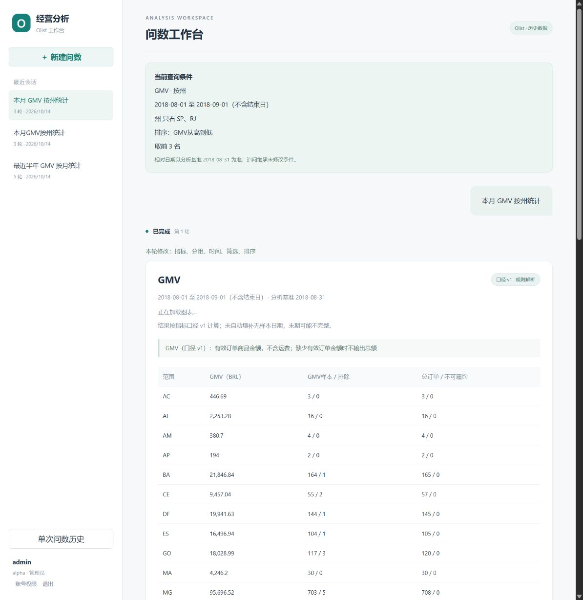

# 受控多轮 ECS 发布验收

2026-10-14，用户授权推送、创建 PR 和部署到现有私有 ECS。已部署应用提交 `d0de02ff44bb0afbf78384cefc949e6cf781c4a2`，入口仍为 SSH → `http://localhost:8088`。PR [#2](https://github.com/zjqylhy/nl2sql_agent/pull/2)以未合并的部署 PR #1 分支为基线；未合并 master。

## 发布与权限

从 Git 提交导出不可变源码构建三个 linux/amd64 镜像，源码不包含本地未提交的仓库规则修改。实际镜像在独立双库上通过 45/45 验收及 SSE 续传，上传后核对归档 SHA256、镜像层、image ID 和提交标签。没有在小内存 ECS 上构建镜像。

发布前创建双库及账号授权备份 `20261013T201554Z-75c28b29`，经用户明确授权下载到本机受限目录并核对摘要。停止应用入口及 API，单独执行 003 迁移，补充 conversations 的四项 DML 授权，再启动匹配的 Agent/API/Web。运行账号仍没有 schema CREATE 或 schema_migrations SELECT 权限。数据与模型隧道配置保持原私有部署参数。

源码入口 `/srv/olist/app`指向候选不可变目录；此前源码和环境文件在候选目录中保留。旧数据库和隧道镜像继续运行，六个常驻容器均健康，无 OOM、重启计数均为 0，备份 timer 为 active。

## 线上验证

| 验证 | 结果 |
| --- | --- |
| HTTP 五轮：半年按月 → 按州 → 缺州/排序 → 补州 → 补排序 | 5/5，计划和原始 Olist CSV 结果正确 |
| HTTP 陌生追问：本月按州 → 只看圣保罗州 → 整体 | 3/3，一次实际模型调用 |
| API/Agent 重启后继续补答 | 会话版本、有效计划、非空草稿、任务历史均保持 |
| 相同 request_id 重发、同 ID 不同输入、陈旧版本 | 返回同一任务、409、409 |
| SSE 与 Last-Event-ID 续传 | 事件有序，续传仅返回后续序号 |
| 同租户管理员读取另一用户的会话、任务、SSE、停止 | 四个入口均 404，不能越过所有权 |
| 仅 GMV 权限用户追问平均评分 | 拒绝，原计划未变，活跃关联释放 |
| 普通用户读取运维统计 | 403；测试账号已停用 |
| 实际 Agent → MySQL 的独立三链 CSV 核对 | 12/12，十轮查询、两轮澄清 |
| 浏览器补答及刷新恢复 | 日期、两个州、排序及前三名保留，历史三轮恢复 |

线上阶段共观察到三次模型请求、5,592 个已知 Token，无未知用量；其中一次 1,874 Token 属于未完成的 CSV 控制器运行。控制器最初在 Ubuntu 宿主缺少 Pydantic 依赖而未启动问数；改用容器内实际请求和宿主标准库计算器后，第一次评分遗漏了 schema 默认空字段。随后只补齐默认字段，黄金条件未改，最终 12/12。上述诊断未当作成功验收，业务镜像未为验收工具问题修改。

## 会话备份恢复

迁移后备份 `20261013T205159Z-0b22cf16`在独立随机、无网络、带验收标签的临时双库中恢复。核对用户与任务快照计数、99,441 条只读订单视图和只读账号无法访问底表。

另外从 PostgreSQL dump 提取 conversations 的 COPY 数据，与恢复库的导出逐行比较并核对摘要：四条会话完全一致，包含四份有效计划和一份非空澄清草稿。验收临时容器已移除，源库未回写。恢复的是备份时的状态，不把随后浏览器补答的状态混入同一快照。

## 回滚边界

003 为新增表与可空任务字段，结构兼容旧单轮代码，但旧 API 没有新会话的所有权校验。业务回退应保留本次 API，只将 Agent/Web 改回旧镜像，暂停多轮、保留单轮；这个组合也在隔离实际镜像中通过 45/45 和 SSE 验证。若新版 API 本身必须撤下，应进入维护状态，不直接恢复旧 API 对新会话任务的读取。

回滚不降级 schema、不删除会话表或数据；此前镜像、源码及配置均保留。原正式 RDS/HTTPS 三轮镜像发布门禁未在本阶段声称通过。本轮没有重复整机重启或长期压力测试，已有 2026-10-12 整机重启记录保持独立。

原始白名单证据：[发布与验收 JSON](evidence/multiturn-ecs-20261014.json)。连续异地备份、公网 HTTPS 和题单人工复核仍属于原有未完成边界。

