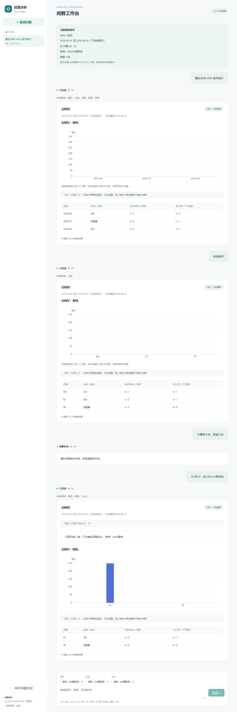

# 受控多轮问数实测证据

日期：2026-10-14。依据为已确认的 [需求与技术方案](controlled-multiturn-spec.md)。配对评测业务代码提交为 `f61f07823ba77bcdc8be97e46c68f94824ac0838`；隔离 Olist 最终复核为 `0497ae7`。本报告记录隔离评测；后续 ECS 发布已完成，见[线上验收](multiturn-ecs-validation.md)。

人工验收：用户于 2026-10-14 对 `91b5eb9` 交付的代码及测试结果确认通过；此确认不改变题单标注的 draft 状态。

会话保存最后一个成功 QueryPlan 与独立澄清草稿，每轮重新查库。支持继承及修改指标、时间、分组、筛选、排序和 Top N；缺条件先补答。取消、失败、越权及范围外问题不覆盖有效计划。刷新恢复历史，另一个窗口更新后要求用户确认当前条件。记忆范围仅限当前会话查询条件。

## 独立意图链与结果

冻结 [30 条链](../evals/multiturn/chains.json)，共 100 个问题和一次取消草稿操作，每链 3–5 轮。开发 15 链/51 问，验收 15 链/49 问，按整链隔离。包括十条陌生追问链、13 个澄清或权限边界问题；成功预期共 87 轮。黄金计划由显式业务条件编写，数值由原始 CSV 独立计算，不用运行时输出回填。

标注仍为 `draft`，复核人为空。题集在开发过程中编写，验收链未用于逐题调参，但不是外部人员提供的盲测；不能推断为真实用户总体准确率。

| 模式 | 正确问题 / 100 | 完整正确链 / 30 | 正确计划及 CSV 结果 / 87 |
| --- | ---: | ---: | ---: |
| 无上下文，仅规则 | 38 | 0 | 26 |
| 受控多轮，仅规则 | 80 | 20 | 67 |
| 无上下文，真实模型第 1 轮 | 39 | 1 | 27 |
| 受控多轮，真实模型第 1 轮 | 100 | 30 | 87 |
| 无上下文，真实模型第 2 轮 | 39 | 1 | 27 |
| 受控多轮，真实模型第 2 轮 | 100 | 30 | 87 |
| 无上下文，真实模型第 3 轮 | 39 | 1 | 27 |
| 受控多轮，真实模型第 3 轮 | 100 | 30 | 87 |

每轮成对使用相同提交、CSV、身份和表达。无上下文模式把每句话发到旧单轮接口，不拼接前文；受控模式使用会话接口，还要求持久计划和草稿符合标注。失败、未返回计划和遗漏条件留在分母；取消操作另计，不放入 100 问的分母。

两个对照回答不同问题：上下文与受控修改使完整链从 1/30 到 30/30；在同一多轮实现内，模型使正确问题从 80/100 到 100/100、完整链从 20/30 到 30/30。后者来自十个陌生追问及十个后续继承轮次，每轮只有十次模型调用，不能说模型“独立理解了全部一百问”。纯规则模式的“最近半年”新增别名仅在会话入口生效，因此纯规则两种接口的差值含该项差异。

三轮受控路径的 261 次成功查询全部有完整正确计划和 CSV 结果。13 个边界问题每轮均未执行 SQL，权限问题每轮均被拒绝；已返回计划未发现条件遗漏、反转或额外条件。纯规则的二十个失败问题没有可用于成功判定的完整计划，不能将“可观察计划无错误”当作整体通过。

| 真实模型轮次 | 无上下文调用 / 已知 Token | 受控调用 / 已知 Token | 总调用 |
| --- | ---: | ---: | ---: |
| 1 | 6 / 3,838 | 10 / 19,059 | 16 |
| 2 | 6 / 5,837 | 10 / 18,854 | 16 |
| 3 | 4 / 2,764 | 10 / 18,709 | 14 |

最终三轮共 46 次模型请求、69,061 个已知 Token，无未知用量。调用差异来自失败后重试；两种模式共用出站前预算。同一轮最多 104 次，加上修复前该逻辑轮次的 16 次诊断请求，仍不超过 120 次。模型输出最多 512 Token，实际权重版本不可获得，记录为 unknown。

原始报告：[纯规则](evidence/multiturn-rules-20261014.json)、[三轮真实模型](evidence/multiturn-live-20261014.json)。报告保存题集、代码、运行时、评分器、夹具、模型配置摘要及逐轮判定，未包含凭据、结果行或 SQL。[离线校验入口](../scripts/summarize_multiturn.py)可核对固定分母和用量。

## 保留的失败与修复

首次纯规则运行发现：陌生州名尚未理解时，后续“改成整体”会丢弃未理解条件。现在无关修改只能进入原草稿，必须补齐原筛选或明确重新开始。另补充 AND 筛选矛盾、金额空区间和不支持的逻辑 OR 检查。回归测试要求这些路径不执行部分查询。修复未修改题单黄金条件。

修复前跑过三轮模型诊断，共 48 次请求、71,213 个已知 Token，不能当作最终提交的验收报告。真实 Olist 首次只通过 10/12：模型请求未返回可用计划，接续一轮缺少预期州筛选；该次用量未知，不能据现有观测归因到具体网络或供应商故障。随后复测通过 12/12；提交诊断字段后再次通过 12/12。首跑失败保留在 [调用与复测记录](evidence/multiturn-call-ledger-20261014.json)。本阶段包含诊断及 Olist 共 97 次请求、143,964 个已知 Token、一次未知用量；未混入上一阶段的 90 题表达评测。

## Olist、事务和界面验收

独立 Olist 原始 CSV 复核三条链、12 轮，包含半年分组、澄清补答、增加和移除指标、陌生州名与继承。最终 12/12 通过，其中十轮成功查询、两轮澄清，一次模型调用、1,844 Token。运行临时只读 Python 服务，连接已有只读 MySQL 视图；此项证明 Python→MySQL 的计划与真实结果，不替代 Go 持久化或 ECS 发布验收。[Olist 报告](evidence/multiturn-olist-20261014.json)

已完成验证：

- Python 全套 275 项通过，含真实 MySQL；Windows 下七项 Linux 发布测试跳过，未计为通过。新增 Delta、草稿、权限及评测器测试。
- Go 全套真实 PostgreSQL 测试与 `go vet`，覆盖幂等、并发接纳、所有权外键、停止与迟到结果、重试和租约恢复、预算耗尽、权限撤销及旧接口旁路。
- 冻结旧单轮门禁 95/95，Olist 八项旧单轮 CSV 复核 8/8。
- React 类型检查和生产构建；浏览器验证四轮问数、刷新恢复、取消草稿、旧历史入口、手动覆盖清空、跨窗口版本冲突及确认后重发。

下一批应增加更多非模板表达和独立人工标注，扩大跨指标歧义、筛选修改及真实用户分布覆盖。本批不支持跨会话偏好、结果归因、对比计算、自由 SQL 或 Agent 自主规划。
