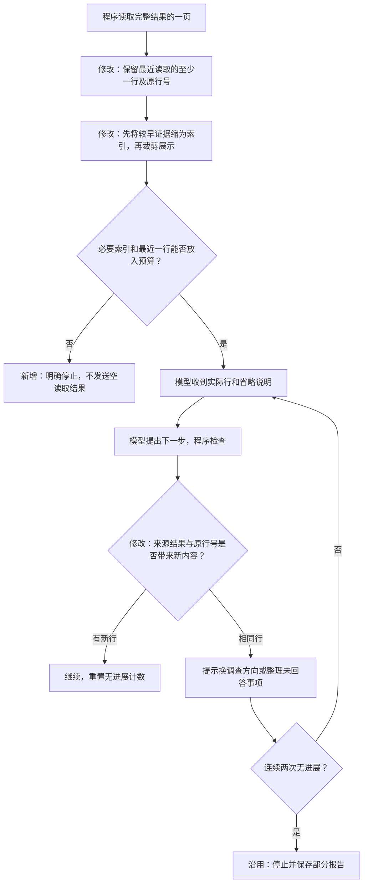

# 最近读取结果与执行过程说明

本轮目标：修复任务 `d5885167` 在查看同一行时消耗完模型次数的问题，并把页面步骤改成具体的自然语言说明。模型调用、费用、Token 和 SQL 上限保持原值；不增加用于写说明的模型请求。

## 已核实的原因

该任务取得两期整体指标并完成比较后，反复请求读取比较结果。最后一次已保存的模型输入有六份证据索引，但每份 `preview` 都为空，整体值也已省略，最近刚读取的行未传到模型。旧检查只看产物编号，改变读取页大小会生成不同编号，因而不能识别相同行。任务最后用了十次模型调用、两次 SQL，停止原因是预算耗尽。

## 修改流程

`observed_rows` 是图检查点内的已读取行标识集合，例 `结果编号:0`，用于识别换页大小、排序后仍只返回相同行的情况。范围变更被用户确认后清空，防止旧范围影响新调查。它不是模型的推理文本，也不表示业务原因已经找到。

完整数据继续保存在服务端。展示预览只去掉供计算使用的分子分母副本，保留模型选择下一步需要的指标值、分组和行号；计算工具仍读取未修改的完整证据。原结果与预览的省略信息分开，排序读取后不会标成原始顺序。

## 页面步骤

API 新增 `description`，表示对已保存动作的程序解释。例如：

- `query_metrics`：查询本期（2026-09-14 至 2026-10-14，结束不含）的到达率、点击率；应用：app_3。
- `compare_periods`：比较基期与本期的到达率、点击率变化。
- `inspect_result`：查看已保存结果的第 1 至 20 行（实际行数以结果为准）。
- `decompose_ratio`：拆解点击率的变化，核对组内变化与结构变化贡献。
- `finish`：核对证据引用与回答覆盖，整理报告及未验证假设。

模型决策步骤根据其已返回的动作显示“确定下一步：……”。尚未取得有效动作时显示“根据已确认条件、已有证据和剩余额度选择下一步”。状态、失败和缓存复用继续单独显示；不把“提出一个动作”写成“该查询已完成”，不提前宣布原因成立。历史任务也由已有结构化记录生成说明，不重跑模型或 SQL。

## 验收要求

紧张预览预算下最近读取仍有实际行；放不下时明确拒绝；所有既有证据编号可追溯。仅改变页大小且连续返回相同行的任务，应在调用上限之前因无进展停止，保留两期证据与部分报告。正常调查、范围变更、恢复与权限检查仍通过对应专项。页面构建通过，并在私有服务器的历史任务上核对自然语言步骤。
