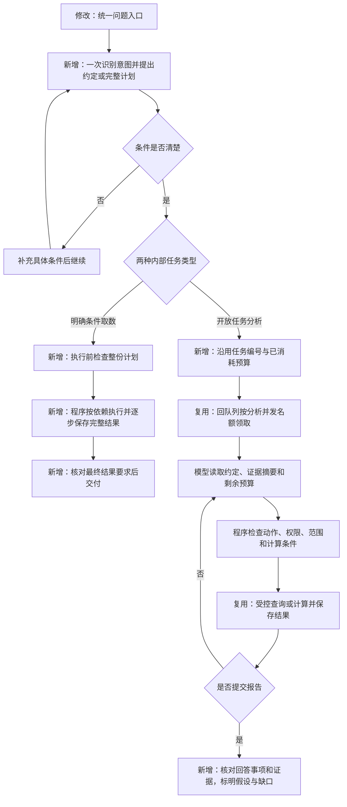

# 统一取数与开放分析：实施与验收记录

日期：2026-10-20。依据：[需求规格](open-exploration-spec.md)、[技术方案](open-exploration-technical-design.md)。

已完成代码实现、本地验证与页面验收演练，等待用户验收。未推送或部署；本记录中的模型响应均由测试程序模拟，不能据此证明真实模型的理解和分析质量。

## 1. 用户入口与执行流程

页面保留一个自然语言问题入口，统一提交到 `POST /api/tasks`。第一次 AI 响应同时识别任务类型并提出约定；明确取数还必须提供完整计划。无需用户手动选择类型，也不为明确取数多加一次分类调用。辅助表单直接生成相同格式的明确取数计划。

“最近七天某厂商的发送量、到达率如何变化”可以是明确趋势取数；“点击率为什么下降”进入开放调查。缺日期、应用范围或观察时长时先追问。分类不依赖“下降、上升、波动”等业务枚举。

## 2. 程序具体控制了什么

| 位置 | 已实现的检查与行为 | 能证明的范围 |
| --- | --- | --- |
| 初始约定 | 严格 JSON 字段、当前指标目录、指标依赖、数据覆盖、当前权限；服务端生成可探索能力 | 已记录的任务边界符合当前能力；不能独立证明 AI 完全理解了原话 |
| 明确取数执行前 | 检查完整依赖图、重复或不存在的步骤、循环、无用步骤、前序列含义、计算粒度、完整候选、最终指标/分组/期间/选组规则 | 能发现 B 没有 C 所需列、把模板 ID 当通道、漏交期间等结构问题；不查询业务数据 |
| 明确取数执行中 | 程序读取完整前序结果，重新核对任务和权限、绑定真实参数；检查实际结果字段与范围，重算比率；结果与回执一起保存 | A→B→C 使用真实数据。B 为空时 C 返回空，不会去掉筛选改查全部；失败不会填零 |
| 明确取数结束 | 重新检查权限与完整要求，核对实际输出、选组与完整性 | 只有全部要求通过才完成；执行阶段不再调用 AI 做决定或总结 |
| 开放分析动作 | 工具名称和参数受限；固定条件由程序继承，追加条件只能收窄；下钻父组必须真实存在；每次执行重查权限 | 模型不能直接发 SQL、改账号、伪造父证据或自行扩大应用/时间范围 |
| 开放分析计算 | 完整结果参与汇总、比较与贡献拆解；校验两期口径和时间可比；总分子除总分母，贡献和与整体差值对账 | 数值运算和统计解释可校验；不能证明厂商、文案等业务因果 |
| 开放分析报告 | 回答事项逐项列明；已回答事项必须引用有效证据；数值定位到原结果和计算项，由程序取值；解释中不接受自填业务数字 | 引用与数字可靠，未回答/未查/假设可见；引用存在不代表文字推理一定正确 |
| 停止与恢复 | 保存调用意图和回执、累计预算；复用已完成结果；未知调用保守停止；耗尽后仅用已有证据形成部分报告 | 不因恢复重复已保存调用，不在失败后冒充完整完成；默认无额外模型复核步骤 |

约定保存在 `task_contracts`，按版本追加，包含原问题、固定范围、两种任务各自的交付要求及检查记录。约定不是权限凭据。用户权限变化立即影响后续执行和读取，模型不能通过修改约定恢复权限。

扩大范围时，页面展示具体变更，由用户点击接受或拒绝，提交带当前版本和请求编号的确认。普通文字“同意”不能批准一个待确认范围。接受后创建新版本，后续不混入旧版本证据，累计预算继续计数。

## 3. 中间结果如何保存和提供给模型

明确取数每步完整结果独立存入 `task_evidence` 的一行；开放分析每次产物沿用 `analysis_artifacts` 单独保存。回执只保存步骤状态和结果引用，不把所有中间表重复塞进一行。约定版本及内容摘要用于核对引用，读取还需核对任务所有者和当前权限。

单份产物的序列化内容最多 512 KiB、查询最多 1000 组。超限会报缺口，不截断后声称完整。明确取数的结果链接使用 `/api/tasks/{id}/evidence/{ref}`；终态超过 30 天的中间证据按现有定期清理流程回收，结果明细链接随后不可再读。

开放分析给模型的是程序生成的摘要：默认前 3 行、总行数、实际条件、指标合计和省略规则。临近输入上限时减少展示细节并明确标记，保留所有证据编号和完整任务约束。模型需要细节时可按分组、排序、偏移读取原结果，每次最多 20 行，返回原始行号；比较与计算始终读取服务端完整内容。这里不额外请求 AI 压缩数据。

本阶段采用有硬上限的小型分析产物，不提供无限量明细导出或任意大表存储。

## 4. 数据、模块与升级

发送记录增加 `template_id`、`title`、`body`，样本生成器产生稳定的模拟文案，导入器要求字段存在，指标目录增加模板分组及筛选。已重新生成本地样本：3 个应用、600 台设备、21960 条发送记录。新增字段不等于已实现消息全文检索或文案因果分析。

| 文件 | 职责 |
| --- | --- |
| `runtime/task_contracts.py`、`platform_app/task_contracts.py` | 定义、检查和保存约定版本 |
| `runtime/push_query.py`、`platform_app/task_intent.py` | 一次初始解析、统一入口分流、承接既有用量 |
| `runtime/query_program.py`、`runtime/query_executor.py` | 检查完整计划、按依赖执行、核对最终交付 |
| `platform_app/query_execution.py` | 逐步回执、独立证据存储和恢复 |
| `runtime/exploration.py`、`runtime/push_calculations.py` | 开放调查动作、模型摘要、独立计算及报告检查 |
| `platform_app/graph.py`、`ledger.py`、`worker.py` | 复用现有调度、预算、任务状态和执行身份检查 |
| `web/src/PushWorkspace.tsx` | 统一入口、两类结果、范围确认和完整结果链接 |

删除原 `push_analysis.py`、`push_tools.py` 固定目标执行协议，保留有效的订单回归域。旧推送终态结果只做读取适配，数据版本或权限不符仍拒绝，不重新启用旧固定目标执行。

部署前需执行平台 `migrate` 和 `provision-roles`，应用 `0005_task_contracts`。模板字段需使用新 schema、新只读账号和新数据版本发布，更新源映射后启动 API/Worker；导入器拒绝覆盖旧快照。本次只生成本地模拟数据，未改线上映射或数据库。

## 5. 验证与已知边界

最终自动化结果见 [验证摘要](evidence/open-exploration-20261020.json)。后端通过真实本机隔离 PostgreSQL、API、执行进程与模拟模型完成验证；前端执行 TypeScript 检查和生产构建，并在浏览器走通统一入口两类任务。

最终完整回归：**469 通过、3 跳过，耗时 186.69 秒**。跳过的是两项需配置 `PG_TEST_BIN` 的备份恢复测试，以及一项需完整 `OLIST_TEST_CSV_DIR` 的 Olist 数据校验，不能视为已验证。前端 `npm run build` 通过，保留现有图表分块超过 500 kB 的体积提示。文档链接、JSON 示例和 Python 语法检查通过；流程图做了代码块静态检查，未声称经过图形渲染验收。

新增用例覆盖完整计划执行前拒绝、动态参数绑定、空选组、按真实完整数据排序与计算、恢复不重复 A、不同调查路径、初始费用接入分析账本、分流后仍受分析并发名额限制、范围确认去重、预算耗尽部分交付、证据引用及上下文摘要保留全部结果编号。历史订单、推送权限和任务恢复纳入完整回归。

浏览器演练证据：

- [明确取数：A 查询、B 选组、C 下钻及完整结果链接](evidence/open-exploration-query-plan.jpg)。
- [开放分析：证据数值、解释、待验证假设、未查方向与用量](evidence/open-exploration-unified-entry.jpg)。

当前边界：

- 明确取数最多 20 个步骤、6 次 SQL、4 个输出；每次查询最多 2 个联合维度、1000 组。排序选组限单维，每个查询最多一个动态选组来源；多个输出共用同一组结果要求，不支持任意复杂查询语言。
- 两期比较要求等长且不重叠；样本不足或零分母不当作零变化。查询链必须绑定已发布的不可变数据版本。
- 明确取数的初始完整计划不合格会拒绝，不增加一次模型修复；执行中不重新规划。未知步骤回执保守停止。持久化查询计划的 180 秒窗口包含恢复等待，超过窗口停止。
- 模型整份输入按不超过 6000 Token 的保守字节上界控制；最小约定与证据索引仍放不下时停止。复杂问题可能需要缩短或拆分。
- 开放分析默认关闭独立模型复核；程序不能保证意图识别、解释充分性或因果判断。真实模型效果评测及用户验收尚未完成。
- 首版限当前发布的推送/设备指标和维度；转化事件、业务人群、消息明细追踪等缺失能力不能由模型自行补造。
