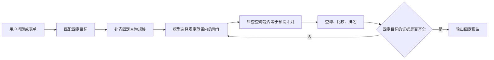
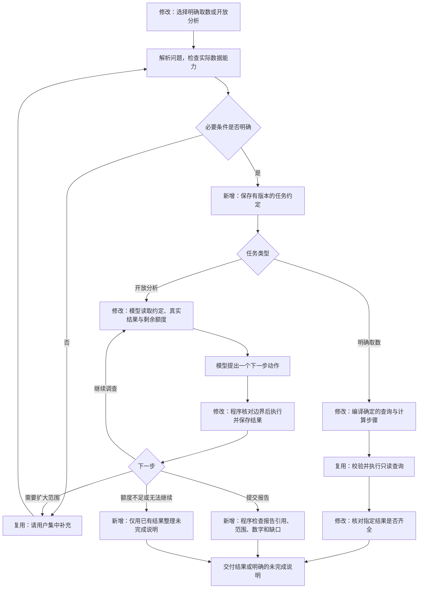
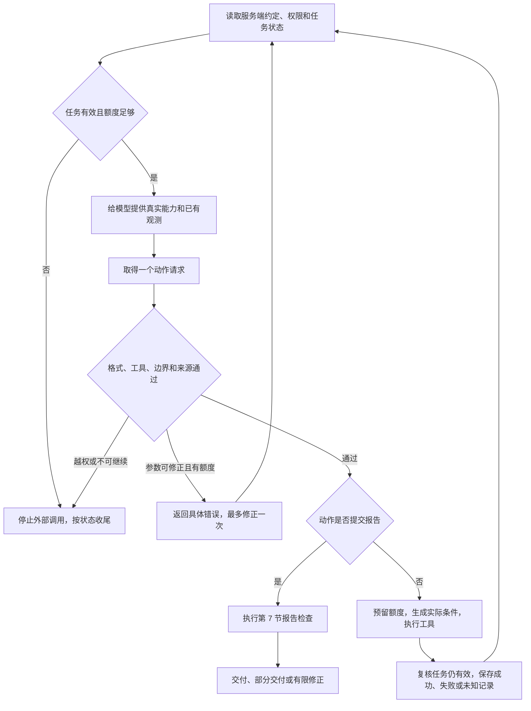
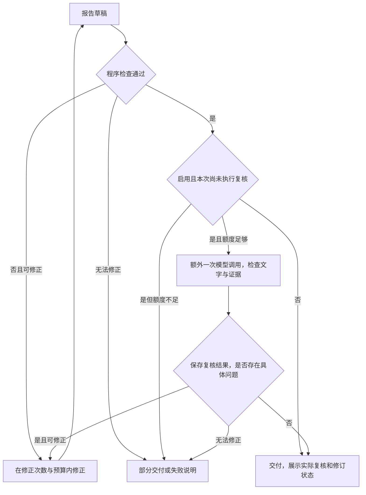

# 明确条件取数与开放任务分析：技术方案

版本：v1 草案；日期：2026-10-19。

状态：依据[需求规格](open-exploration-spec.md)及本轮讨论起草，待人工确认后编码。本文给出具体实现建议，不表示已经实现，也不把仍未确认的选项视为已授权。

## 1. 本次要实现什么

项目只保留“明确条件取数”和“开放任务分析”两种跑数类型。原推送汇总、Top N、两期比较归入明确条件取数，不再作为独立的固定分析入口。

开放分析按下面的分工运行：模型决定下一步准备查什么，程序决定能不能执行、实际怎样执行、哪些结果可以交付。本文把这组程序控制称为“执行控制层”，也就是 harness。

第一阶段使用现有推送/设备数据，支持范围内的趋势、比较和自主调查。用户消息排查、模板、人群、业务类型与转化等缺失的数据及工具，按后续领域扩展接入；第一阶段明确显示能力缺口，不宣称整张业务场景表均已支持。

基础工具及计算操作预先定义。业务问题、调查顺序、结论句式不做“下降、上升、波动”等业务枚举，不以是否属于某个题型决定任务能否运行。

## 2. 当前实现与需要改变的位置

已检查当前代码，主要限制如下：

| 位置 | 当前行为 | 本次变化 |
| --- | --- | --- |
| `agent/runtime/push_analysis.py` | 选择固定目标，比较需分组与 N | 新建任务使用两类任务约定，不再要求开放问题匹配固定目标 |
| `agent/runtime/push_tools.py` | 查询必须完全等于固定规格中的查询之一 | 开放分析改为核对用户边界、实际权限和工具规则 |
| `agent/platform_app/graph.py` | 已有逐轮模型/工具循环，报告产物即触发完成 | 保留循环，增加约定版本、调查进度和独立报告检查 |
| `agent/platform_app/ledger.py` | 已有调用记录、预算和结果复用 | 复用，并将约定版本与真实执行条件纳入复用检查 |
| `agent/runtime/analysis_api.py` | 推送模型主要看到结果编号与行数 | 提供实际指标、样本情况、覆盖范围和预算，允许根据结果换方向 |
| `web/src/PushWorkspace.tsx` | 表单、自然语言、固定工具分析入口并列 | 只保留两类任务，表单/自然语言归入明确取数内部 |

继续使用现有 Python 服务、任务执行进程、PostgreSQL 数据库和流程运行组件。后者负责保存流程执行到哪一步，便于中断后恢复；不另建一套调度系统，不引入多个助手互相调度。

## 3. 流程图：旧流程在哪里改变

图中“修改”表示替换现有行为，“新增”表示本次补充，“复用”表示沿用已有机制。

### 3.1 旧固定分析流程



旧流程即使由模型选择下一动作，允许查询的范围和完成方式仍由固定目标锁定。

### 3.2 新的两类任务流程



失败、取消等细节由下一张图处理。补充条件与扩大范围仍受现有补充次数限制；扩大范围后保存新约定版本，不覆盖原版本。

### 3.3 每一轮开放分析的程序控制



图中任何一处停止都不能被模型的一句“继续执行”绕过。工具失败的有限重试仍经过额度检查；取消、越权不重试。

## 4. 涉及的实体：分别是什么、有什么用

实体就是程序需要分别记录和处理的一类信息。这里只新增必要的记录结构，复用现有任务、调用账本和结果表，不为每种业务问题建立新实体。

| 实体 | 定义与用途 | 具体例子 | 保存位置与写入方 |
| --- | --- | --- | --- |
| 任务约定：新增 | 保存用户目标、不可自行放宽的边界和交付要求，是每次检查的依据 | 只查 app_1，两期已确定，点击/发送率，24 小时观察 | 新增 `task_contracts` 表，服务端保存；模型只能提交草案 |
| 能力说明：新增值结构 | 当前用户实际可用的指标、维度、工具和数据范围，防止模型臆造能力 | 可按通道、厂商和日分组，没有模板和转化数据 | 从已发布目录、数据配置及权限生成；约定记录其版本，调用时重新核对权限 |
| 调查进度：新增值结构 | 保存待查方向、已查方向和证据关联，允许调整计划且保留未完成项 | 待查厂商；已比较通道，引用 e4/e5/e6 | 复用 `analysis_runs.state` 的 `progress` 部分；程序校验模型建议后更新 |
| 动作请求：改造已有结构 | 模型本轮准备调用的一个工具及参数，提供检查和审计依据 | 查询当前期，按通道分组，指标为发送、点击和点击率 | 复用 `analysis_steps.input`；程序记录，不代表已经执行成功 |
| 结果证据：改造已有实体 | 由成功工具生成的数据及其真实条件，是计算与数值展示的依据 | e1：app_1 基期发送 7000、点击 560 | 分析复用 `analysis_artifacts`；明确取数保存到 `tasks.result`；均由程序生成 |
| 交付报告：新增通用内容结构 | 将数值引用、解释、假设、未回答事项分开，避免报告内容直接决定任务成功 | 数据引用 e3；解释通道集中；厂商故障仍是待验证假设 | 分析复用报告产物，最终投影到 `tasks.result`；程序检查后保存 |
| 复核记录：可选新增值结构 | 保存独立模型对报告的具体意见，不作为程序已证明原因的凭证 | 报告提到文案变差，但没有文案证据 | 仅启用复核时，复用调用记录及输出；不单独建表 |

“新增值结构”表示增加一组有定义的 JSON 字段，不必新增数据库表。JSON 是结构化的数据格式；PostgreSQL 的 `JSONB` 字段用于保存并读取其中的字段。

### 4.1 任务约定的具体保存格式

新增 `task_contracts`，由明确取数和开放分析共同使用：

| 字段 | 用途 |
| --- | --- |
| `task_id`、`tenant_id`、`user_id` | 关联任务及所有者，沿用任务身份约束 |
| `version` | 约定版本，同一任务版本只能增加 |
| `status` | 草案或已确认；未确认必要条件前不执行业务查询 |
| `body JSONB` | 完整结构化约定 |
| `confirmation_request_id` | 去重用户确认或补充，重复请求不新增版本 |
| `created_at` | 保存时间 |

在 `tasks` 增加当前约定版本号。约定表以任务编号与版本号共同唯一，并使用任务编号、租户和用户共同关联已有任务，避免仅凭一个任务编号写入其他所有者的约定。保存新约定与更新版本号在同一数据库事务内完成，即一起成功或一起失败。已确认约定不原地覆盖；用户明确修改范围时新增版本。

下面是开放分析约定的示例。字段名是本方案建议，并非当前已实现的接口：

```json
{
  "schema_version": 1,
  "task_type": "analysis",
  "question": "分析 app_1 点击率下降的原因",
  "scope": {
    "filters": [{"field": "app_id", "op": "in", "values": ["app_1"]}],
    "periods": {
      "baseline": {"start": "2026-09-01T00:00:00+08:00", "end_exclusive": "2026-09-08T00:00:00+08:00"},
      "current": {"start": "2026-09-08T00:00:00+08:00", "end_exclusive": "2026-09-15T00:00:00+08:00"}
    },
    "observation_hours": 24
  },
  "target_metrics": ["click_rate"],
  "exploration_permissions": {
    "metrics": ["sent", "clicked", "click_rate", "delivered", "delivery_rate"],
    "dimensions": ["channel", "manufacturer", "day"],
    "filter_fields": ["channel", "manufacturer"]
  },
  "answer_items": [
    {"id": "a1", "text": "核实整体变化", "source": "question"},
    {"id": "a2", "text": "调查有数据支持的解释，交代未验证原因", "source": "question"}
  ],
  "capability_version": "push-capabilities-v2"
}
```

`scope` 来自用户明确条件；`exploration_permissions` 由程序按能力与权限生成，不能由模型自行授予。指标定义来自已发布目录，不能由模型修改 `click_rate` 的分母。每次执行仍检查当前权限，不能把旧约定当作永久授权。

明确取数使用相同的身份、范围和口径结构，另有必须交付的结果要求，例如：

```json
{
  "task_type": "query",
  "result_requirements": {
    "metrics": ["sent", "delivery_rate"],
    "dimensions": ["day"],
    "period_names": ["current"],
    "coverage": "complete"
  }
}
```

此处仅展示差异字段，完整记录仍需包含问题、实际时间、应用与观察窗口。明确取数中的 `day` 是必须按天交付；开放分析中的允许维度是可选调查方向，除非用户明确要求，否则不必全部执行。

### 4.2 约定、进度、证据如何保持一致

每次动作记录、证据、报告与流程恢复位置都记录 `contract_version`，表示使用哪个约定版本。

- 调用前与保存结果时均核对当前版本，旧执行者不能把旧约定结果写成新版本结果。
- 第一阶段不跨约定版本复用计算证据。原结果保留供授权查看，但新版本重新获取所需证据，减少“旧子范围冒充新总体”的风险。
- 任务预算不因新版本或重启而清零；若额度不足，交付未完成说明或请用户新建任务。
- 当前约定在业务数据库中保存唯一权威副本；流程恢复记录只保存版本引用和进度，不另存一份可由模型改写的有效约定。

调查进度示例：`待查厂商；已查通道；通道比较引用 e6`。更新计划时可以调整未来方向，但不删除用户回答要求，取消某项调查也保留取消理由。

证据的编号由程序生成。模型看到的 e1、e2 是本轮便于引用的简称；落库使用现有内容摘要编号，并绑定任务、数据版本、约定版本、指标权限、实际查询条件和完整性说明。

## 5. 执行控制层的实现思路

### 5.1 每轮按固定顺序处理

程序的控制顺序固定，调查方向可变：

1. 从数据库读取已确认约定、当前用户权限、任务状态和已用预算。
2. 确认仍可执行，并为本次模型调用预留额度。
3. 将问题、能力说明、有效证据摘要、调查进度和剩余额度交给模型。
4. 解析一个动作请求；检查工具名称、参数类型及不允许的额外字段。
5. 对查询检查范围，对计算检查输入与可比性，对报告进入第 7 节检查。
6. 对真正需要执行的动作先保存调用记录、预留额度，再执行工具。
7. 保存结果前重新核对任务状态、执行者和约定版本，避免取消后的迟到写入。
8. 保存回执及证据，更新进度，再进入下一轮或结束。回执就是本次调用的实际结果记录。

这里的“固定顺序”属于程序控制，不是固定业务题型。没有跳过检查的快捷工具。

### 5.2 查询条件由程序组装

模型的查询请求只包含可变部分，例如：当前期、通道分组、发送/点击指标、额外筛选，以及可选的父证据引用。

程序读取约定，把“当前期”转换为真实日期，将固定 app_1 筛选与合法的追加条件取交集，再交给现有受控 SQL 编译器。SQL 是数据库查询语句；这里的编译器将结构化条件转换成这些语句。模型不直接提供 SQL 或数据库账号。

检查分三类：

| 检查对象 | 具体处理 | 不通过的行为 |
| --- | --- | --- |
| 用户固定边界 | 应用、日期、观察窗口不放宽；细分日期须在已确认期间内 | 不执行范围外查询，不能把 app_1 改为全部应用 |
| 实际能力与权限 | 指标依赖、维度、筛选和数据源均存在且当前授权 | 未发布模板字段时不执行模板查询，撤权后不继续 |
| 证据与统计规则 | 父组真实存在、计算输入属于同任务同约定、比较口径一致 | 不能用不存在的 e99，也不能比较 24 小时和 48 小时观察结果 |

用户未要求的维度可由开放分析自主选择；用户已要求的维度不能忽略。声称沿某条结果下钻时，验证父组确实存在；直接在允许范围内调查不强制先有父证据。

SQL 继续使用只读账号、允许对象检查、时间限制和结果上限。每条查询最多两个联合维度、最多 1000 组；超量不截断后冒充完整总体。

### 5.3 数字与摘要分开处理

查询和计算结果保存完整内容，模型只读取有大小限制的摘要。摘要必须含实际指标值、分子分母、样本情况、实际条件和覆盖情况，省略部分分组时明确说明。

保持现有单次模型输入最多预留 6000 Token 的保守上界；Token 是模型输入输出额度和计费使用的计数单位。发送前检查整份输入，超限时压缩重复说明和证据展示，不截断用户约束或修改原始结果；仍无法容纳则说明上下文超限，不强行发送。

比较、汇总、首末差值等读取完整保存结果，不对摘要里的前几行做整体计算。比率按总分子除以总分母，零分母无样本；不同粒度的数据不能混算。

比率贡献拆解作为按需调用的计算工具，验证完整互斥分组后计算组内变化与结构变化。不同维度的贡献不能相加；它只解释统计变化，不证明业务因果。

工具返回成功、有数据，成功但无样本，失败，结果未知等明确情况。模型不能把失败解释成零，也不能用自己写的数据表创建可信证据。

### 5.4 重试和停止仍由程序决定

开放分析沿用模型最多 10 次、工具最多 12 次、SQL 最多 6 次、活跃执行最多 180 秒，以及既有 Token/费用上限。未知用量继续保留预留额度。

参数修正最多一次，SQL 只读重试最多一次；取消、越权不重试。已完成调用复用保存回执，不因为流程恢复再次发出；模型调用结果未知时停止，不假定未执行而重发。

连续两次重复产生相同证据且没有新进展时停止，其他无效调查仍受总预算约束。等待用户补充释放执行名额，但不重置消耗。

正常执行步骤和失败收尾分开：预算耗尽后不再调用模型或业务数据查询工具，只读取平台中仍可授权访问的本任务已有证据，生成确定的未完成清单。收尾保持幂等，即重复执行也不重复创建报告或覆盖取消结果。

## 6. 贯穿例子：app_1 点击率下降

使用第 4.1 节约定，下面所有数字仅为设计示例。

| 次序 | 模型请求 | 程序实际检查与执行 | 保存结果 |
| --- | --- | --- | --- |
| 1 | 查询基期整体发送、点击和点击率 | 取约定基期与 app_1，检查指标依赖、观察期成熟和额度 | e1：发送 7000，点击 560，点击率 8% |
| 2 | 查询当前期同口径指标 | 使用约定当前期，同样保留 app_1 和 24 小时 | e2：发送 7000，点击 420，点击率 6% |
| 3 | 比较 e1、e2 | 检查同任务、同约定、同口径，再由代码计算 | e3：差值 -2 个百分点 |
| 4、5 | 分别查询两期通道分组 | 通道在允许维度中，固定筛选仍生效 | e4/e5：完整通道分组 |
| 6 | 比较 e4、e5 | 检查可比性，由代码计算每组变化 | e6：B 通道从 6% 变成 2%，A 保持 10% |
| 7 | 提交报告，或在预算内进一步查 B 的厂商分布 | 报告进入检查；下钻则先确认父结果中存在 B，再加约束 | 报告或新查询证据 |

示例分组：A 两期均发送 3500、点击 350；B 基期发送 3500、点击 210，当前发送 3500、点击 70。合计与 e1/e2 一致。

如果模型改查 app_2，程序拒绝。若请求按模板分组但目录没有模板，程序记录能力缺口。不能沿用“需要对照”的理由直接扩大用户范围，也不能把未知回执推断成厂商故障。

第 7 步不是保证剩余预算足够开展完整厂商调查，是否继续由当前额度决定；应优先为交付保留步骤。示例不构成所有问题必须执行的工具顺序。

## 7. 报告检查与可选的模型复核

### 7.1 程序检查什么

报告包含数值引用、分析解释、待验证假设、未回答事项和停止原因。每个数值引用都定位到证据、分组、指标和计算项，程序读取原值生成图表与数值片段，不采信模型自行填写的业务数字。

程序按顺序检查：

1. 引用存在，属于本任务当前约定，真实执行成功且当前有权读取。
2. 引用结果的条件覆盖其所声称的范围，子组不能冒充总体。
3. 数值和单位来自保存结果，需要的计算已经由工具完成。
4. 用户要求逐项有关联证据，或有可核对的未回答原因；不能删除要求来提前完成。
5. 已查方向、未完成项和预算/失败等停止原因与真实记录相符。

明确取数检查指定指标、分组、范围和计算是否交付。开放分析检查边界、证据与调查说明，不要求所有问题都具备固定的“两期比较、下降排名”产物。

只取得部分结果则交付部分结果并列出缺口；没有有效证据则交付失败或无法回答说明。取消保持取消。保留现有任务执行状态，并在报告内新增 `completeness`：

| 实际情况 | 任务状态建议 | 报告完整性与页面展示 |
| --- | --- | --- |
| 所需结果和程序交付检查通过 | `completed` | `complete`，显示调查范围与解释性质，不表示因果已证明 |
| 已取得部分证据，但有预算终止、失败或能力缺口 | `failed` | `partial`，页面显示部分完成及未回答事项，保留已有报告 |
| 没有任何可用证据 | `failed` | 不伪造结果报告，提供明确错误或无法回答说明 |
| 用户停止 | `canceled` | 保持停止，只在权限允许时展示此前已保存结果 |

不能仅因产生报告产物就设置任务成功。这些状态值只是执行和交付状态，不是重新引入业务题型或“下降/上升”结论枚举。对于成功执行但无样本的查询，可以完整回答“该范围无样本”；它与查询失败后不知道是否有数据不同。

已有机械检查无法证明“因为文案变差”成立。表格数字和自由解释分区展示，程序不把“报告可交付”标成“原因已被证明”。

### 7.2 可选复核流程图

**建议第一阶段默认关闭独立模型复核，作为待确认配置项。** 它不是人工审批，也不因本文写出就自动启用。配置由服务端保存到任务执行策略，不能由模型开启、关闭或为自己增加额度。若选择启用，流程如下：



实现时为本次交付记录是否已复核及剩余修正次数。修正后重新做程序检查，复核分支因已经执行过而不再进入；最多一次复核，不能循环消耗。未启用、复核未提出问题、已按意见修订但未二次复核分别展示，不能把最后一种写成“再次复核通过”。若复核意见无法在上限内处理，交付限制或部分结果，不能显示“问题已修正”。

复核需要读取原问题、约定、报告及相关真实证据。检查是否答非所问、文字与数字冲突、解释无依据或遗漏限制。所有调用仍占原任务预算，不另外增加额度；额度不足显示未完成复核，不冒充通过。

开发上线验收和上线后抽检由人工完成。线上任务不默认等待人工批准；模型复核通过也不保证分析一定正确。

## 8. 模块分工与旧逻辑清理

新增代码按职责拆开，不建立每个业务场景一个类或一套流程：

| 模块建议 | 只负责什么 | 使用现有能力 |
| --- | --- | --- |
| `task_contracts.py` | 定义、保存、确认和读取约定版本 | 数据库事务、任务身份和补充请求去重 |
| `task_guards.py` | 检查动作、组装实际条件，检查结果范围 | 指标依赖、数据时间和权限检查 |
| `push_calculations.py` | 对真实证据执行通用比较、聚合等计算 | 现有比率计算与受控结果结构 |
| `analysis_reports.py` | 解析数值引用，检查报告，生成交付和未完成清单 | 证据保存、报告产物与前端结果格式 |
| 现有 `graph.py`、`ledger.py`、`worker.py` | 调度上述职责，控制预算、恢复与终态 | 现有检查点、回执和执行围栏 |

检查函数不直接发起模型或 SQL；查询和计算工具分开；流程代码通过明确调用边界使用它们。测试时可以替换模型响应和工具输出，不需要另建复杂继承体系。

清理前用引用搜索及测试确认实际使用情况。完成明确取数替代能力后，删除不再使用的推送 `PushSpec.goal` 新建校验、固定目标提示词、固定动作选择分支和旧前端独立入口。通用排序/Top N 计算仍有用途就保留，不能因旧目标不用而一并删除。

历史数据读取使用最小的格式适配，不保留已失效的旧协议执行入口。订单域等仍有明确配置、有效调用或回归场景的逻辑先确认用途，不借本次改造盲目删除；不能为了保留历史读取继续允许推送新建固定分析任务。

本阶段不强行合并明确取数和分析的全部执行账本。明确取数复用现有查询任务执行及模型未知调用控制，固定多查询逐步记录实际条件与结果；开放分析复用现有分析账本。共享的是约定、范围检查和结果结构，不是通过额外运行类型绕过两类任务。

## 9. 验证方式与通过标准

| 验证内容 | 验证方法 | 通过标准 |
| --- | --- | --- |
| 约定保存与版本 | 隔离数据库验证确认、重复补充、并发修改和恢复 | 版本不覆盖；同请求不重复写；旧执行者不能写入新版本 |
| 两类约定差异 | 同一范围分别测试每日明确取数和自主分析 | 明确取数按天完整交付；开放分析可换维度且不越界 |
| 程序控制 | 模拟模型请求越权应用、不支持字段、非法时间、伪造证据、篡改约定 | 工具未被真正调用；错误与停止记录可核查 |
| 统计计算 | 独立样本预期值对齐真实只读视图和计算工具 | 分子分母、差值、结构变化、空样本与截断行为正确 |
| 自主调查 | 两组不同的模拟模型动作路径处理同一问题 | 路径可以不同，均真实执行并保存可验证证据 |
| 预算与恢复 | 执行中断、回执已保存、重复投递、额度耗尽、未知调用 | 不重放已完成外部调用，不清零预算，不继续未知模型调用 |
| 交付与取消 | 缺指标、错误引用、仅子组结果、用户取消、撤权 | 不虚假完整、不跨权读数据、不覆盖取消 |
| 前端与兼容 | 构建、浏览器操作、旧结果授权读取回归 | 两类入口清晰，步骤和未完成项真实，必要历史结果可读 |
| 分析质量 | 独立场景由人工评测；真实模型请求另定上限 | 检查是否切题、解释有依据、限制如实，不以结束成功率代替正确率 |

测试工具规则时使用模拟模型，不增加真实费用。真实模型评测另行固定题单、模型和请求上限，不能用模拟测试成绩宣称真实效果。代码验证后提交独立 commit，提交内容与验证范围对应。

## 10. 建议实施顺序及确认项

1. 建立任务约定与版本检查，先验证保存、权限和恢复一致性。
2. 统一明确取数，迁移原汇总、Top N、两期比较；验证后删除失效的固定推送执行分支。
3. 开放调查动作和真实观测摘要，接入调查进度、证据计算和边界检查。
4. 接入报告交付检查、预算停止后的本地收尾及前端展示。
5. 完成数据库、流程和页面验证，再进行代码与测试结果人工验收。

待确认的方案选择：

- 新增一张共享约定表，约定有版本，模型无权覆盖已确认内容。
- 第一阶段仅用现有已发布推送/设备数据，缺失领域另行扩展。
- 独立模型质量复核建议默认关闭；若启用，最多一次，共用现有预算。
- 不跨约定版本复用计算证据，预算不清零，以清晰可靠优先。

人工确认本技术方案后才修改运行代码。部署、远端推送和 PR 不包含在本次方案起草范围内。
