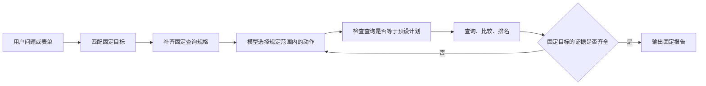
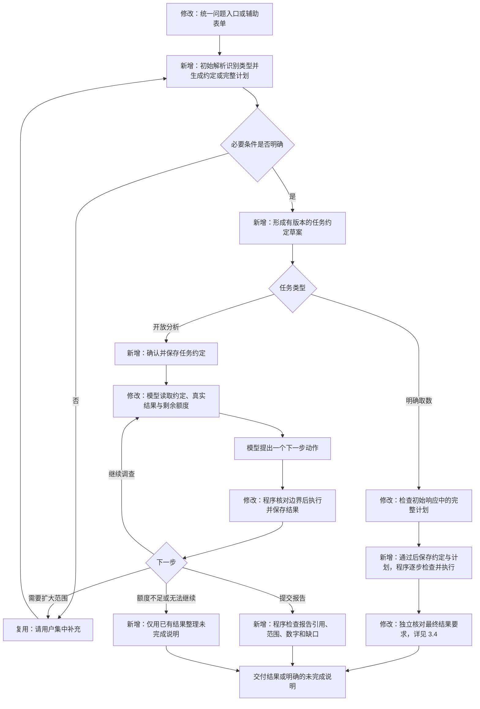
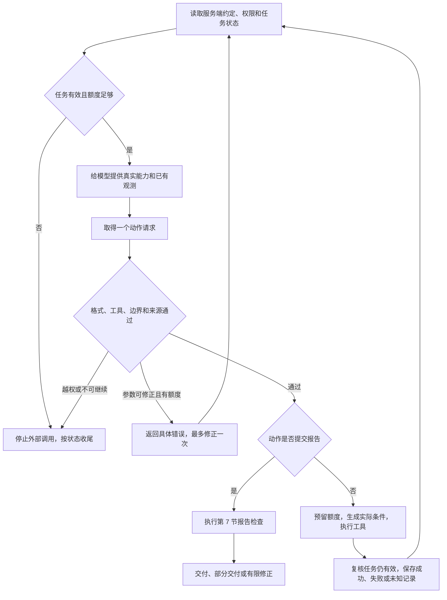
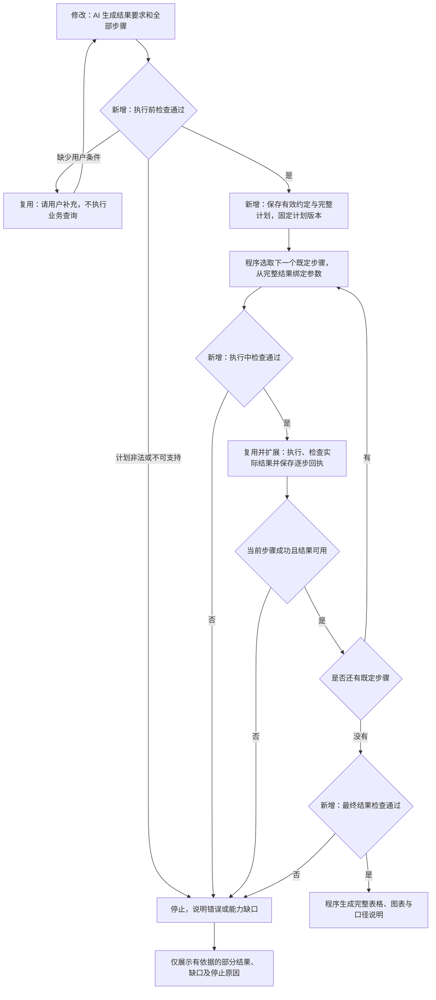
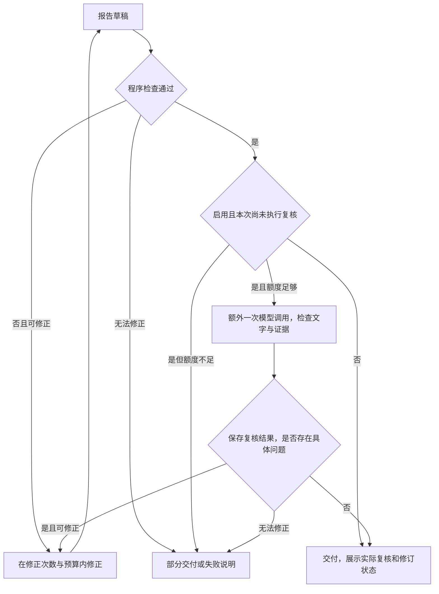

# 明确条件取数与开放任务分析：技术方案

版本：v3；日期：2026-10-20。

后续补充：明确取数新增“列出维度取值”步骤，取值请求不计算指标或回执，允许空指标和 `null` 观察时长；原指标取数与开放分析的约束保持。模型失败可按用户点击新建重试任务，保留问题和已确认条件。流程、实体及检查规则见[维度取值方案](dimension-value-query.md)和[手动重试方案](model-request-retry.md)。

状态：需求与 v2 技术方案已获确认，代码实现与本地验证完成，待人工验收。v3 纳入用户补充的“统一入口、按输入识别任务类型”并与首版实现对齐。实现和验收记录另见 [实施记录](open-exploration-implementation.md)，方案描述不代替真实模型效果或人工验收。

明确条件取数采用“AI 在开始执行前生成完整计划，程序检查后执行全部依赖步骤”，细化执行前、执行中和最终结果的检查。依据见[明确取数执行方式调研](explicit-query-execution-research.md)。用户不必先选择任务类型，初始解析同时给出意图及约定；明确取数不因此增加一次单独的分类请求。

## 1. 本次要实现什么

项目只保留“明确条件取数”和“开放任务分析”两种跑数类型。原推送汇总、Top N、两期比较归入明确条件取数，不再作为独立的固定分析入口。

页面提供一个问题输入入口，服务端依据完整问题识别类型；“如何变化”等明确趋势取数不因包含多步骤而自动变成开放分析。“为什么、调查原因”等需要选择调查方向的请求进入开放分析；意图或条件不明确先追问，不用关键词命中直接决定类型。辅助表单生成确定的明确取数计划。

明确条件取数由 AI 把自然语言转成结果要求和完整步骤计划，程序检查后按依赖执行，步骤之间的数据由程序传递，执行阶段不再让 AI 决定下一步。表单也生成相同格式的约定和计划，无须先转成自然语言。查询、筛选、排序、选前 N、汇总、比较等基础操作需要预先实现；基础操作的组合不枚举为业务题型。

开放分析按下面的分工运行：模型决定下一步准备查什么，程序决定能不能执行、实际怎样执行、哪些结果可以交付。本文把这组程序控制称为“执行控制层”，也就是 harness。

第一阶段使用现有推送/设备数据，支持范围内的趋势、比较和自主调查，并按用户补充要求增加发送记录的模板 ID、标题和正文，可按模板分组取数。消息明细排查、文案归因、人群、业务类型与转化等缺失的数据及工具，按后续领域扩展接入；有文案字段不代表已具备文案原因的证明能力。

基础工具及计算操作预先定义。业务问题、调查顺序、结论句式不做“下降、上升、波动”等业务枚举，不以是否属于某个题型决定任务能否运行。

## 2. 当前实现与需要改变的位置

已检查当前代码，主要限制如下：

| 位置 | 当前行为 | 本次变化 |
| --- | --- | --- |
| 原 `agent/runtime/push_analysis.py`、`push_tools.py` | 固定目标与完全相等的预设查询 | 新入口由完整计划与 `exploration.py` 替代，删除失效的固定推送执行协议 |
| `agent/runtime/push_query.py`、`agent/platform_app/worker.py` | 解析查询规格并执行，尚无通用多步骤计划检查与执行 | 初始 AI 输出结果要求与计划，程序检查依赖、逐步执行和核对交付 |
| `agent/runtime/push_tools.py` | 查询必须完全等于固定规格中的查询之一 | 开放分析改为核对用户边界、实际权限和工具规则 |
| `agent/platform_app/graph.py` | 已有逐轮模型/工具循环，报告产物即触发完成 | 保留循环，增加约定版本、调查进度和独立报告检查 |
| `agent/platform_app/ledger.py` | 已有调用记录、预算和结果复用 | 复用，并将约定版本与真实执行条件纳入复用检查 |
| `agent/runtime/analysis_api.py` | 推送模型主要看到结果编号与行数 | 提供实际指标、样本情况、覆盖范围和预算，允许根据结果换方向 |
| `web/src/PushWorkspace.tsx` | 表单、自然语言、固定工具分析入口并列 | 统一问题入口自动识别两类任务，表单作为明确条件辅助输入 |

继续使用现有 Python 服务、任务执行进程、PostgreSQL 数据库和流程运行组件。后者负责保存流程执行到哪一步，便于中断后恢复；不另建一套调度系统，不引入多个助手互相调度。

## 3. 流程图：旧流程在哪里改变

图中“修改”表示替换现有行为，“新增”表示本次补充，“复用”表示沿用已有机制。

### 3.1 旧固定分析流程



旧流程即使由模型选择下一动作，允许查询的范围和完成方式仍由固定目标锁定。

### 3.2 新的两类任务流程



这是任务分流概览：明确取数的失败分支见 3.4，开放分析的逐轮控制见 3.3。初始 AI 可在同一响应中提交约定草案、结果要求和完整计划，图中的分段不表示必须分别请求模型。缺条件时先补充；必要条件已明确且通过程序检查后，可以直接形成有效约定，不额外增加一次固定人工审批。补充条件与扩大范围仍受现有补充次数限制；扩大范围后保存新约定版本，不覆盖原版本。

HTTP 统一从 `/api/tasks` 接纳。自然语言首次解析期间复用查询回执；若识别为开放分析，在同一事务内将同一个任务转入分析执行，冻结分析配置、保存约定并承接初始模型消耗。任务编号不变；恢复不重复分类。辅助表单与明确取数都进入同一个程序计划执行器。原 `/api/analysis-runs` 保留内部直接提交完整分析约定和读取能力，页面不提供第二个独立的新建入口。

### 3.3 每一轮开放分析的程序控制



图中任何一处停止都不能被模型的一句“继续执行”绕过。工具失败的有限重试仍经过额度检查；取消、越权不重试。

### 3.4 明确条件取数：完整计划与三层检查



“一次生成完整计划”指执行前完成规划，执行中不逐步调用 AI。缺条件时可先追问，因此不承诺所有任务恰好只有一次模型请求。首版对非法完整计划直接返回具体错误，不追加一次自动模型修复；开放分析的动作参数仍受最多一次修正约束。确认后的计划没有任意循环、临时新增步骤或由模型编写的代码。

程序依据依赖关系安排顺序；B 使用 A 的值、C 使用 B 的值，都不需要再给 AI 传数据。空集合等情况按预先定义的操作规则处理，不让模型临时删除筛选或改变口径。逐步检查和最终检查的细则见 5.5—5.8。

## 4. 涉及的实体：分别是什么、有什么用

实体就是程序需要分别记录和处理的一类信息。这里只新增必要的记录结构，复用现有任务、调用账本和结果表，不为每种业务问题建立新实体。

| 实体 | 定义与用途 | 具体例子 | 保存位置与写入方 |
| --- | --- | --- | --- |
| 任务约定：新增 | 保存用户目标、不可自行放宽的边界和交付要求，是每次检查的依据 | 只查 app_1，两期已确定，点击/发送率，24 小时观察 | 新增 `task_contracts` 表，服务端保存；模型只能提交草案 |
| 明确取数计划：新增值结构 | 有限、无循环的完整步骤及指定输出，告诉程序先后执行什么 | A 查通道，B 选最低 3 个，C 用 B 的通道查每日厂商数据 | 已通过检查的计划保存在约定 `body.execution_plan`，模型提交草案，程序保存 |
| 计划步骤：新增嵌套值结构 | 一个已实现的基础操作，声明编号、参数和前序结果引用 | B：对 A 按到达率升序，取 3 个通道 | 嵌入取数计划；运行状态与实际参数另记逐步回执，不修改原计划 |
| 步骤结果说明：新增值结构 | 程序推导或实际核对的字段、类型、粒度、范围及完整性，用来判断能否连接后续步骤 | B 最多输出 3 个通道，通道列可用作通道筛选，不可用作设备 ID | 执行前检查记录及逐步回执中保存；由工具定义和实际结果生成，不采信模型自报 |
| 能力说明：新增值结构 | 当前用户实际可用的指标、维度、工具和数据范围，防止模型臆造能力 | 可按通道、厂商、模板和日分组，没有转化事件 | 从已发布目录、数据配置及权限生成；约定记录其版本，调用时重新核对权限 |
| 调查进度：新增值结构 | 保存待查方向、已查方向和证据关联，允许调整计划且保留未完成项 | 待查厂商；已比较通道，引用 e4/e5/e6 | 复用 `analysis_runs.state` 的 `progress` 部分；程序校验模型建议后更新 |
| 动作请求：改造已有结构 | 模型本轮准备调用的一个工具及参数，提供检查和审计依据 | 查询当前期，按通道分组，指标为发送、点击和点击率 | 复用 `analysis_steps.input`；程序记录，不代表已经执行成功 |
| 结果证据：改造已有实体 | 由成功工具生成的数据及其真实条件，是计算与数值展示的依据 | e1：app_1 基期发送 7000、点击 560 | 分析复用 `analysis_artifacts`；明确取数在 `task_evidence` 逐份保存，最终展示投影到 `tasks.result`；均由程序生成 |
| 交付报告：新增通用内容结构 | 将数值引用、解释、假设、未回答事项分开，避免报告内容直接决定任务成功 | 数据引用 e3；解释通道集中；厂商故障仍是待验证假设 | 分析复用报告产物，最终投影到 `tasks.result`；程序检查后保存 |
| 复核记录：可选新增值结构 | 保存独立模型对报告的具体意见，不作为程序已证明原因的凭证 | 报告提到文案变差，但没有文案证据 | 仅启用复核时，复用调用记录及输出；不单独建表 |

“新增值结构”表示增加一组有定义的 JSON 字段，不必新增数据库表。JSON 是结构化的数据格式；PostgreSQL 的 `JSONB` 字段用于保存并读取其中的字段。

明确取数新增物理结果表 `task_evidence`，字段为任务编号、约定版本、结果引用、完整内容和保存时间。例：A、B、C 三步结果分别三行，查询回执只存步骤状态与结果引用，不把全部中间数据积累在一个大字段里。单份结果仍受 1000 组、512 KiB 上限约束；服务端返回完整结果接口再次检查当前权限。明细结果保留 30 天，过期后明确返回不可用，不拿展示预览替代完整数据。

### 4.1 任务约定的具体保存格式

新增 `task_contracts`，由明确取数和开放分析共同使用：

| 字段 | 用途 |
| --- | --- |
| `task_id`、`tenant_id`、`user_id` | 关联任务及所有者，沿用任务身份约束 |
| `version` | 约定版本，同一任务版本只能增加 |
| `status` | 约定表只保存通过检查的已确认版本；草案留在解析或流程状态中，未确认必要条件前不执行业务查询 |
| `body JSONB` | 完整结构化约定 |
| `confirmation_request_id` | 去重用户确认或补充，重复请求不新增版本 |
| `created_at` | 保存时间 |

在 `tasks` 增加当前约定版本号。约定表以任务编号与版本号共同唯一，并使用任务编号、租户和用户共同关联已有任务，避免仅凭一个任务编号写入其他所有者的约定。保存新约定与更新版本号在同一数据库事务内完成，即一起成功或一起失败。已确认约定不原地覆盖；用户明确修改范围时新增版本。

下面是开放分析约定的示例。字段名是本方案建议，并非当前已实现的接口：

```json
{
  "schema_version": 1,
  "task_type": "analysis",
  "question": "分析 app_1 点击率下降的原因",
  "scope": {
    "filters": [{"field": "app_id", "op": "in", "values": ["app_1"]}],
    "periods": {
      "baseline": {"start": "2026-09-01T00:00:00+08:00", "end_exclusive": "2026-09-08T00:00:00+08:00"},
      "current": {"start": "2026-09-08T00:00:00+08:00", "end_exclusive": "2026-09-15T00:00:00+08:00"}
    },
    "observation_hours": 24
  },
  "target_metrics": ["click_rate"],
  "exploration_permissions": {
    "metrics": ["sent", "clicked", "click_rate", "delivered", "delivery_rate"],
    "dimensions": ["channel", "manufacturer", "day"],
    "filter_fields": ["channel", "manufacturer"]
  },
  "answer_items": [
    {"id": "a1", "text": "核实整体变化", "source": "question"},
    {"id": "a2", "text": "调查有数据支持的解释，交代未验证原因", "source": "question"}
  ],
  "capability_version": "push-capabilities-v2"
}
```

`scope` 来自用户明确条件；`exploration_permissions` 由程序按能力与权限生成，不能由模型自行授予。指标定义来自已发布目录，不能由模型修改 `click_rate` 的分母。每次执行仍检查当前权限，不能把旧约定当作永久授权。

明确取数使用相同的身份、范围和口径结构，另存 `result_requirements`（用户要什么）与 `execution_plan`（准备怎样取得）。二者不能合成“只要执行完计划就算回答了用户”。下面展示完整的业务字段示例，任务身份及确认状态仍由上表字段保存：

```json
{
  "schema_version": 1,
  "task_type": "query",
  "question": "查 app_1 在 2026-09-08 至 09-14 到达率最低的 3 个通道，再看这些通道按厂商、按日的发送量与到达率；观察窗口为 24 小时",
  "scope": {
    "filters": [{"field": "app_id", "op": "in", "values": ["app_1"]}],
    "periods": {
      "current": {"start": "2026-09-08T00:00:00+08:00", "end_exclusive": "2026-09-15T00:00:00+08:00"}
    },
    "observation_hours": 24
  },
  "result_requirements": {
    "metrics": ["sent", "delivery_rate"],
    "dimensions": ["manufacturer", "day"],
    "period_names": ["current"],
    "selection": {
      "field": "channel",
      "rank_metric": "delivery_rate",
      "direction": "asc",
      "limit": 3,
      "nulls": "exclude",
      "tie_breakers": [{"field": "channel", "direction": "asc"}]
    },
    "coverage": "complete"
  },
  "execution_plan": {
    "schema_version": 1,
    "steps": [
      {"id": "A", "op": "query", "period": "current", "dimensions": ["channel"], "metrics": ["sent", "delivery_rate"]},
      {"id": "B", "op": "sort_limit", "input": "A", "metric": "delivery_rate", "direction": "asc", "limit": 3,
        "nulls": "exclude", "tie_breakers": [{"field": "channel", "direction": "asc"}]},
      {"id": "C", "op": "query", "period": "current", "dimensions": ["manufacturer", "day"], "metrics": ["sent", "delivery_rate"],
        "filters_from": [{"field": "channel", "op": "in", "step": "B", "column": "channel", "on_empty": "return_empty"}]}
    ],
    "outputs": [{"step": "C", "metrics": ["sent", "delivery_rate"], "dimensions": ["manufacturer", "day"]}]
  },
  "capability_version": "push-capabilities-v2"
}
```

这里约定“最低 3 个”排除无样本比率，同率时按通道标识升序确定顺序；若用户要求“并列全部保留”，则要用支持该规则的操作并重新检查数量上限，不能默默套用本例。少于 3 个有效通道时返回实际数量并说明。上述排序规则来自已发布默认规则，初始确认信息中应可见；用户明确指定时以用户要求为准。

所有查询自动继承 `scope`。A 输出通道粒度，B 保留该粒度并选组，C 将选中通道合并后按厂商与日统计；最终不要求按通道分列，因为本例用户没有要求。指标目录负责定义分子分母与设备/发送粒度，程序按这些定义计算，不能把通道比率直接求平均。

如果用户只要求“每天的发送和到达率”，则结果要求为 `day` 分组，不需要增加选通道步骤。明确取数中的维度是必须交付的分组；开放分析中的允许维度是可选调查方向，除非用户明确要求，否则不必全部执行。

### 4.2 约定、进度、证据如何保持一致

每次动作记录、证据、报告与流程恢复位置都记录 `contract_version`，表示使用哪个约定版本。

明确取数还记录程序计算的 `plan_hash`（完整计划内容的摘要编号）。检查通过的约定和计划一起保存，执行器只读取该版本，不直接执行模型刚返回的内容。检查记录包含规则版本、推导出的步骤结果说明以及具体错误；失败的草案可供审计，但不能成为有效执行计划。检查记录复用查询回执的结构化字段，属于程序写入的校验结果，不接受模型填写“已经通过”。

- 调用前与保存结果时均核对当前版本，旧执行者不能把旧约定结果写成新版本结果。
- 第一阶段不跨约定版本复用计算证据。原结果保留供授权查看，但新版本重新获取所需证据，减少“旧子范围冒充新总体”的风险。
- 任务预算不因新版本或重启而清零；若额度不足，交付未完成说明或请用户新建任务。
- 当前约定在业务数据库中保存唯一权威副本；流程恢复记录只保存版本引用和进度，不另存一份可由模型改写的有效约定。

调查进度示例：`待查厂商；已查通道；通道比较引用 e6`。更新计划时可以调整未来方向，但不删除用户回答要求，取消某项调查也保留取消理由。

证据的编号由程序生成。模型看到的 e1、e2 是本轮便于引用的简称；落库使用现有内容摘要编号，并绑定任务、数据版本、约定版本、指标权限、实际查询条件和完整性说明。

## 5. 执行控制层的实现思路

### 5.1 开放分析每轮按固定顺序处理

程序的控制顺序固定，调查方向可变：

1. 从数据库读取已确认约定、当前用户权限、任务状态和已用预算。
2. 确认仍可执行，并为本次模型调用预留额度。
3. 将问题、能力说明、有效证据摘要、调查进度和剩余额度交给模型。
4. 解析一个动作请求；检查工具名称、参数类型及不允许的额外字段。
5. 对查询检查范围，对计算检查输入与可比性，对报告进入第 7 节检查。
6. 对真正需要执行的动作先保存调用记录、预留额度，再执行工具。
7. 保存结果前重新核对任务状态、执行者和约定版本，避免取消后的迟到写入。
8. 保存回执及证据，更新进度，再进入下一轮或结束。回执就是本次调用的实际结果记录。

这里的“固定顺序”属于程序控制，不是固定业务题型。没有跳过检查的快捷工具。

明确取数不进入这个逐轮模型循环。两类任务共享权限、范围、数据与预算检查，明确取数额外按下面的完整计划规则执行。

### 5.2 查询条件由程序组装

模型的查询请求只包含可变部分，例如：当前期、通道分组、发送/点击指标、额外筛选，以及可选的父证据引用。

程序读取约定，把“当前期”转换为真实日期，将固定 app_1 筛选与合法的追加条件取交集，再交给现有受控 SQL 编译器。SQL 是数据库查询语句；这里的编译器将结构化条件转换成这些语句。模型不直接提供 SQL 或数据库账号。

检查分三类：

| 检查对象 | 具体处理 | 不通过的行为 |
| --- | --- | --- |
| 用户固定边界 | 应用、日期、观察窗口不放宽；细分日期须在已确认期间内 | 不执行范围外查询，不能把 app_1 改为全部应用 |
| 实际能力与权限 | 指标依赖、维度、筛选和数据源均存在且当前授权 | 未发布转化事件时不执行转化查询，撤权后不继续 |
| 证据与统计规则 | 父组真实存在、计算输入属于同任务同约定、比较口径一致 | 不能用不存在的 e99，也不能比较 24 小时和 48 小时观察结果 |

用户未要求的维度可由开放分析自主选择；用户已要求的维度不能忽略。声称沿某条结果下钻时，验证父组确实存在；直接在允许范围内调查不强制先有父证据。

SQL 继续使用只读账号、允许对象检查、时间限制和结果上限。每条查询最多两个联合维度、最多 1000 组；超量不截断后冒充完整总体。

### 5.3 数字与摘要分开处理

查询和计算结果保存完整内容，模型只读取有大小限制的摘要。正常摘要包含实际指标值、分子分母、样本情况、实际条件和覆盖情况；默认展示原结果固定顺序前 3 行，并标明总行数、选取规则和省略行数。临近输入上限时由程序先减少预览行，再省略明确标记的合计或重复范围细节；始终保留全部证据编号，避免模型忘记已有查询并重复执行。必要的完整任务约束不裁剪，模型可用 `inspect_result` 按原结果编号查看指定分组、排序或分页，单次最多 20 行；不会额外调用模型压缩数据。

保持现有单次模型输入最多预留 6000 Token 的保守上界；Token 是模型输入输出额度和计费使用的计数单位。发送前检查整份输入，超限时压缩重复说明和证据展示，不截断用户约束或修改原始结果；仍无法容纳则说明上下文超限，不强行发送。

比较、汇总、首末差值等读取完整保存结果，不对摘要里的前几行做整体计算。比率按总分子除以总分母，零分母无样本；不同粒度的数据不能混算。

比率贡献拆解作为按需调用的计算工具，验证完整互斥分组后计算组内变化与结构变化。不同维度的贡献不能相加；它只解释统计变化，不证明业务因果。

工具返回成功、有数据，成功但无样本，失败，结果未知等明确情况。模型不能把失败解释成零，也不能用自己写的数据表创建可信证据。

### 5.4 重试和停止仍由程序决定

开放分析沿用模型最多 10 次、工具最多 12 次、SQL 最多 6 次、活跃执行最多 180 秒，以及既有 Token/费用上限。未知用量继续保留预留额度。

参数修正最多一次，SQL 只读重试最多一次；取消、越权不重试。已完成调用复用保存回执，不因为流程恢复再次发出；模型调用结果未知时停止，不假定未执行而重发。

连续两次重复产生相同证据且没有新进展时停止，其他无效调查仍受总预算约束。等待用户补充释放执行名额，但不重置消耗。

正常执行步骤和失败收尾分开：预算耗尽后不再调用模型或业务数据查询工具，只读取平台中仍可授权访问的本任务已有证据，生成确定的未完成清单。收尾保持幂等，即重复执行也不重复创建报告或覆盖取消结果。

### 5.5 明确取数：执行前怎样检查完整计划

执行前检查不查询业务明细。程序读取有效的数据目录、工具定义、权限与任务约定，先检查整份计划；任何一步不通过，都不能先执行 A、再考虑 B 是否合法。检查结果必须能指明“第几步、哪个字段、违反什么规则”，例如：`C.filters_from[0]：B 没有 device_id 列，可引用的标识列为 channel`。

程序按以下顺序检查：

| 检查内容 | 程序具体检查什么 | 不通过时怎样处理 |
| --- | --- | --- |
| 格式与操作存在 | 严格解析 JSON；步骤编号唯一；只有已实现的操作和参数；输出非空且引用有效步骤；拒绝额外 SQL、脚本及未知字段 | 整份计划不执行，返回对应字段错误 |
| 依赖能否排出顺序 | 收集 `input`、`filters_from` 等引用，确认被引用步骤存在，且没有 A 依赖 B、B 又依赖 A 的循环；每一步都应服务指定输出或已声明的必要检查 | 整份计划不执行；书写顺序可以不同，实际执行顺序由依赖推导；无关多余查询也不能执行 |
| 上一步会输出什么 | 按工具定义和参数推导每步字段、字段类型、含义、分组粒度、单位、范围、来源及数量上限；不使用 AI 自报的结果结构代替推导 | 工具无法给出可校验的输出定义时，视为未支持，不能猜测字段 |
| 字段能否连接 | 后一步引用的列必须存在；标量/列表匹配；标识的业务含义也要匹配；不能因为通道 ID 和设备 ID 都是字符串就允许互换 | 如 B 只有通道列，C 用它筛选设备则执行前拒绝 |
| 数量是否受控 | 计划步骤数、查询数、引用值数和潜在展开有上限；第一阶段不支持逐行动态新增查询，只支持有上限的整体参数绑定 | 能静态确定超过上限则拒绝；实际数量尚不确定则保留明确的执行时检查，不能标为已证明足够小 |
| 范围、权限及数据能力 | 每个查询继承固定应用、时间和观察窗口；追加筛选不能扩大范围；指标、维度、数据源及必要关联均已发布且授权；静态查询能编译，动态引用先按类型检查参数位置 | 未发布的转化字段、非法关联、范围外日期均拒绝；缺少必要用户条件则先补充；不先执行 SQL 试错再补计划 |
| 计算规则 | 比率按有效分子分母计算；不能直接相加比率；汇总需有可合并的原始计数；比较需粒度、指标定义、单位、筛选及观察口径可比 | 不能用一个按通道的表直接与一个按厂商的表逐行相减；必要的对齐或再汇总必须在计划中明确 |
| 选组规则 | 排序指标存在；方向、N、无样本处理和同值处理明确；全局最低/最高 N 的候选来源必须是完整范围 | 只查部分通道再声称最低 3 个不通过；缺规则且没有发布默认值则补充 |
| 最终输出能否满足要求 | 将指定输出的推导结果与独立保存的 `result_requirements` 对照：指标、分组、期间、选组方式和覆盖要求逐项匹配 | 用户要每天发送和到达率，计划只输出总发送量，执行前即可拒绝 |
| 版本与预算 | 计划绑定当前约定、工具规则及能力版本；预计必须的步骤和 SQL 调用数不超过剩余额度 | 拒绝已过期计划或确定无法执行完的计划；数据库耗时等未知消耗执行中继续控制 |

第一阶段明确取数最多 20 个计划步骤、6 次业务 SQL；每条查询仍最多两个联合维度、1000 组，动态筛选最多绑定 1000 个不同值，单份序列化结果上限 512 KiB。额度由服务端控制，模型无权增加；开放分析的只读重试也占 SQL 次数。明确取数执行阶段不重新规划，未知步骤保守停止；首版持久计划的 180 秒窗口包含恢复等待。输出上限不等于可以截断后继续，无法得到完整候选或指定结果时必须说明缺口。为识别行数超限，可以额外探测第 1001 组，但不能把前 1000 组声明为完整结果。

结果要求约束最终交付，不要求所有中间步骤都与最终输出相同。本例 A 按通道、C 按厂商与日是合法的；需要检查的是二者如何通过 B 的选组相连，以及整个过程是否保持固定边界。对于明确要求完整范围的交付，不能只因子范围仍在允许边界内就视为满足要求。

执行前检查的结论是“结构可执行、在已知规则下符合约定，仍有列明的运行时条件”，不是“已经保证能取得用户想要的全部数据”。例如实际查询耗时、结果是否为空、具体筛选值是否合法，需要取得真实数据后再检查。

以第 4.1 节的 A → B → C 为例，程序自己推导：

| 步骤 | 由操作推导的结果说明 | 后续能使用什么 |
| --- | --- | --- |
| A：按通道查询 | 一行一个通道；含通道标识、发送量、到达率和计算所需计数；保留固定范围与观察口径；若超限则不完整 | B 可按到达率排序；只有完整候选才能做全范围最低排名 |
| B：升序取 3 个 | 保留 A 的列和通道含义，最多 3 行；记录来源为 A、无样本排除规则和同值规则 | C 可提取 `channel` 列作通道筛选；不能提取不存在的 `device_id` |
| C：按厂商与日查询 | 使用 B 选出的通道，按厂商与日统计；固定日期、应用及口径仍继承约定 | 可以交付指定分组的发送量和到达率，不能说成所有通道的整体表现 |

### 5.6 明确取数：执行中怎样检查真实数据

每一步都按“读取当前约定与权限 → 绑定前序结果 → 检查实际输入 → 预留额度并执行 → 检查实际输出 → 保存回执”处理。执行器只调用查询和计算工具，不调用模型决定步骤或修复业务含义。

| 检查时机 | 程序具体处理 | 示例与失败处理 |
| --- | --- | --- |
| 每步执行前 | 核对任务仍可运行、执行者有效、约定版本与 `plan_hash` 未变、当前权限与工具规则仍允许，剩余预算足够 | A 后用户被撤权，则 B/C 不再执行；旧约定失效时不沿用旧计划继续 |
| 取前序数据时 | 只读取同任务、同约定、同计划中已成功保存的完整结果；检查结果字段、类型、范围、数据版本和完整性 | A 只返回摘要、被截断或失败，不能交给 B 做完整排名；模型展示摘要不作为步骤输入 |
| 绑定筛选时 | 对引用列取值，按规则检查类型、空值、去重数量及允许范围，作为 SQL 参数绑定，不拼接 SQL | B 的 3 个真实通道用于 C；若实际超过筛选上限则停止，不暗中只取前几个 |
| 前序结果为空时 | 执行工具定义中的明确空值规则；本例 C 的 `return_empty` 生成“无可选通道”的空结果，记录来源，不发送无筛选查询 | 不能把空列表等同于没有限制，更不能删除通道条件查询全部数据 |
| 计算与排名时 | 使用完整数据及已发布公式，检查零分母、无样本、可合并计数和来源；按计划中的排序及同值规则选组 | 零分母比率记为无样本；B 排除无样本后不足 3 个，保留实际数量与原因，不补造通道 |
| 查询/计算返回时 | 校验实际字段与推导结构一致，行数、字节数和数据范围合规；核对观察窗口及数据是否可比较；保存数据版本和实际数量 | 超限、字段缺失、观察期不满足或来源数据不可比较时，该步骤不可作为后续有效输入；不同 SQL 不自动保证读到同一时点，需共享数据版本/读取快照，否则不得声称同一时点 |
| 发生失败、超时或取消时 | 区分成功无样本、执行失败、结果未知；只在预设的只读重试与剩余额度内重试，依赖失败步骤的后续步骤不执行 | 不能把超时当作发送量 0；超过重试次数时交付已有有效部分并列出缺口 |
| 保存与恢复时 | 保存真实输入、依赖引用、输出引用、状态、消耗与版本；保存前再核对任务状态；恢复时复用已成功回执 | 不重复执行已完成步骤；结果未知时不得冒充成功，按已设的只读恢复规则处理，不能重新请求 AI 编造新计划 |

逐步回执扩展现有查询回执的结构化字段，记录 `step_id`、`contract_version`、`plan_hash`、状态、实际条件、前序引用、结果引用和检查错误。完整结果逐份存入 `task_evidence`，回执只保存必要元信息和引用；不把全部历史结果重复塞入计划或模型上下文。每步成功结果与回执一起可靠保存，保存失败的结果不能传给下一步。失败展示只取前 20 行并声明省略；完整结果可按引用授权读取，不把本次计划执行改造成无限量数据导出。

需要同一读取时点的步骤，应使用数据源已提供的固定发布版本或数据库一致读取快照；同一快照内的查询看到相同时间点的数据。第一阶段若恢复后无法继续使用原版本/快照，则停止依赖链并说明缺口，不把新旧数据拼成同一时点结果。工具名称、SQL 文本相同或目录版本相同，都不能代替数据一致性证明。

若执行中发现需要新的业务判断，例如“这三个通道都很正常，是否改查文案”，明确取数停止并说明当前计划能回答的范围。需要用户改变要求时产生新约定和重新检查的计划，累计预算不清零；不能悄悄切换为开放分析，也不能在旧计划中追加一次模型决策。

### 5.7 明确取数：交付前怎样检查最终结果

全部步骤执行结束后，程序仍要按用户结果要求单独验收。步骤都成功，不等于任务已经回答。

| 检查内容 | 必须核对的事实 | 不满足时的交付 |
| --- | --- | --- |
| 来源真实且可读取 | 指定输出确实有成功回执，来自当前约定和计划，引用存在且交付时仍有权限 | 不展示无权数据；不把模型填写的表格当查询结果 |
| 指标、分组与范围齐全 | 指定指标和分组均有对应字段；实际应用、日期、观察窗口及筛选与要求一致；多个输出不能遗漏 | 缺少到达率、只有总数没有按日、少交一张指定表，都不能显示完整完成 |
| 依赖选组符合要求 | 检查真实执行记录：B 确实在 A 的完整候选上按约定排序，C 使用 B 的真实选组，且未遗漏或新增值 | 即使 C 表格字段齐全，筛错通道也不能通过；不能只检查最后一张表的列名 |
| 统计口径和计算可复核 | 比率的分子分母、单位、分组后汇总、排名与比较来自受控计算；展示精度按规则处理 | 不对分组比率直接平均；不将差值百分点写成相对变化百分比 |
| 覆盖与无样本如实 | 行数与大小未截断；候选和最终范围完整；空结果、观察窗口及未出数据的日期有明确标记 | 查询失败不填 0；无记录、无样本、尚不成熟分别说明。趋势图需要连续日期时按目录规则补日期，不虚构比率 |
| 终态与停止原因一致 | 最终检查完成后原子更新任务结果和终态，防止取消、换约定或撤权后迟到提交 | 完整通过才 `completed`；缺口按第 7.1 节部分交付规则处理，取消仍是取消 |

表格、图表、计算值和固定口径说明由程序从有效结果生成，不需要追加一次 AI 总结或强制模型质量复核。若今后增加自由文字解释，它是单独的产品需求，不能绕过这些检查。

成功执行且该范围确实无样本，可以完整交付“无样本”，同时显示实际范围和证据；这不是“没有结果也算完成”。如用户要求“比较哪期更高”，两期均无有效比率则不能声称已经完成比较，应明确无法比较及其原因。

### 5.8 能提前发现什么，不能保证什么

| 错误例子 | 能否在执行前发现 | 仍需哪一层检查 |
| --- | --- | --- |
| B 没有设备列，C 却引用该列；两步循环依赖 | 能，通过字段推导和依赖检查 | 执行中仍核对实际结构，防止工具实现与定义不一致 |
| 用户明确要每天到达率，最终只计划查整体发送量 | 能，前提是 `result_requirements` 正确记录了用户要求 | 最终再核对实际输出，避免执行失败后仍冒充完整 |
| B 实际为空，或引用值实际太多 | 通常不能确定，只能预先检查是否定义处理规则和上限 | 执行中根据真实值处理，不删除约束或静默截断 |
| 数据查询失败、被撤权、预算用尽或数据版本变化 | 不能保证不会发生 | 每步和交付时重新检查，保留已有有效证据及停止原因 |
| AI 把用户的“按发送日期”理解为“按到达日期”，且结果要求和计划都写成了后者 | 仅比对要求和计划不能可靠发现，因为二者可能同样理解错 | 保留用户原话与口径来源，歧义先澄清，界面显示解析后的关键条件，开发验收和后续抽检覆盖这类理解错误 |

`result_requirements` 仍由 AI 解析自然语言后提出，程序负责校验、保存并禁止执行阶段修改。它与计划分开是为了发现“计划遗漏已记录要求”，不能当作已经独立证明了用户原意。程序发现歧义、缺少必要条件或没有支持的操作时先说明，不用一套自洽的错误计划冒充理解正确。线上不因此新增固定的人工审批或模型复核步骤。

因此，“程序校验后执行全部依赖”指程序能够约束可执行性、数据传递、边界和交付一致性；并不承诺单靠格式与依赖检查就能证明自然语言理解、业务解释或最终答案绝对正确。

## 6. 贯穿例子：app_1 点击率下降

使用第 4.1 节约定，下面所有数字仅为设计示例。

| 次序 | 模型请求 | 程序实际检查与执行 | 保存结果 |
| --- | --- | --- | --- |
| 1 | 查询基期整体发送、点击和点击率 | 取约定基期与 app_1，检查指标依赖、观察期成熟和额度 | e1：发送 7000，点击 560，点击率 8% |
| 2 | 查询当前期同口径指标 | 使用约定当前期，同样保留 app_1 和 24 小时 | e2：发送 7000，点击 420，点击率 6% |
| 3 | 比较 e1、e2 | 检查同任务、同约定、同口径，再由代码计算 | e3：差值 -2 个百分点 |
| 4、5 | 分别查询两期通道分组 | 通道在允许维度中，固定筛选仍生效 | e4/e5：完整通道分组 |
| 6 | 比较 e4、e5 | 检查可比性，由代码计算每组变化 | e6：B 通道从 6% 变成 2%，A 保持 10% |
| 7 | 提交报告，或在预算内进一步查 B 的厂商分布 | 报告进入检查；下钻则先确认父结果中存在 B，再加约束 | 报告或新查询证据 |

示例分组：A 两期均发送 3500、点击 350；B 基期发送 3500、点击 210，当前发送 3500、点击 70。合计与 e1/e2 一致。

如果模型改查 app_2，程序拒绝。若请求按尚未发布的转化事件取数，程序记录能力缺口。不能沿用“需要对照”的理由直接扩大用户范围，也不能把未知回执推断成厂商故障。

第 7 步不是保证剩余预算足够开展完整厂商调查，是否继续由当前额度决定；应优先为交付保留步骤。示例不构成所有问题必须执行的工具顺序。

## 7. 报告检查与可选的模型复核

### 7.1 程序检查什么

报告包含数值引用、分析解释、待验证假设、未回答事项和停止原因。每个数值引用都定位到证据、分组、指标和计算项，程序读取原值生成图表与数值片段，不采信模型自行填写的业务数字。

程序按顺序检查：

1. 引用存在，属于本任务当前约定，真实执行成功且当前有权读取。
2. 引用结果的条件覆盖其所声称的范围，子组不能冒充总体。
3. 数值和单位来自保存结果，需要的计算已经由工具完成。
4. 用户要求逐项有关联证据，或有可核对的未回答原因；不能删除要求来提前完成。
5. 已查方向、未完成项和预算/失败等停止原因与真实记录相符。

明确取数按第 5.7 节检查指定指标、分组、范围、依赖选组和计算是否交付。开放分析检查边界、证据与调查说明，不要求所有问题都具备固定的“两期比较、下降排名”产物。下节的可选模型复核面向开放分析的自由文字报告，不是明确取数程序闭环所需的步骤。

只取得部分结果则交付部分结果并列出缺口；没有有效证据则交付失败或无法回答说明。取消保持取消。保留现有任务执行状态，并在报告内新增 `completeness`：

| 实际情况 | 任务状态建议 | 报告完整性与页面展示 |
| --- | --- | --- |
| 所需结果和程序交付检查通过 | `completed` | `complete`，显示调查范围与解释性质，不表示因果已证明 |
| 已取得部分证据，但有预算终止、失败或能力缺口 | `failed` | `partial`，页面显示部分完成及未回答事项，保留已有报告 |
| 没有任何可用证据 | `failed` | 不伪造结果报告，提供明确错误或无法回答说明 |
| 用户停止 | `canceled` | 保持停止，只在权限允许时展示此前已保存结果 |

不能仅因产生报告产物就设置任务成功。这些状态值只是执行和交付状态，不是重新引入业务题型或“下降/上升”结论枚举。对于成功执行但无样本的查询，可以完整回答“该范围无样本”；它与查询失败后不知道是否有数据不同。

已有机械检查无法证明“因为文案变差”成立。表格数字和自由解释分区展示，程序不把“报告可交付”标成“原因已被证明”。

### 7.2 可选复核流程图

**第一阶段关闭独立模型复核；以下为未来启用时的受控流程。** 它不是人工审批，也不因本文写出就自动启用。配置由服务端保存到任务执行策略，不能由模型开启、关闭或为自己增加额度。若选择启用，流程如下：



实现时为本次交付记录是否已复核及剩余修正次数。修正后重新做程序检查，复核分支因已经执行过而不再进入；最多一次复核，不能循环消耗。未启用、复核未提出问题、已按意见修订但未二次复核分别展示，不能把最后一种写成“再次复核通过”。若复核意见无法在上限内处理，交付限制或部分结果，不能显示“问题已修正”。

复核需要读取原问题、约定、报告及相关真实证据。检查是否答非所问、文字与数字冲突、解释无依据或遗漏限制。所有调用仍占原任务预算，不另外增加额度；额度不足显示未完成复核，不冒充通过。

开发上线验收和上线后抽检由人工完成。线上任务不默认等待人工批准；模型复核通过也不保证分析一定正确。

## 8. 模块分工与旧逻辑清理

新增代码按职责拆开，不建立每个业务场景一个类或一套流程：

| 模块建议 | 只负责什么 | 使用现有能力 |
| --- | --- | --- |
| `task_contracts.py` | 定义、保存、确认和读取约定版本 | 数据库事务、任务身份和补充请求去重 |
| `platform_app/task_intent.py` | 统一入口分流、冻结初始模型预算，将同一任务转入开放分析 | 查询回执、任务身份、分析账本，承接已有消耗 |
| `query_program.py` | 定义明确取数计划和基础操作的输入输出，检查依赖，推导结果结构并核对结果要求 | 初始自然语言解析、已发布指标和工具定义；不发起业务查询 |
| `query_executor.py` | 按已检查计划绑定前序结果，调用工具，检查实际结果，保存回执并生成确定的交付 | 现有只读执行、查询回执、结果存储及任务终态；不调用模型 |
| `task_guards.py` | 检查动作、组装实际条件，检查结果范围 | 指标依赖、数据时间和权限检查 |
| `push_calculations.py` | 对真实证据执行通用比较、聚合等计算 | 现有比率计算与受控结果结构 |
| `analysis_reports.py` | 解析数值引用，检查报告，生成交付和未完成清单 | 证据保存、报告产物与前端结果格式 |
| 现有 `graph.py`、`ledger.py`、`worker.py` | 调度上述职责，控制预算、恢复与终态 | 现有检查点、回执和执行围栏 |

检查函数不直接发起模型或 SQL；查询和计算工具分开；流程代码通过明确调用边界使用它们。测试时可以替换模型响应和工具输出，不需要另建复杂继承体系。

清理前用引用搜索及测试确认实际使用情况。完成明确取数替代能力后，删除不再使用的推送 `PushSpec.goal` 新建校验、固定目标提示词、固定动作选择分支和旧前端独立入口。汇总、Top N、比较与比较后的条件筛选用通用操作组合实现，不保留第三种固定业务任务。

历史数据读取使用最小的格式适配，不保留已失效的旧协议执行入口。订单域等仍有明确配置、有效调用或回归场景的逻辑先确认用途，不借本次改造盲目删除；不能为了保留历史读取继续允许推送新建固定分析任务。

本阶段不强行合并明确取数和分析的全部执行账本。明确取数复用现有查询任务执行及模型未知调用控制，扩展完整计划的检查记录和逐步回执，替换目前仅保存整个查询响应的处理；开放分析复用现有分析账本。共享的是约定、范围检查和结果结构，不是通过额外运行类型绕过两类任务。

## 9. 验证方式与通过标准

| 验证内容 | 验证方法 | 通过标准 |
| --- | --- | --- |
| 约定保存与版本 | 隔离数据库验证确认、重复补充、并发修改和恢复 | 版本不覆盖；同请求不重复写；旧执行者不能写入新版本 |
| 两类约定差异 | 同一范围分别测试每日明确取数和自主分析 | 明确取数按天完整交付；开放分析可换维度且不越界 |
| 统一意图入口 | 同一 `/api/tasks` 分别提交完整查询计划、自然语言取数、调查原因及缺条件请求 | 不需要前端选类型；明确取数初始响应同时给出计划；开放分析沿用任务编号并承接初始模型/费用消耗；缺条件先补充 |
| 明确取数正常依赖链 | 模拟一次初始 AI 返回 A 查询、B 选组、C 用 B 筛选的完整计划，执行器配置为禁止调用模型；同时提供不完整展示摘要与完整保存结果 | 全部既定步骤由程序完成；C 绑定 B 的完整真实值；执行阶段模型调用数为 0；摘要不影响结果 |
| 执行前结构与连接检查 | 构造重复编号、未知操作、缺失引用、循环、B 没有 C 所需列、通道 ID 冒充设备 ID、列表传标量及确定超限的计划 | 返回步骤和字段错误；业务 SQL 调用数为 0；不能靠 AI 自报输出列或数量绕过 |
| 执行前结果要求检查 | 分别构造少指标、错粒度、错期间、最低改最高、候选来源不完整、比率直接求和及中间分组合法变化 | 错误计划在首条业务 SQL 前拒绝；A 按通道、C 按厂商与日等正确依赖组合能够通过 |
| 执行中真实值检查 | A/B 返回空集合、零分母、实际过多值、缺字段、超行数/字节数、失败、结果未知或数据版本不可比较 | 不删除筛选、不静默截断、不失败填零；依赖不可用结果的步骤不执行；预设空结果规则能正确收尾 |
| 明确取数固定计划与恢复 | A 成功后模拟中断、撤权、约定变更或后续查询失败；恢复时禁止模型调用并检查 SQL 记录 | 复用有效回执，过期计划不继续，重试符合预算；不在执行中调用 AI 换计划；所需数据快照失效则停止依赖链并说明缺口 |
| 最终结果独立验收 | 模拟全部步骤成功但交付缺表、缺指标、错范围、错选组、部分数据冒充完整；另测成功无样本与无有效比率的比较 | 不能仅以步骤成功设置任务完成；缺口可核查；真实无样本与无法比较区分展示 |
| 程序控制 | 模拟模型请求越权应用、不支持字段、非法时间、伪造证据、篡改约定 | 工具未被真正调用；错误与停止记录可核查 |
| 统计计算 | 独立样本预期值对齐真实只读视图和计算工具 | 分子分母、差值、结构变化、空样本与截断行为正确 |
| 自主调查 | 两组不同的模拟模型动作路径处理同一问题 | 路径可以不同，均真实执行并保存可验证证据 |
| 预算与恢复 | 执行中断、回执已保存、重复投递、额度耗尽、未知调用 | 不重放已完成外部调用，不清零预算，不继续未知模型调用 |
| 交付与取消 | 缺指标、错误引用、仅子组结果、用户取消、撤权 | 不虚假完整、不跨权读数据、不覆盖取消 |
| 前端与兼容 | 构建、浏览器操作、旧结果授权读取回归 | 统一入口的类型识别和展示清晰，步骤和未完成项真实，必要历史结果可读 |
| 分析质量 | 独立场景由人工评测；真实模型请求另定上限 | 检查是否切题、解释有依据、限制如实，不以结束成功率代替正确率 |

测试工具规则时使用模拟模型，不增加真实费用。真实模型评测另行固定题单、模型和请求上限，覆盖“解析后的要求和计划一致，但都误解了用户”的场景；不能用模拟测试成绩宣称真实理解效果，也不能声称程序检查可以排除全部语义错误。代码验证后提交独立 commit，提交内容与验证范围对应。

## 10. 建议实施顺序及确认项

1. 建立任务约定与版本检查，先验证保存、权限和恢复一致性。
2. 统一明确取数：初始 AI 生成完整计划，新增执行前检查、逐步参数绑定与检查、最终独立验收；迁移原汇总、Top N、两期比较，验证后删除失效的固定推送执行分支。
3. 开放调查动作和真实观测摘要，接入调查进度、证据计算和边界检查。
4. 接入报告交付检查、预算停止后的本地收尾及前端展示。
5. 完成数据库、流程和页面验证，再进行代码与测试结果人工验收。

已经明确的执行方式：明确条件取数在执行前由 AI 生成完整计划，程序校验后执行全部依赖，不在每个步骤重新请求 AI；开放分析继续依据中间结果逐步选择调查方向。

本次供人工确认的细化内容及其余方案选择：

- 第 3.4、4.1、5.5—5.8 和第 9 节中的计划格式、三层检查、失败处理及验证标准；检查不能保证自然语言理解绝对正确。
- 新增一张共享约定表，约定有版本，模型无权覆盖已确认内容。
- 第一阶段仅用现有已发布推送/设备数据，缺失领域另行扩展。
- 独立模型质量复核建议默认关闭；若启用，最多一次，共用现有预算。
- 不跨约定版本复用计算证据，预算不清零，以清晰可靠优先。

本轮已按确认方案完成代码与本地验证，首版边界详见实施记录，待人工验收。部署、远端推送和 PR 不包含在本次实现授权中。
