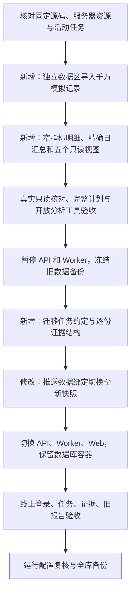

# 统一入口与大样本：服务器发布记录

日期：2026-10-20。已按用户授权完成服务器部署与验证，运行提交为 `3ae6d66678af6781a08064b45bd80ee02ee183e8`。本机通过现有私有隧道访问 [应用](http://localhost:8088)，首页及 `/healthz` 均已实测通过。源码归档摘要及去敏结果见 [机器可读证据](evidence/push-scale-deployment-20261020.json)。

## 发布流程与变化

统一自然语言入口只区分明确条件取数、开放式分析。前者使用一次生成的完整步骤计划，执行前验证依赖与输出、执行时绑定真实结果、结束时检查要求；后者逐步查询和计算，受已确认范围、当前权限、预算、证据引用和完成条件控制。详细规则见 [技术方案](open-exploration-technical-design.md)。

新快照为 `analytics_push_20261020_large`，旧推送快照 `analytics_push_20261018` 及订单数据源保留。只读账号只能读取五个指标视图，不能直接访问原始发送、私有指标明细或日汇总表。服务器监听仍仅为回环地址，模型配置、数据库全局 10 秒查询截止及原内存上限保持原值。

## 数据与查询实现

| 内容 | 实际数量 |
| --- | ---: |
| 设备 | 200000 |
| 逻辑发送 | 10000000 |
| 发送尝试 | 10605535 |
| 回执 | 7662701 |
| 活跃事件 | 10806113 |
| 权限历史 | 260263 |
| 通道历史 | 288394 |

全部为模拟数据。每条发送有模板 ID、标题和正文；发送覆盖上海时间 2026-04-01 至 2026-10-01 前，回执与设备状态截止 2026-10-15。测试时应指定这个区间，不能把当前日期的空区间当作效果下降。

完整原始数据导入及维护耗时 1463.376 秒，导入进程峰值 44597248 字节；这是初次导入实测，后续优化分别记录。最终快照表及索引合计 **10749673472 字节**，不能用初始布局的大小替代。

服务器全期明细扫描曾接近 10 秒，因此补充两类派生数据：

- `push_delivery_metric_facts`：每条发送一行，只保存指标计算所需字段，不复制标题正文；用于精确明细查询。
- `push_daily_outcomes`：按发送日、应用、厂商、通道、模板、失败原因、受理状态及三个事件的整小时门槛联合归并。1000 万发送形成 439172 组，条数之和仍为 10000000。保存到达耗时总和，平均值仍按总耗时除以到达数计算。

例如两条发送分别在 20 分钟和 50 分钟到达，均归入到达门槛 1；观察 1 小时计 2 条到达。联合保存到达、点击、过期门槛，保留交集与缺回执情况。对已支持的整数小时窗口精确等价于逐条时间比较，没有固定为 24 小时。只在查询起止都对齐上海零点时使用日汇总，部分日期范围及设备查询继续走原路径。

新快照只读账号单独设置两个并行进程、`work_mem=4MB`、`random_page_cost=1.1`，全局参数和旧账号不变。试建但未生效的索引已移除；查询路径变化没有增加每个工具动作的 SQL 次数。

## 验证结果

- 最终本地专项：**57 项通过**，包含全部消息指标在 1、24、48、72 小时窗口的明细/日汇总逐组对照、非整日回退、私有表拒绝访问、真实第 1001 组拒绝，以及私有部署配置检查。本轮小样本已在测试结束后删除。
- 最终服务器核心与边界回归：**41 项通过**，159.04 秒；运行镜像与验收镜像的 97 个后端文件逐字节等于上述固定提交，依赖相同。
- 服务器真实只读对照：10 项消息指标 × 4 种观察窗口 × 2 种应用范围，逐组组件与明细精确相等；查询仍受原 10 秒截止控制。
- 千万快照独立核对：**18 组通过**，覆盖单日、七天、单月、全期的整体和通道/厂商/模板分组、联合筛选、设备存量/状态/活跃。消息计数和比率来自独立文件核对值，设备与活跃事件逐行复核；最慢 **6.0758 秒**。
- 完整 A→B→C 依赖链、开放分析的查询/两期比较/带证据完成工具通过；千万快照超量分组请求明确触发 1000 组限制，未作为完整结果保存。
- 实际线上验证：登录、两种任务类型、10000000 发送、200000 设备、三步查询及各步独立证据接口、事件流完成信号均通过；两条原订单报告可读。

| 查询 | 实测耗时 |
| --- | ---: |
| 单日消息整体 | 0.1443 秒 |
| 七天消息整体 | 1.2519 秒 |
| 单月消息整体 | 0.0781 秒 |
| 六个月消息整体 | 0.1637 秒 |
| 设备存量、状态与月活跃 | 6.0758 秒 |

这些是维护完成后的串行实测，含缓存效果，不代表并发容量或冷启动保证。查询执行计划的实际/估算标记保存在证据中，不混同为实测。

初始服务器全量回归另有 483 个不同测试通过、无跳过：首轮 473 项通过、10 项因 384 MiB 临时盘不足而报错；在工作盘重跑全部 11 项扩容测试后逐项合并核对。保留初次错误证据，不把这个合并结果称作最终代码的一次全绿运行。

部署验收没有调用外部模型；真实数据库、工具协议及模拟模型测试能够验证执行控制，但不代表模型对自然语言的理解和业务调查质量已通过真实模型评测。

## 数据保留、备份与回退

切换前保存旧配置、源码、镜像和冻结备份；迁移后对 16 张旧业务与任务表比较数量及内容摘要，一致。原数据库容器未替换，两条待补充任务保留。旧推送任务仍冻结在旧数据版本，新入口按当前绑定检查权限，旧记录可能不出现在当前推送任务列表；订单绑定不变。

部署前备份已在空测试库实际恢复，47 张表计数一致。部署后全库备份已成功：**62 张表、830832490 字节、252.293 秒**，包含新千万快照；定时备份服务正常。本次未对部署后大备份再进行完整恢复，避免额外复制整库占用服务器空间。维护计数单独取消超时，不改变用户查询截止。

回退时恢复旧环境文件和 `current` 链接，重新启动旧 API、Worker、Web；新增的 `0005_task_contracts` 结构保留，不删除任务约定和证据。新旧数据区均保留。

按用户要求，本地百万/千万样本、对应两套隔离数据库和只读账号已删除，另清理 9 个本轮临时样本目录；验证报告保留于 `.cache/push-scale-reports/`。原项目快速样本不属于此次扩容产物。代码和去敏证据已本地提交，本轮未执行 GitHub 推送。
