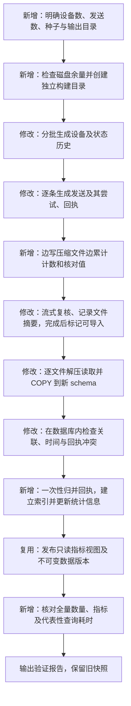

# 千万发送记录与二十万设备：扩容方案

日期：2026-10-20。状态：方案已获用户确认，本地实施与验证完成；用户随后授权部署服务器。用户补充说明 20 万设备、1000 万发送允许为约数，最终报告以实际数量为准。

## 1. 目标与验收口径

- 新增一份独立模拟快照，目标约 **200000 台设备、10000000 条逻辑发送记录**，保留三个模拟应用。数量可为约数；当前生成参数支持精确指定。大快照的设备 ID 全局唯一，每台归属一个应用，因此物理设备数和应用设备行数一致；跨应用重复注册仍由现有小样本回归覆盖。
- 重试属于发送尝试，不增加逻辑发送量；到达、点击、过期及重复回执另外保存，数量由生成结果统计。不能把发送尝试或回执行数算进 10000000。
- 每条发送包含模板 ID、标题和正文。保留多厂商、多通道、多个发送时段，以及重试、缺失回执、重复回执、权限变化、活跃变化和可核查的模拟异常。
- 暂沿用现有样本时间范围 `[2026-04-01,2026-10-01)`、快照时点 `2026-10-15T00:00:00+08:00`，与现有指标口径一致。全部明确标记为模拟数据。
- 大样本单独保存，不覆盖现有回归样本。先完成本地生成、隔离数据库导入与查询验证；线上部署及数据源切换另行明确。

## 2. 已核实的瓶颈

| 位置 | 当前实现 | 扩容时的问题 |
| --- | --- | --- |
| `generate_push.py` | 所有记录累积进列表，回执及活跃事件全量排序，导出后整批重新读取 | 发送及关联事件达到千万级时，多份对象同时驻留内存 |
| 生成后的检查 | 每台设备重新遍历全部活跃事件，发送与回执建立完整字典 | 设备数乘事件数的重复扫描不可继续沿用 |
| `import_push_postgres.py` | 每份文件整批读取、解析，所有表一起留在内存，再开始 COPY | COPY 本身已是批量写入，但前面的读取与检查没有流式处理 |
| `metric_push_deliveries` | 每次查询先对原始回执按投递编号聚合，再与发送记录关联 | 查询一个小时间范围也可能重复处理大量历史回执 |

按当前文件的实际平均大小线性外推，目标规模的未压缩 JSONL 合计约 **9.84 GiB**。这是容量估算，尚未包含 PostgreSQL 表、索引和写入日志，也不代表实测导入占用。检查时 C 盘可用约 **41.6 GB**，需要避免同时保留多份完整解压文件及数据库副本。

## 3. 新流程与变化位置

失败的构建目录不标记为完成；失败的数据库导入回滚，不发布半成品。后续查询继续使用原有指标视图名称、权限和执行上限。

实测补充：发送时间和应用的索引附带指标所需字段，避免读取标题正文所在的宽表；回执归并主键附带三个事件时间。独立导入事务提交后执行 VACUUM，允许只读查询直接利用索引。维护连接可以单独取消批量导入的语句超时；运行查询仍保持原有 10 秒限制。服务器上线前检查资源、备份旧库，在新 schema 导入并核对后切换配置，保留旧版本和旧数据源用于回退。

## 4. 生成与文件保存

生成器增加明确数量参数，例如 `--devices 200000 --deliveries 10000000`，输出到独立的 `data/push-large`。现有默认小样本继续用于快速回归，避免每次测试都重新生成千万记录。

发送、尝试、回执和活跃事件按批次写入，不在 Python 列表中保留完整历史；分组统计与核对值同步累计。设备及必要的少量状态索引可以缓存，但不建立千万条发送记录的内存字典。事件文件不再为了展示顺序进行全量内存排序；查询按真实事件时间计算，文件物理顺序不作为业务口径。

大文件使用 `.jsonl.gz`：每行仍是同样的 JSON 记录，仅外层压缩。导入器同时支持现有 `.jsonl` 和该压缩格式，逐行解压、解析、送入 COPY，不先解压完整副本。压缩不改变字段、去重键或时间。

记录固定种子、参数、真实行数、逻辑内容 SHA256、生成耗时和峰值内存。同一参数能够复现同一逻辑数据；数据版本以逻辑内容计算，不因压缩文件的时间戳变化而改变。

## 5. 导入与查询

导入继续使用 PostgreSQL COPY，但改为逐表、逐行读取；保留字段类型、模板内容长度、时间和时区检查。需要跨表的完整关联与冲突检查在数据库内执行，不为了检查外键把全部发送 ID 放入 Python 内存。

新增一个数据快照内的派生表 `push_receipt_summary`：每条逻辑投递至多一行，保存已确认到达、点击及过期的最早发生时间。例如，`dlv_0000001` 的两份重复到达回执归并成一个 `delivered_at`，点击时间单独保存；缺少到达回执时仍为空，不能由点击补出到达。

该表只在导入时从原始回执完整归并一次。它不属于新的用户任务类型，也不对模型或查询账号开放。原 `metric_push_deliveries` 视图改为关联发送表与这个派生表，仍按用户所选发送范围和观察窗口计算指标。不会提前把所有观察窗口固定成 24 小时。

发布后快照不可修改，所以派生表无须实时刷新。原始回执保留用于校验和追溯；只读账号仍只访问授权指标视图。

索引围绕实际使用的应用、发送时间、设备、通道及回执关联键建立，并执行 `ANALYZE` 更新数据库统计信息。先用真实查询执行计划和耗时确定额外索引，不为所有维度组合建立索引。保持现有只读 SQL、单次查询超时、1000 组结果及任务预算限制。

### 服务器实测后的查询优化

服务器实际执行计划显示，即使查询七天，仍会扫描整张回执归并表；月度查询触发 10 秒上限。补充私有表 `push_delivery_metric_facts`，每条发送一行，只合并发送时间、应用、厂商、通道、模板、失败原因、受理时间及三个回执时间。例如，一条发送在该表保留 `app_1 / xiaomi / tpl_001 / 发送时间 / 到达时间 / 点击时间`，不复制标题正文。它保存精确明细，不预先固定观察窗口，也不按天近似聚合。

原指标视图仍保留全部原列及相同只读授权。指标字段从窄表读取，标题正文等字段通过原发送编号关联宽表；只取指标时，数据库可以消除不需要的宽表关联。这样不再每次统计都关联整张回执表。时间索引放在窄表，原发送表上不再使用的覆盖索引移除，避免重复占用。导入后同样执行可见性维护；回归逐列、逐行比较新旧视图的结果，并在服务器重跑全部代表性查询。原始记录、数据版本、观察口径和超时限制均不变。

按日分组使用私有窄表内一次性计算并保存的上海时区日期 `sent_day`；视图直接提供这个辅助列，原列和原授权保留，返回时仍转为相同的 `YYYY-MM-DD` 文本。例如上海时间 9 月 8 日的发送保存日期 `2026-09-08`。日期与模板索引直接使用该列，不在分组时重复格式化千万行，也不依赖越过权限视图的表达式推导。查询完整算出前 1001 个分组后由上层拒绝超量结果，不把截断结果冒充完整结果，也不延长超时。

## 6. 分级验证与验收

| 阶段 | 数据规模或操作 | 通过条件 |
| --- | --- | --- |
| 回归 | 现有小样本、压缩和未压缩输入 | 原指标、权限、回执去重、只读发布及完整计划/开放分析检查继续通过 |
| 中等规模 | 20000 设备、1000000 发送 | 计数及独立核对值一致；记录生成、导入的耗时、峰值内存和磁盘增长 |
| 资源评估 | 用中等规模实测外推目标峰值 | 工作盘预计仍能保留至少 8 GiB 余量；不足则停止扩容导入并说明实际缺口，不擅自改用其他盘或删除旧数据 |
| 目标规模 | 约 200000 设备、10000000 发送 | 实际数量接近目标，导入前后计数精确一致；关联无孤儿、去重键无冲突、生命周期时间合法；每条发送的模板字段完整 |
| 指标核对 | 固定时间窗、应用、厂商及模板组合 | 数据库结果与流式读取原文件所得独立统计一致；比率按总分子/总分母计算 |
| 查询性能 | 单日、七天、单月和全期的整体/通道/厂商/模板查询，以及设备存量与活跃查询 | 记录真实耗时及执行计划；代表性查询在当前超时限制内完成，否则先优化再交付，不以延长超时或只返回部分记录代替通过 |
| 执行控制 | 大样本上的明确条件取数与模拟开放分析 | A→B→C 绑定真实结果；摘要仍有明确上限；大底表不直接传给模型；现有额度与权限继续生效 |

生成器和导入器的峰值进程内存目标各不超过 **1.5 GiB**，以实际测量为准，不包括 PostgreSQL 服务自身内存。千万级全量生成和导入只做专项验证，不加入日常快速测试。

交付报告包含实际行数、文件大小、数据库及索引大小、耗时、峰值内存、查询耗时、未通过项及复现命令。压缩率、完整导入时间和目标规模性能在实测之前不作保证。

## 7. 实施确认

本方案需要修改生成、校验和导入流程，并新增快照内的回执归并表，不是单纯改一个样本数量常量。用户已明确“约数即可，继续”，本轮按以上范围实施，不再重复请求确认。
