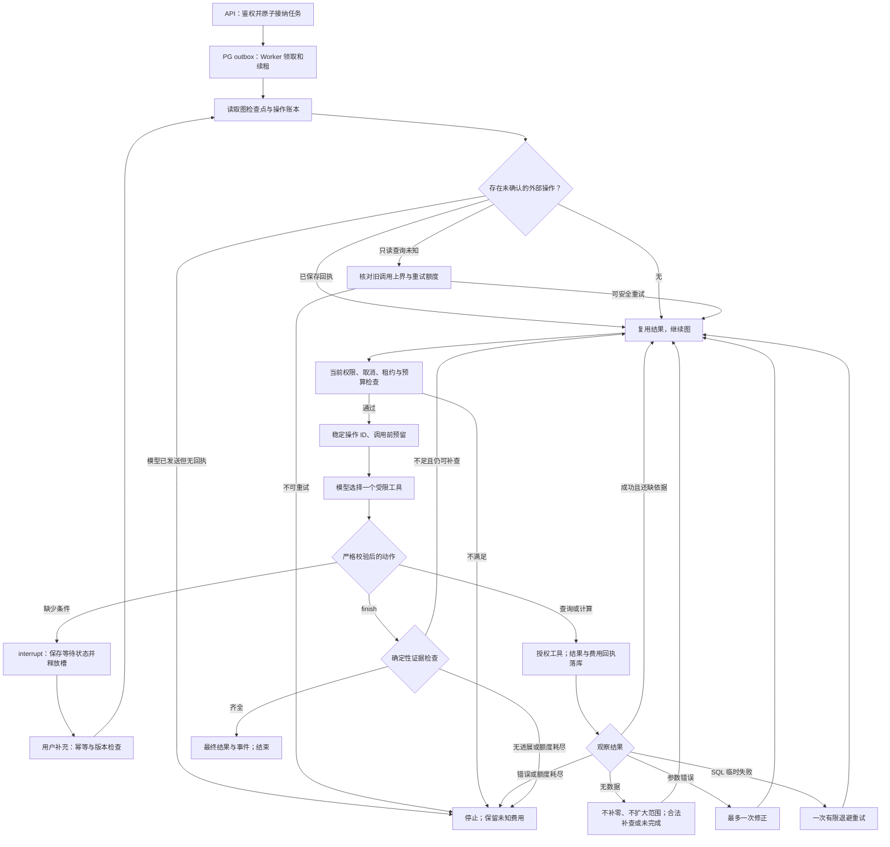

# Python 单栈经营分析助手：目标架构与实施规格

日期：2026-10-17。目标岗位：**AI / Agent 应用后端**。状态：**技术方案待确认，目标代码尚未实现**。

本方案替代“Go 持有 Agent 状态机、Python 执行单步”的目标架构。现有实现保留为对照基线，不能将本方案的 LangGraph、Python 平台或 PostgreSQL 分析数据源写成已实现能力。当前工作台仍运行原实现，浏览器演示使用模拟模型。

## 1 从零设计的约束与结论

业务是一个有限、只读的经营分析 Agent：两期各州 GMV 下降核查，以及单期 GMV Top N 合计、订单量、整体客单价和占比。需要工具选择、确定性计算、失败反馈、有限预算、等待补充、中断恢复和独立评测。分析并发初始为 2；没有已验证的高吞吐、跨语言组织边界、CPU 密集计算或必须连接外部 MySQL 的要求。

**选型：Python 单栈后端 + FastAPI + LangGraph + PostgreSQL + React。** API 和后台 Worker 分进程、共用代码库与应用服务。默认一套 PostgreSQL 实例，以平台、图检查点和分析数据 schema 分域，并使用独立账号、连接池和最小权限。没有 Go 运行服务、Redis、Celery、Kafka、多 Agent 或托管 Agent Server 的首版依赖。

选型依据是需求与约束的匹配，不以当前实现的迁移成本、个人熟悉程度或简历关键词作技术理由。“最优”指在上述约束下的推荐；后续若业务条件变化，再以压测、故障数据和维护证据调整。

## 2 候选方案与代价

| 决策 | 本方案 | 选择理由 | 代价及重新评估条件 |
| --- | --- | --- | --- |
| 后端语言 | Python 单栈 | API、Agent、工具、数据核对与评测使用相同类型和执行代码；当前主要等待模型/数据库，没有引入语言边界的必要 | 必须控制阻塞 I/O；多进程的内存、连接数需实测；真实 CPU 或平台吞吐瓶颈出现后再评估 Go 服务 |
| Agent 编排 | LangGraph StateGraph，单 Agent | 实际需求包含持久化节点状态、条件分支和等待用户后恢复，采用现成图运行时与持久检查点 | 增加框架、检查点表及版本管理；需验证与预算账本、租约围栏的组合；框架不能替代业务安全规则 |
| 手写 Python 循环 | 作为备选，不是默认 | 简单循环易理解，但本任务的持久节点、中断和恢复已经是明确需求 | 如果关键机制 PoC 表明 LangGraph 的适配代码多于被替代的通用代码，应回到该方案，而不是削弱安全语义 |
| Web API | FastAPI / Pydantic | 请求与工具统一严格 schema，复用 Python 领域对象；API 只接纳和读取任务 | async 路由不能直接执行阻塞 SQL 或模型调用；不得把长任务放入无持久保障的进程内 BackgroundTasks |
| 任务队列 | PostgreSQL task/outbox + SKIP LOCKED | 低并发持久任务的领取、幂等和预算需要事务；一个存储可满足首版 | 连接、锁等待和轮询需监控；实际积压和吞吐证据出现后再考虑消息中间件 |
| 平台与业务数据 | 一套 PostgreSQL，独立 schema/账号 | 自持订单数据无需第二种数据库引擎；数据库权限仍可隔离只读视图与平台写入 | 隔离的是权限域，不是故障域；将来对接外部 MySQL 时再增加明确的数据源适配器 |
| 数据访问 | SQLAlchemy 2 / Alembic，psycopg 3 | 常规平台表使用标准迁移与连接管理；领取、额度与版本围栏使用显式事务 SQL；图持久层通过 psycopg 接入 | ORM 不替代锁、唯一约束和条件更新；应用池和图检查点池分别计入连接预算 |
| 结果与界面 | React + 持久 SSE | 展示完整任务、依据、失败和恢复；SSE 断线可按事件序号补读 | 图事件需转为授权的业务事件，不能直接把内部图状态公开给浏览器 |

Go 与 Python 都能实现权限、队列、预算和 SSE；本项目选择 Python，主要减少平台与 Agent 之间的运行协议和状态转换。并发模型可参考 [Python asyncio](https://docs.python.org/3.13/library/asyncio.html)、[Go concurrency](https://go.dev/doc/effective_go#concurrency)，多 worker 部署的内存边界见 [FastAPI deployment](https://fastapi.tiangolo.com/deployment/concepts/)。这些文档支持机制说明，不提供本项目语言性能结论。

## 3 LangGraph 承担什么

使用 StateGraph 显式构建“准备决策 → 调用模型 → 校验动作 → 准备操作 → 执行工具 → 处理观察 → 再决策”的循环。模型每次只提出一个受限动作；代码决定该动作能否执行。选择自定义节点和注册工具，避免使用允许自由生成 SQL 的预制 SQL Agent。

LangGraph 的持久检查点记录图状态及后续节点；用户缺少条件时通过 interrupt 等待，补充后以原 thread 恢复。首版使用 PostgreSQL checkpointer，执行采用同步持久化模式；具体依赖版本和 API 由实施前 PoC 锁定，不以示例中的内存 saver 作为跨进程恢复方案。见[持久化](https://docs.langchain.com/oss/python/langgraph/persistence)、[检查点与持久化模式](https://docs.langchain.com/oss/python/langgraph/checkpointers)、[interrupt](https://docs.langchain.com/oss/python/langgraph/interrupts)。

框架不负责租户身份、指标授权、SQL 安全、金额算法、费用上限和完整任务判定，也不保证外部调用 exactly-once。interrupt 所在节点恢复时可能从节点开头执行，所以等待节点只处理幂等状态，不在 interrupt 前调用模型或执行 SQL。外部操作的确定回执先进入业务执行账本，再让图继续。

框架的价值须通过代码边界和恢复测试证明，不以“用了 LangGraph”证明 Agent 能力或任务效果更好。模型判断补查与固定流程的差异仍由独立 A/B/C 实验衡量。

## 4 已有部分与待实现部分

代码基线：`866da61`。以下“已有”指本地已提交实现，不表示真实模型效果或线上验收通过。

| 部分 | 已有部分与依据 | 待实现部分 |
| --- | --- | --- |
| Agent 与数学 | `agent/runtime/analysis.py` 的严格协议、Decimal 计算、引用、覆盖和完成检查 | 接入 StateGraph 节点；保留领域工具，移除跨语言的单步 HTTP 控制 |
| 目录与查询 | `catalog.json`、`plan.py`、`security.py`、`app.py` | PostgreSQL 方言、参数绑定、只读事务、视图导入及权限；原有六指标和样本语义需独立核对 |
| 模型传输 | `model_transport.py`，现有 JSON 输出校验和超时 | 作为图节点适配器；决策预留、回执和未知执行接入统一操作账本 |
| API 与任务 | `internal/api`、`internal/store` 的 Go 版本 | Python API、认证、账号、任务、会话、SSE、取消、预算和遥测；最终默认路径不运行 Go API/Worker |
| 图持久化 | 当前 Go 手写阶段状态和步骤账本 | LangGraph PostgreSQL 检查点、稳定 thread 映射、重放及执行版本围栏；不保留第二套图控制器 |
| 部署与数据 | Go/Python 双服务、PostgreSQL/MySQL 双引擎 | 同一 Python 镜像分 API/Worker 命令、一套 PostgreSQL、分域最小权限、初始化与备份恢复 |
| 界面 | React 分析入口、历史、依据、步骤和补充 | 兼容新 API；明确显示图恢复状态、真实/模拟模型及部分结果 |
| 评测 | `evals/analysis` 的 80 表达/40 组 draft、CSV oracle 和 A/B/C 脚本 | 新平台与 PG 数据源适配；人工复核、隐藏组扩充和真实模型实验；已有统计不能冒充新架构验证 |

迁移先做可验证的纵向闭环，再完成全部旧功能兼容；过渡运行只在隔离环境中存在。最终入口、部署模板与简历叙述必须一致，不把临时兼容层当作目标架构。

## 5 目标架构节点职责

交互图：[Python 单栈目标架构（待实现）](../.archify/architecture-python-agent-target-20261017-041515/python-agent-target.html)。图表示下述目标，不能证明当前代码已实现。

### 5.1 React 工作台

浏览器调用 FastAPI 提交问数/分析、补充条件、停止任务和读取历史；以 SSE 订阅持久业务事件。继续显示指标口径、时间、选中州、结果引用、未知费用和部分完成状态。浏览器不指定租户权限、数据库连接或 LangGraph thread_id。

### 5.2 FastAPI API 进程

Python API 负责会话与租户授权、严格请求校验、任务接纳、幂等、补充和停止。向 PostgreSQL 平台域原子写 task/outbox/request_id；读取平台结果与业务事件对外返回，逐次检查权限及完整指标依赖。API 不驱动 Agent 节点，也不在 HTTP 连接生命周期内运行分析。

### 5.3 Python Worker / LangGraph

Worker 从 PostgreSQL 平台域领取任务，维护租约和执行版本；调用 Python 应用服务检查当前身份、指标、取消和预算。LangGraph 在该进程内拥有 Agent 循环：模型选工具、读取观察、选择修正/补查/澄清或结束。所有外部调用先通过平台域额度事务，再调用模型网关或受限工具；两者回执进入执行账本。正常阶段不重新入队；只有等待、退避、结束或可恢复进程中断释放执行槽。

Worker 使用 PostgreSQL 图状态域的持久 checkpointer，同步保存图状态后再进入下一阶段。模型传输使用现有 gateway 适配器，模型无法绕过工具注册表发出数据库操作。原固定流程 C 组也运行在相同 Worker 和安全边界内。

### 5.4 受限查询与确定性计算

Python 工具模块接受原 QueryPlan 语义，不接受自由 SQL、DSN、租户或身份。PostgreSQL 方言编译后，经 AST 白名单、只读事务、语句超时和行数限制，只读查询 PostgreSQL 分析域的授权订单视图。查询连接使用专用只读身份；无法读取平台域、原始事实表或写入分析数据。

Decimal 工具执行比较、稳定排名、sum、加减乘除及变化率；核对引用、日期、单位、同口径与覆盖集合。Top N 读取完整州候选后选择；整体客单价用同范围总 GMV / 总有效订单量。finish 由代码验证证据，再按受限 finding 生成说明，拒绝无依据数字和因果结论。

### 5.5 PostgreSQL 三个权限域

`platform` 保存账号、会话、task/outbox、执行版本、操作回执、授权证据、预算、结果和持久事件；API/Worker 通过受控 repository 访问，关键更新都带 tenant/owner/version 条件。

`agent_checkpoint` 仅由 Worker 的 LangGraph 持久层写图状态与 pending writes；API 不写图的下一节点，也不提供按任意 thread_id 读取图状态的公开接口。thread_id 由服务端映射到 run/tenant/owner。

`analytics_*` 保存版本化 Olist 事实及授权视图；导入身份可写，查询身份仅能 SELECT 被授权视图。schema/账号隔离不能替代资源隔离，SQL 超时、并发和连接上限仍必须执行。三个域部署在同一 PostgreSQL 实例，图中的多个数据库节点代表逻辑域，并非三个引擎或三台服务器。

## 6 状态归属与一致性

| 状态 | 唯一权威来源 | 其他组件可做什么 |
| --- | --- | --- |
| 身份、授权、取消、租约、执行版本 | platform 数据表 | 图每次外部调用前读取，图缓存不能恢复已撤销权限 |
| 是否还有调用/费用额度 | platform 预算与操作事务 | 图显示计数并选择停止，不自行绕过硬限制 |
| Agent 规格、观察引用、下一节点、interrupt | LangGraph checkpointer | API 只读授权后的展示投影，不复制第二套阶段控制 |
| 外部操作是否已发送、是否有确定回执 | platform 操作账本 | 图恢复执行节点先核账，不能仅凭图缺少成功快照就再次发送 |
| 查询证据与最终结果 | platform artifacts/results，绑定数据版本 | 图只持 result_ref 和摘要；模型不能伪造已完成依据 |
| 对外任务状态与 SSE | platform 业务投影/事件 | 由 Worker 基于持久检查点与账本幂等生成；投影滞后时可补写 |

图状态、操作账本和展示投影有不同责任，不要求它们的独立写入天然构成一个事务。操作 ID 必须在外部执行节点之前稳定确定，并进入同步检查点；节点重放用同一 ID 查询账本。调用前的预算预留与 running 记录同事务，确定回执、证据、费用结算和已完成记录同事务。图检查点稍后写入；若此处崩溃，重放读取回执，不再次调用外部服务。

框架持久层不能绕过 worker 围栏：同一 thread 只允许一个有效执行者；领取、续租和业务写入检查执行版本。检查点写入同样需要版本校验与写入的原子保护，不能只在调用图之前检查一次。优先通过薄持久层适配器接入同连接事务/锁，PoC 必须验证 checkpoint 与 pending-writes 两条路径，以及旧 worker 恢复后的迟到写入。若官方 saver 接口无法满足，须先调整适配方案并复核，不能省略围栏或宣称原生 saver 已解决全部一致性。

## 7 主流程与失败分支

图中的循环始终受总预算限制；无数据不能无限绕回模型。停止、撤权、绑定改变和租约失效会阻止后续动作，迟到结果不能改变终态。补充等待最多 24 小时、两轮；清理同步覆盖业务记录与对应 graph thread，保留明确的过期结果说明。

当前边界继续采用：10 次模型决策、12 次工具动作、6 次 SQL、一次全局参数修正、一次全局 SQL 重试、180 秒活跃执行、30000 Token 预留与已知消耗。模型调用结果未知不自动重发，保留费用预留；SQL 未知仅在上界已过且仍有额度时只读重试。框架递归上限是额外保护，不能替代这些业务预算。

模型计价和 tokenizer 映射仍需维护者确认，配置随 run 冻结。byte-BPE 字节上界只能用于经确认的模型/网关；未知映射不启用硬预算。界面展示预算估算与未知费用，不能将估算说成最终供应商账单。

## 8 迁移与验收顺序

| 阶段 | 交付 | 必须通过的检查 |
| --- | --- | --- |
| P0 机制 PoC | 锁定 Python/LangGraph/PG 依赖，验证持久层和 interrupt | 跨进程恢复、模型 unknown 不重发、已完成操作重放、旧 epoch 检查点及 pending-writes 被拒绝 |
| P1 平台 Python 化 | FastAPI、身份、任务/outbox、Worker 租约、预算和 SSE | 租户/角色/指标撤权、CSRF、幂等、多实例领取、停止迟到回执、原 API 契约；Go 不参与新路径 |
| P2 分析域 PostgreSQL 化 | 订单导入、只读视图、QueryPlan 方言与编译 | 六指标与样本逐项对照独立 CSV、日期/排序/Top N/NULL 语义、禁止写入和越权读取 |
| P3 LangGraph 闭环 | 自适应、固定流程、等待补充与完成检查 | 成功、无数据、修正、SQL 超时、模型未知、宕机窗口、检查点写失败、取消和绑定变化 |
| P4 兼容与交付 | 原单步/多轮、React、迁移、初始化、部署及备份恢复 | 旧 HTTP 功能契约、会话条件继承、历史/SSE、账号兼容、完整新平台恢复演练；默认部署无 Go/MySQL 服务 |
| P5 效果实测 | A 单步 / B 自适应 / C 固定流程 | 同一新 Python 平台、PG 快照、授权和题集；题集复核、真实模型多轮实验、全部失败和费用保留 |

不能以“测试数量很多”替代 P0/P3 的故障窗口证据。不能用旧 Go＋MySQL 的延迟和新 Python＋PG 的延迟直接证明 ReAct 的收益；A/B/C 必须在相同新平台比较，以控制平台与数据库变化的影响。

过渡代码不增加第四个项目。旧 Go 和 MySQL 实现保留在 Git 历史及基线证据，最终默认源码入口、Compose、README 和演示使用新架构。切换前必须验证账号/会话数据兼容、数据版本、数据库备份与回退；本次方案确认不授权远端部署、推送或删除现有数据。

## 9 面试中的准确讲述

从业务问题出发说明：模型选择下一步，受限工具计算数字；图持久化负责恢复，操作账本防止不安全重放；身份、SQL 和预算由应用与数据库强制执行。选 Python 以统一 Agent、平台和评测，选 LangGraph 为持久流程与人工中断，选 PostgreSQL 为持久任务与事务语义。展示真实的成功与失败轨迹、恢复故障注入以及同平台 A/B/C 数据。

不要将保留旧实现的成本、语言标签或框架名称作为架构优势。完成前只能说“目标方案/正在实现”；真实模型实测前不能宣称提高完成率、减少成本或超过某个吞吐阈值。哪些是设计判断、机制 PoC、真实数据验证和真实模型实验，应分别标明。

## 10 当前交付与确认点

本次只完成目标选型、职责划分、流程与迁移验收规格。没有把旧 Go 状态机包装成 Python Agent，也没有在未确认新目标前改写平台代码。按用户提供的 AGENTS.md：“至少需在以下节点进行人工确认：……2. 技术方案产出……”。

需要确认的具体范围是：**最终默认后端为 Python 单栈，采用 LangGraph，默认数据存储统一 PostgreSQL，保留原问数/多轮和授权语义。** 确认后按 P0–P5 实施；若必须保留 MySQL 数据源，将其作为明确业务约束单独调整，而不是以已有代码作为理由。
