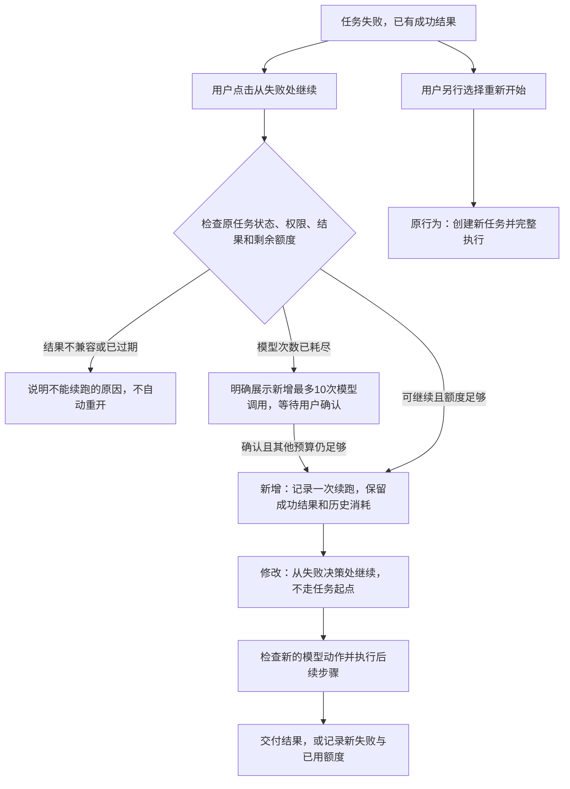

# 从失败位置继续重试：需求规格

状态：需求与技术方案均已由用户确认，实现及隔离验证完成，待人工验收。2026-10-20。

实现、验证结果及发布限制见 [retry-from-failure-validation.md](retry-from-failure-validation.md)。

确认内容：保留原任务、成功结果和累计消耗，只从失败决策继续；原模型次数耗尽后，可由用户明确追加最多10次模型调用，其他预算不自动提高。技术方案见 [retry-from-failure-technical-design.md](retry-from-failure-technical-design.md)。

## 目标与现状

用户点击重试后，从当前失败处继续，保留之前成功的取数、计算、用户补充及已确认约定，避免重跑成功步骤。

当前 `task_retry.py` 会创建新任务，仅复制原问题、补充和约定；不会复制分析证据、调查进度和恢复位置，界面也明确写着“新建一次任务”。这属于原有重试方式的限制，需要改变重试语义。

本次只读核实：原任务 `138a62fd` 因模型响应格式错误失败，已用10次模型调用、4次SQL，保存6份非报告产物；点击重试后创建 `0848b3af`，后者从头执行4次SQL。读取这些状态没有发起模型或业务取数调用。

## 用户体验与范围

1. 默认按钮改为“从失败处继续”，继续同一分析任务，执行历史中单独显示本次续跑。
2. 成功步骤复用完整保存结果。模型失败后重新发起该次决策，请求中携带已确认条件、成功证据、最近有效读取和失败反馈。
3. 模型已产出但被程序拒绝的参数或证据引用，不能当作成功结果复用。续跑从重新选择合法动作开始，不重复执行同一个错误工具请求。
4. 初始意图识别失败时，只重试识别，保留全部已提交补充；没有成功步骤可复用时，明确说明。
5. “重新开始”作为独立操作，明确表示新建任务；不能在无法续跑时暗中退回从头执行。
6. 本期重点覆盖模型请求、响应格式和模型生成参数失败。权限拒绝、用户取消、数据不兼容、结果过期等不能直接靠重发模型解决的情况，展示具体原因。

例子：A查整体、B按厂商分组均成功，C比较或生成下一步失败。继续后复用A、B；如果C是模型响应格式错误，重试C的模型决策；如果C的比较参数不合法，将错误反馈和A、B交给模型修正。A、B不再发送SQL。

## 恢复位置与历史

“恢复位置”指服务器记录的失败阶段以及之前已成功保存的状态。例如任务T在第7次决策失败，恢复位置包含该阶段、已确认约定及A、B的完整结果引用；不是让模型自己描述一个断点。

“续跑轮次”表示用户明确发起的一次继续执行。例如T的第2轮从第7次失败决策继续，用于区分原失败和新尝试的状态及消耗。它不代表新业务任务，也不预设一定需要新建数据库表。

原失败回执、原调用与费用记录不覆盖、不删除；新请求追加记录。界面同时展示累计消耗和本轮新增消耗，成功后仍能查看此前失败。用于失败收尾的旧部分报告不能冒充新的调查证据或最终报告。

## 额度规则

- 原有已知消耗、未知消耗预留、模型次数和SQL次数全部保留，不归零。
- 先使用原任务剩余执行额度。原模型次数已耗尽时，页面必须明确展示“此次继续新增最多10次模型调用”，用户确认后才增加调用次数上限，不能用一次普通网络重发来追加额度。
- 上述确认只追加模型调用次数；原任务累计Token、费用、SQL、工具和活跃时长等上限不自动提高。其他预算不足时说明原因，不伪装成模型故障，也不自动从头跑。
- 网关月额度、费用上限、价格和数据范围不因点击继续而改变。用户主动重新开始则按新任务规则处理，并明确展示与续跑的区别。
- 调用结果未知时保留原预留，提示本次继续是新的调用，不能承诺之前未执行或不计费。

## 复用条件

- 只复用同一用户当前有权访问的完整成功结果，并核实所属任务、约定、指标口径、范围、数据版本和完整性；预览不作为完整计算来源。
- 每次继续重新检查当前权限、任务状态和并发名额；不能通过重试绕过撤权、取消或额度限制。
- 双击、网络重发、多个页面同时点击，同一请求只能启动一次；重复请求不能重复追加额度或重复发出模型调用。
- 新旧执行者不能同时写入任务，迟到回执不得覆盖新的状态。
- 程序升级或详细证据被清理后，不能直接假定旧任务可恢复。技术方案需明确兼容核实方式；无法证明兼容时拒绝续跑，不直接改写旧绑定来绕过检查。

## 验收标准

| 场景 | 可观察的结果 |
| --- | --- |
| A、B成功后模型格式错误 | 点击继续后A、B业务SQL新增次数为0，模型收到原约定和有效A、B结果 |
| 模型比较参数不合法 | 重新决策获得具体错误反馈，未把无效C当作成功，未重复执行A、B |
| 原问题已有多轮补充 | 不丢失或重复询问已明确条件，不再次识别成另一种任务 |
| 初始识别失败 | 只重试识别，保留完整补充；此前无SQL则不声称复用了查询结果 |
| 模型次数已用完 | 普通重试不能偷增额度；用户明确确认后仅增加约定数量，其余累计预算仍生效 |
| 费用或其他硬预算不足 | 调用前停止并说明，不重置计数，不自动创建新任务 |
| 未知调用及迟到回执 | 原费用预留保留，新尝试独立记账，旧执行者不能覆盖新状态 |
| 重复点击或网络重发 | 只启动一轮、只追加一次额度、同一新操作不重复发送 |
| 撤权、数据变更、结果过期 | 拒绝复用并说明原因，无额外模型或业务查询 |
| 用户主动重新开始 | 明确新建任务，原失败、续跑记录和消耗可追溯 |

先以隔离数据库和模拟模型验证恢复、幂等、权限与预算；真实网关验收的调用上限另行明确授权，不沿用此前已经耗尽的授权。
