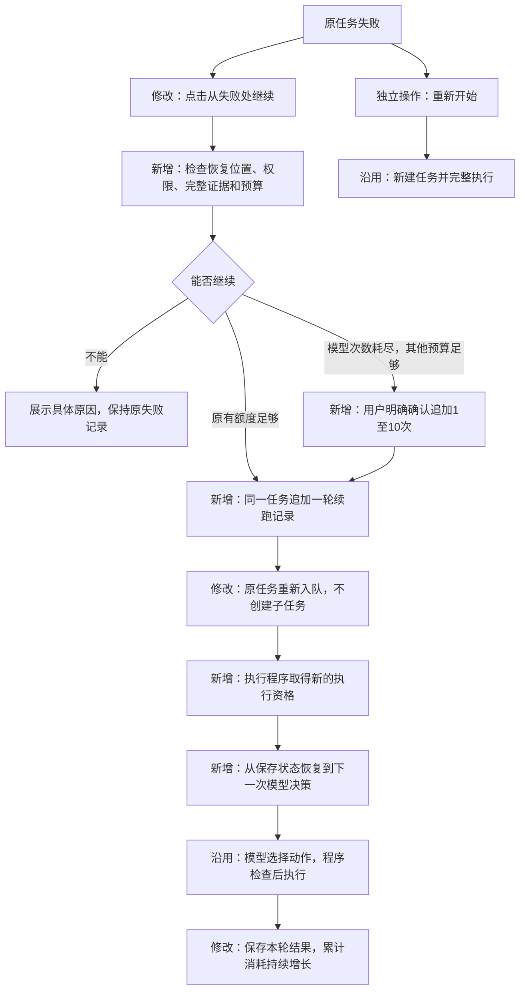
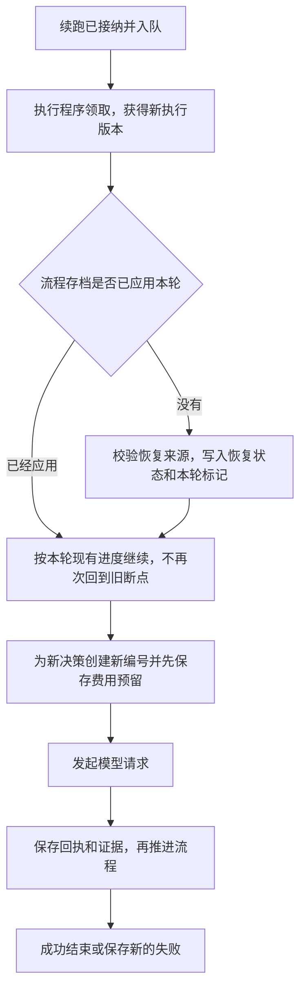

# 从失败位置继续重试：技术方案

状态：需求、技术方案及实现已由用户确认，服务器核验及部署完成。2026-10-20。

实现结果、测试与旧任务迁移限制见 [retry-from-failure-validation.md](retry-from-failure-validation.md)。

需求依据：[retry-from-failure-spec.md](retry-from-failure-spec.md)。本文中的表、字段、接口均为拟实现设计；下文单独标明已完成的可行性验证。

## 1. 实现后的行为

假设任务T已经完成A“查询本期整体指标”和B“查询基期整体指标”，在C“决定下一步比较方式”时模型返回格式错误。

点击“从失败处继续”后，仍然是任务T。程序复用A、B的完整结果，将原问题、已确认条件、成功证据和C的错误交给模型，重新做C的决策，再执行后续动作。A、B不重新发送SQL，原来的10次调用和费用继续计入T。

如果C已经返回比较参数，但参数不合法，同样从重新决策开始；不会把原错误参数直接再执行一遍。如果失败发生在最初的意图识别，则仅重试识别，并保留已回答的补充条件。

“重新开始”保留为另一个明确操作，创建新任务。无法续跑时只解释原因，不自动改成重新开始。

## 2. 现有流程要改哪里

目前有两处需要同时改变：`task_retry.py` 创建新任务，丢失原调查进度；`worker.py` 恢复一个已经结束的失败流程时，没有指定新的执行位置，不能靠修改任务状态继续执行。



网页负责展示和提交用户选择；恢复位置、证据可否复用、额度是否足够，全部由服务器判断。模型不能指定要跳回哪个步骤，也不能批准追加额度。

## 3. 保存什么，分别用来做什么

继续使用原任务表、分析状态、完整证据、步骤回执和费用账本。完整数据保持在现有服务端存储中，不复制到新任务，也不整批塞入模型上下文。

新增一张 `task_resume_rounds` 表，记录每次人工续跑；两个已有状态增加少量字段。原始执行称为第0轮，第一次人工继续是第1轮。

| 实体或字段 | 定义及例子 | 用途 |
| --- | --- | --- |
| 续跑记录 `task_resume_rounds` | 任务T的第1轮，来自第18个失败步骤，恢复方式为 `analysis_decision`，用户确认追加10次 | 记录谁因什么失败继续、如何恢复、是否追加额度，并区分各轮历史 |
| 恢复描述 `recovery`，存于续跑记录 | 当前约定版本3、原失败步骤引用、失败类型 `model_format`、恢复方式、失败前图状态校验标识、可用证据引用 | 固定服务器认可的恢复来源，不保存或信任模型自报的恢复位置 |
| 当前轮次 `tasks.resume_round` | 原任务T从0变成1，任务ID不变 | 将后续执行、回执、报告与本轮关联 |
| 已应用轮次 `State.applied_resume_round` | 执行程序已把第1轮恢复状态写入流程存档 | 进程中断后避免再次跳回同一个失败点，覆盖已经完成的新进度 |
| 清理状态 `analysis_runs.evidence_lifecycle` | `available`、`pruning`、`pruned` | 在跨连接清理详细结果之前阻止续跑，避免边恢复边删除结果 |
| 恢复快照 `analysis_runs.recovery_checkpoint` | 执行程序保存的原生存档编号及恢复所需状态，包含约定、引用和失败位置 | API账号不能读取原生存档所在数据库区域，因此读取该快照检查；执行程序实际恢复时再核对原生存档，清理证据时一并删除 |

续跑表关键内容如下。标识和证据引用均为示例，真实值由服务器生成：

```json
{
  "task_id": "T",
  "round_no": 1,
  "request_id": "4db0bb4b-3c1f-4957-93c8-88eab21ee012",
  "request_hash": "服务器对请求内容计算的摘要",
  "source_execution_version": 7,
  "recovery": {
    "mode": "analysis_decision",
    "failed_step_ref": "step-C",
    "error_code": "model_format",
    "contract_version": 3,
    "checkpoint_id": "原流程存档标识",
    "valid_result_refs": ["result-A", "result-B"]
  },
  "additional_model_calls": 10,
  "usage_before": {"model_calls": 10, "sql_calls": 4},
  "previous_report_ref": "上一轮部分报告的引用",
  "status": "accepted"
}
```

还保存创建人、创建及结束时间、原失败摘要、完整的起始消耗快照、本轮结束消耗快照、适用的升级兼容证明。本轮新增消耗由两份累计快照相减，另分别展示已知费用和未知调用预留。

唯一约束为 `(task_id, round_no)`、`(task_id, request_id)` 和 `(task_id, source_execution_version)`。同一个失败版本最多接纳一轮；同一请求标识换了追加次数或版本则拒绝，不能把不一样的请求当成网络重发。

这些记录只保存控制信息和引用，不再复制A、B的数据。新增字段和枚举用于程序内部执行控制，不把“指标下降、上升、波动”等业务问题改成预定义任务类型。

## 4. 接到点击后，服务器怎么检查

沿用 `POST /api/tasks/{id}/retry`，调整其语义为继续同一任务；请求增加 `additional_model_calls`，默认0，整数范围0至10。旧页面未传该字段时只能使用剩余额度，不能隐式追加次数。

```json
{
  "request_id": "4db0bb4b-3c1f-4957-93c8-88eab21ee012",
  "expected_execution_version": 7,
  "additional_model_calls": 10
}
```

在同一个数据库事务中按顺序处理：

1. 沿用任务接纳的容量锁，锁定任务及其执行状态，核实当前用户、租户、任务归属和权限。
2. 检查请求标识。已接纳的相同请求返回原轮次和同一任务，不再入队或追加额度；仍须检查当前访问权限。
3. 核实任务仍为失败、执行版本与页面一致，且失败原因可恢复。取消、正在执行、已完成的任务都不能由旧页面重新启动。
4. 找到真正导致失败的决策或工具错误。忽略失败收尾所生成的部分报告，不简单把“最后一条记录”当成失败位置。接口综合执行程序保存的恢复快照、步骤回执和执行记录；执行程序恢复时再读原生流程存档，核实编号及状态。冲突或存档丢失则在新调用之前拒绝恢复，不扩大API数据库账号的权限。
5. 校验保存的约定和完整证据，检查代码兼容性及清理状态，具体规则见第6、9节。
6. 核实剩余额度、用户并发名额和队列容量。只在模型次数已经耗尽时接受1至10次追加；尚有次数却提交追加请求，返回冲突并要求刷新页面。
7. 追加续跑记录和额度授权；任务转为待执行，递增执行版本、清除旧租约、重新启用原任务的队列记录。上述修改一起提交，任一检查失败全部回滚。

返回202，包含原任务ID、本轮编号、状态和累计预算。双击用同一请求标识；多页面用不同标识但同一失败版本时，也只有一个能成功。网页断网后重发同一请求不会再次追加次数。

本期只覆盖统一入口的独立任务。原来已创建的“旧任务→重试子任务”关系保留为历史，不能自动合并两者数据和费用。

恢复分类只依据服务器保存的错误和执行阶段：模型请求或响应格式失败进入重新决策；模型生成的工具参数、条件或引用错误进入带反馈的重新决策；模型次数耗尽且下一步确为决策时可进入追加确认。权限失败、主动取消、数据或证据失效、SQL结果未知、其他硬预算不足均不给通用续跑入口。不能仅因错误消息含“模型”就判断可重试。

## 5. 执行程序如何回到失败处

### 5.1 开放分析

执行程序领取任务后，再次核实权限、绑定、额度和续跑来源。取得新的执行版本后，才允许写流程存档或发出外部请求；接口接纳阶段不直接修改流程存档，也不调用模型。

使用现有流程框架的 `update_state(..., as_node="interpret")`，将本轮状态设为“需要重新决策”，让下一节点进入 `prepare_decision`；随后 `invoke(None)` 执行。保留已有流程线程ID，不调用任务起点，不使用旧的失败操作ID。

恢复状态的取舍：

| 内容 | 处理规则 |
| --- | --- |
| 原问题、用户补充、已确认约定 | 保留；以持久化约定为准，核实与流程状态一致，不重新识别任务类型 |
| 成功证据、有效结果读取、调查覆盖情况 | 保留通过第6节校验的引用，排除旧报告；恢复所必需的结果校验失败则拒绝，不悄悄跳过，也不用预览替代完整计算结果 |
| 已观察行、无进展计数、全局SQL重试次数 | 保留，避免续跑绕过无进展停止和SQL重试上限 |
| 错误反馈 | 保留具体失败原因，并说明已有结果可复用；限制长度，不重复堆叠整段历史 |
| 旧决策、旧工具输出、失败消息、旧待确认动作 | 清空执行中的残留；未被确认的范围变更不能因重试生效 |
| 自动格式修复及模型退避次数 | 改为按人工续跑轮次记录，每轮仍沿用原有限次规则；历史累计次数留在回执中，所有真实请求照常扣总预算 |
| 步骤编号 | 从账本和流程存档中的最大编号继续递增，避免新操作命中旧失败回执 |

程序从完整结果和有效的读取记录重建模型可见内容。继续沿用已有输入大小限制、证据索引和按需读取机制；续跑不增加一次专门的模型压缩调用。

已有工具结果缓存继续生效：同一约定、数据绑定和规范化查询参数已经有完整成功回执时，返回已有结果引用。失败或结果未知的回执不能作为成功命中。因此模型再次提出A、B的相同查询，也不会再次发送它们的SQL；真正不同的查询仍要正常检查和扣预算。

### 5.2 初始意图识别或计划生成失败

此时可能还没有分析流程存档。保持任务ID、原问题和 `query_dialogue`，只为当前补充版本创建本轮新的解析回执，然后重新解析。原失败回执不删除、不改成未执行。

两个现有解析回执表 `query_receipts`、`query_followup_receipts` 都增加 `resume_round` 并纳入主键。所有读取、写入及 `QueryExecution` 统一按“任务＋补充版本＋轮次”定位，旧记录迁移为第0轮。补充版本不因续跑递增，避免丢条件或重新获得补充次数。

只有“尚未接纳完整计划、尚未执行该计划SQL”的解析失败进入此分支。已经进入明确取数计划执行的SQL失败，不在本期悄悄改成再次生成计划。

如果本轮识别为开放分析，原有调用与本轮调用一起转入分析账本，并沿用同一任务的追加次数记录，不能在分流时重新获得10次。

### 5.3 进程中断与旧执行者



续跑表和流程存档可能用不同数据库连接，不能假定一次事务覆盖两者。是否已经应用恢复，以流程存档中与恢复状态一起提交的 `applied_resume_round` 为准；数据库中的轮次状态仅供调度及展示。

- 接纳后、领取前崩溃：队列记录仍在，新执行者正常领取。
- 写入恢复状态前崩溃：新执行者仍可应用本轮恢复。
- 写入后、更新轮次展示状态前崩溃：存档已有本轮标记，不再次回退。
- 工具成功回执已保存、流程尚未推进就崩溃：按原操作编号读取成功回执，不重跑SQL。
- 模型请求已发送、没有可靠回执就崩溃：保留未知消耗，停止并提示；不能靠进程恢复自动重发。用户再次明确继续才创建新的调用。
- 原执行者迟到：账本、结果写入及流程存档都检查任务执行版本和有效租约，不符合就拒绝。恢复接纳时即废止旧版本，不等到下次领取。

上述机制防止重复派发和迟到写入，但不承诺外部模型服务“只处理过一次”；没有可靠回执的调用仍按未知处理。

## 6. 成功结果什么时候可以复用

接纳续跑及执行程序恢复时都检查：

1. 当前账号有效，角色、应用范围、所需指标和维度权限仍满足原约定及待复用证据；沿用正常查询的授权入口，后续每步继续核实。
2. 任务、租户、约定版本、数据绑定、指标定义和观察窗口一致。不得为通过检查而缩减或重写原约定，或替换证据绑定。
3. 证据来自已完成的成功步骤，完整结果存在、内容校验值一致、依赖引用可追溯；已有未授权内容不能进入模型请求。
4. 恢复依赖的流程状态存在且可读取，详细证据未过期、未开始清理，代码版本满足第9节的兼容规则。

读取大结果时沿用现有分页及数量限制；完整性校验按存储形态执行，不把完整大结果一次加载进模型上下文。校验失败发生在外部调用之前，并提供具体原因。

失败收尾产生的部分报告保留用于查看历史，但从新一轮证据索引中排除。新报告只能引用原始查询、计算等有效产物，继续通过原有结论引用和计算检查。

最终展示改为按“本轮明确生成的报告引用”选择，不能再取“本任务最近一份报告”充当成功结果。本轮尚未出报告时，旧报告明确标记“上一轮部分结果”；旧版没有轮次字段的报告归入第0轮。

## 7. 预算怎么累计与追加

模型调用次数上限使用同一个计算入口：

`有效次数上限 = 初始10次 + 本任务已接纳续跑记录中追加次数的合计`

初始解析预留、分流到分析、分析账本、模型收到的剩余额度、页面显示全部使用这个入口，清除各处固定写死10次的判断。原任务冻结的模型、价格和其他预算不因采用当前服务器配置而更新。

| 限制 | 继续后如何处理 |
| --- | --- |
| 模型调用次数 | 有剩余就用剩余；耗尽时经用户明确确认才加1至10次，最多获得所确认数量 |
| 累计Token、费用 | 原消耗与未知预留保留，下一次最大预留仍必须放得下，不自动提高上限 |
| 累计SQL、工具动作、步骤数 | 继续累计，保留原上限，包括当前6次SQL、12次工具动作、40个账本步骤 |
| 活跃执行时长 | 继续累计，沿用180秒上限和调用前最坏时长检查；用户等待和排队不占活跃时长 |
| 单次输入、输出、超时、调用间隔 | 沿用原任务配置；单次输入超限不靠追加次数解决 |

例如T已调用10次、执行4次SQL，用户确认追加10次后，次数上限为20，已用仍为10；SQL仍为4/6。若后续仅剩Token或时长不足，程序仍会停止，不能声称确认追加后保证一定调用满10次或一定完成分析。

追加前必须检查其他硬限制至少允许下一次决策；执行前再次检查。超限错误按具体维度区分，让页面能说明“模型次数不足”还是“费用、步骤或时长不足”，后者不展示无效的追加按钮。

未知结果调用原预留不释放，新的调用单独预留。初始解析也必须从已持久化的调用预留和执行回执核算，按调用标识去重；不能只依赖可能因崩溃缺失的日志，不能与转入分析账本的同一调用重复计算。

追加额度与续跑接纳同一事务提交，同一个请求只授权一次。授权后实际未发送任何请求，额度记录仍可追溯；不能在网络重发、进程重启或多次领取时再次增加。

## 8. 页面如何展示

- 失败且可恢复时显示“从失败处继续”，旁边说明“保留已完成查询、补充条件和累计消耗”。尚无成功查询时按事实显示“重试识别，保留补充条件”。
- 模型次数已耗尽但其他额度足够时，先展示剩余各项预算，要求明确选择追加1至10次，再点击“确认追加并继续”。说明新增请求照常计费，未知调用的旧预留仍保留。
- 普通按钮不附带追加授权；前端修改数字本身不会执行任务，最终以服务器检查和接纳为准。点击后按钮禁用，超时重发沿用原请求标识。
- 保持原任务和当前页面，不跳到新任务。分组展示“原执行失败”“第1轮续跑”，执行步骤继续使用自然语言说明，并展示累计及本轮新增消耗。
- 不能恢复时说明原因，另行提供明确的“重新开始”入口，复用已有新建任务流程；不复用旧版“重试即创建子任务”逻辑。

接口返回 `retry` 描述可包含：`available`、`reason_code`、`message`、`execution_version`、`current_round`、`requires_call_extension`、`max_additional_model_calls`、`remaining_budget`。这些值用于展示，服务器接纳时重新计算。

## 9. 升级和清理如何处理

### 9.1 程序升级

当前运行元数据包含代码摘要，代码改动后直接恢复旧任务可能被现有执行检查拒绝。不能只关闭检查，也不能把旧任务改绑当前代码就宣称兼容。

本期采用两条规则：

1. 同一代码版本、流程版本、数据及指标绑定的任务正常续跑。
2. 跨版本只接受经过验证的具体“旧代码摘要→新代码摘要”组合。发布构建完成后生成独立JSON兼容清单，随发布只读交付，包含恢复格式版本、已验证的回放用例标识；该文件不参与其自身目标代码摘要的计算。续跑记录保存采用的证明。原任务元数据和证据绑定不覆盖，正常执行检查通过同一兼容校验函数核实当前版本是否获准执行。

开发阶段针对当前线上旧版本，使用去敏后的真实保存结构和模拟模型，验证恢复状态可读、查询及计算含义不变、权限与预算不放宽、A/B SQL不重发后，才加入兼容清单。没有原版标识、回放失败、数据或口径已改变，一律不接纳。

因此当前失败任务能否在升级后续跑，必须通过这项迁移验证，不能仅凭有几份结果就承诺可恢复。兼容清单不允许网页或模型提交，也不允许只按某个版本名前缀放行。

实现提供 `python -m agent.tools.prepare_task_resume --task-id <任务ID>`，在服务器原地核实旧任务与原生存档，默认只检查，只返回技术校验摘要。通过具体版本兼容清单后，可在发布迁移阶段加 `--apply` 补齐恢复快照；不修改原约定、数据绑定、账本或证据，也不启动任务。当前清单仅包含经两条真实旧任务隔离回放的b351d1c到本次实现组合，详见验证记录。

数据库迁移增加续跑表和轮次字段，解析回执旧记录设为第0轮；不修改原步骤编号、原报告或费用回执。已有子任务关系继续可查。发布时同步更新接口、执行程序和页面，避免新旧执行程序混跑；本次功能启用后不能直接回滚到会忽略续跑授权及轮次的旧程序。

### 9.2 详细结果清理

清理程序和续跑接纳使用同一任务行锁。清理决定删除详细结果时，先在事务内把 `evidence_lifecycle` 从 `available` 改成 `pruning`，然后再分连接清理证据和流程存档，完成后标记 `pruned`。

若续跑先接纳，任务已为待执行，清理不可选中；若清理先标记，续跑拒绝。清理失败保持 `pruning`，供原清理重试，不能在删除到一半时恢复。旧记录迁移根据已清理标记、证据过期标记和实际存档情况归类，不一律当作可用。

保留现有30天终态详细结果清理规则，同时对续跑轮次保留必要的失败摘要和累计费用快照。用于计费的记录在任务再次活跃期间不能按旧失败时间删除，避免恢复后预算归零。

## 10. 修改范围与职责

| 位置 | 负责的改动 |
| --- | --- |
| `task_retry.py` | 计算是否可恢复、原子接纳续跑、请求去重、追加次数；移除默认创建子任务的旧逻辑 |
| 新增恢复辅助模块 | 解析及校验恢复来源、构造状态、核实版本兼容；不执行模型或SQL |
| 数据库迁移、`repository.py` | 轮次及清理状态、同一任务重新排队、历史和预算查询，沿用执行版本约束 |
| `worker.py`、`graph.py`、`checkpoints.py` | 应用恢复状态、避免重复回退、重新决策、按本轮选择最终报告；保留存档写入资格检查 |
| `ledger.py`、`task_intent.py`及预算辅助函数 | 共用有效次数上限，累计核算所有轮次及未知预留，不修改其他预算 |
| `query_execution.py`及解析回执访问 | 按轮次追加解析回执，已接纳计划不进入重新解析分支 |
| `api.py`和现有任务页面 | 请求字段、追加确认、续跑历史和累计/本轮消耗，不再承诺默认新建任务 |
| `retention.py` | 清理与恢复互斥、保留活跃任务计费依据 |

拆分按职责进行，不另建一套任务引擎，也不引入第二个模型评审恢复位置。删除旧“点击重试创建子任务”运行分支及对应过时测试断言；保留原任务历史查询和用户主动新建任务的有效场景。

## 11. 验证与验收

已完成一项离线可行性验证：在本地安装的流程框架中，用内存存档构造“决策失败→结束”，再调用第5节的状态更新方法，下一节点确实为 `prepare_decision`，后续决策仅增加一次，没有重新执行起点。该实验没有模型、SQL或服务端写入；尚不代表完整功能已通过。

编码后在隔离PostgreSQL和模拟模型中完成以下验证：

| 场景 | 主要检查 |
| --- | --- |
| A/B成功、C格式错误后继续 | ID相同，A/B内容及引用不变，A/B新增业务SQL为0；新请求能看到原条件、有效证据和错误反馈 |
| C比较参数或证据引用错误 | 新模型决策获得具体错误，原错误工具调用不盲目重放，无效产物不进入证据列表 |
| 已回答多轮条件 | 补充及约定版本不丢失，不重复追问，不再识别分析类型 |
| 解析失败及后续分流 | 新轮次解析回执独立，原失败仍可查；累计消耗和追加额度正确转入分析 |
| 成功计划已执行部分SQL | 不进入本期解析重试分支，不以新计划覆盖原计划 |
| 10次耗尽后普通继续、确认继续 | 前者不加额度；后者只增加所选次数，Token、费用、SQL、步骤、时长不变 |
| 双击、不同页面并发、网络重发 | 同一失败版本仅接纳一次，授权和入队各一次；同标识不同内容返回冲突 |
| 接纳、写恢复状态、工具回执等位置崩溃 | 重新领取后不重复回退、不重复SQL、不重复追加；未知模型调用不自动重发 |
| 迟到回执及过期执行者 | 不能更新任务、账本、证据或流程存档 |
| 旧部分报告与新报告 | 旧报告可查但不供证据引用；本轮无报告时不能显示为本轮已完成 |
| 撤权、数据/口径变化、损坏或过期证据 | 在调用前拒绝，未泄漏旧结果，未改写原绑定 |
| 清理与续跑竞争 | 仅一方获得执行条件，清理中断也不放行残缺结果 |
| 当前线上版本迁移回放 | 明确验证可恢复的具体版本组合；未知版本不能借兼容分支放行 |
| 原正常查询、分析、取消及保留规则 | 相关现有回归通过，初始10次和其他硬预算保持有效 |

通过测试后提交独立代码commit，提供验证结果及仍不支持的情况，供人工验收。真实网关验收需要另行明确调用上限；本方案确认不构成新的真实调用授权，也不沿用已耗尽的历史额度授权。
