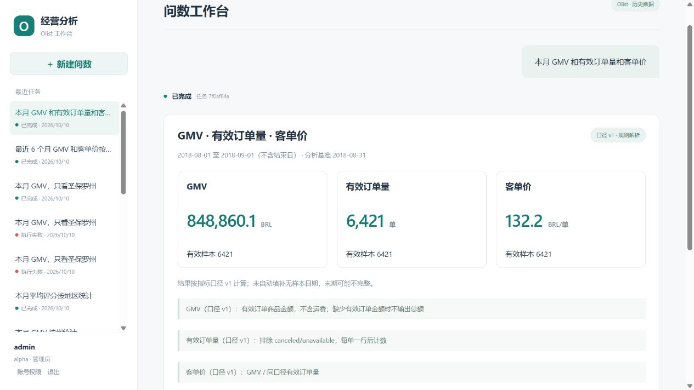
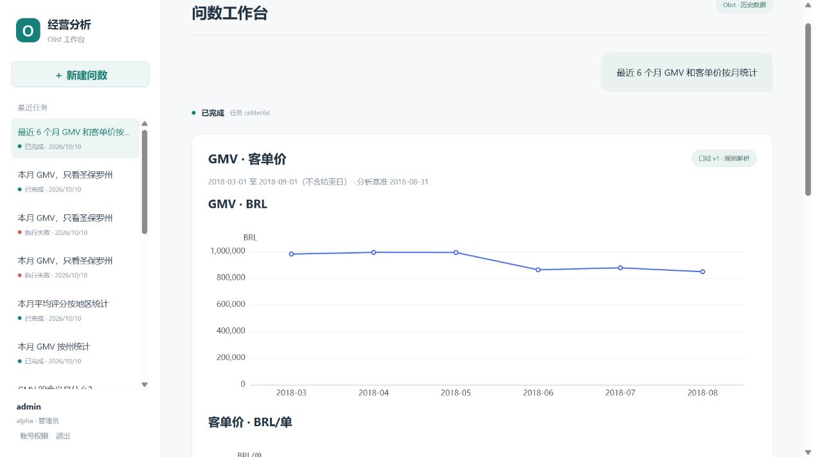
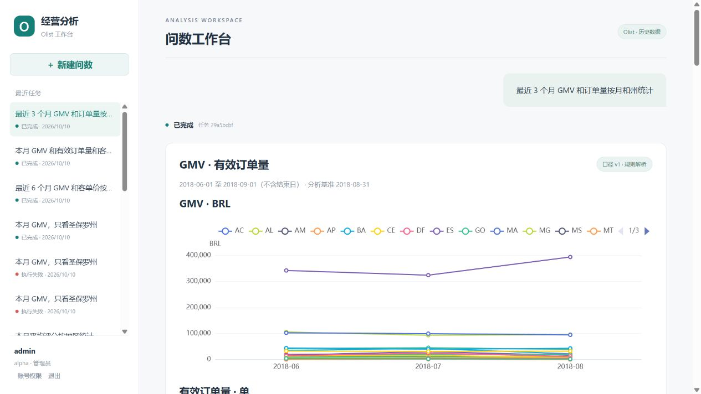

# 验证记录

日期：2026-10-09 至 2026-10-10。完成代码和测试后等待用户人工验收；不代表 M2/M3 或正式云上线验收完成。

## 环境与数据

Windows；Go 1.27.1、Python 3.12、Node.js 24。功能验收使用临时 PostgreSQL 18.4 与 MySQL 8.4.11，只监听本机，不安装系统数据库服务。随后在 Docker Linux 引擎 29.8.2 上验证本地 Compose 启动，数据库镜像为 PostgreSQL 17 与 MySQL 8.4。

从官方 Olist 下载并真实导入 99,441 笔订单。两个独立租户 schema；alpha 全范围，beta 的查询视图仅允许 SP 州。真实 CSV/数据库文件、密码和测试运行配置均在 Git 忽略目录。

下载包 SHA256：`967e41e04fc306fe604e2a693f488995a8b41e5047418f8a5c8e4abd6deca784`。

## 已通过

| 检查 | 结果与边界 |
| --- | --- |
| Go vet / 测试 / 构建 | 通过；5 项 API 测试、6 项真实 PostgreSQL 集成测试 |
| Python 测试 | 60 passed，含真实 MySQL 导入/只读权限测试与模型 HTTP mock 契约 |
| 前端 | npm ci、TypeScript、Vite 生产构建通过；npm audit 显示 0 漏洞 |
| 真实 HTTP 链路 | Go→Python→MySQL；六指标与独立原始 CSV 计算核对通过 |
| 权限 | 跨租户详情/SSE/停止 404，运营管理接口 403；撤权后历史 404、停用后会话 401 |
| 请求安全 | 客户端伪造 tenant_id 被拒，非同源写请求被拒，SQL AST 攻击集被拒 |
| 任务协议 | 单用户并发、并发抢占、租约过期、旧版本写回隔离、停止、累计重试预算与事件续传 |
| 数据语义 | 金额避免联表倍增、评价稳定去重、有效时间、歧义澄清、无数据与真实零区分 |
| 迁移 | 重复执行幂等；改写已应用 SQL 校验值时拒绝迁移 |
| 部署模板 | 官方 Docker Compose 5.6.0 校验本地及云配置；Kubernetes 9 个资源 YAML 解析通过 |
| 本地容器部署 | API/迁移/agent/web 镜像完整构建通过；两个数据库 healthy，迁移 Exited (0)，应用服务运行；:8088 页面与 /healthz 返回 200 |
| 真实模型调用 | 将 Windows 用户 DEEPSEEK_API_KEY 接入本地 LLM_API_KEY 并重建 agent；单次“本月 GMV 按州统计”内部请求返回 200/completed，parser=llm、deepseek-flash、338 Token、26 行结果 |
| 规则优先变更 | Windows 111 passed/2 个 MySQL 集成用例未配置时跳过；Linux 容器含真实 MySQL 共 113 passed。覆盖规则零模型调用、受限兜底、缺失/冲突/越权/超范围、手动约束、未知筛选、模型失败及澄清用量 |
| 两条真实解析路径 | 新版 agent、模型密钥已配置：本月 GMV 按州统计走 rules/0 Token、26 行/合计 848860.10 BRL；本月 GMV 只看圣保罗州（手动指标 gmv）走 llm/522 Token、1 行/394403.11 BRL。各州与圣保罗金额均独立核对原始 CSV；公网入口 /healthz 返回 200 |
| 浏览器 | 本地登录、问数、历史回查、真实州分组图表显示通过 |

验收脚本 `scripts/verify.ps1` 已实际执行通过。Windows 验证前应停止 Vite，避免 npm ci 遇到 esbuild 文件锁。

## 黄金结果

基准 2018-08-31；区间 [2018-08-01, 2018-09-01)。`scripts/smoke.py` 独立读取原始 CSV 计算结果，没有复用运行时 SQL。

| 指标 | 实际查询结果 |
| --- | ---: |
| GMV | 848860.10 BRL |
| 有效订单 | 6421 |
| 客单价 | 132.200607 BRL/单 |
| 取消率 | 1.28993% |
| 平均交付时长 | 7.73278000 天 |
| 平均评分 | 4.2561 分 |

金额和计数要求精确一致；除法/平均允许绝对误差 0.0001，覆盖 MySQL 整数 AVG 默认四位小数的舍入。NULL 单独核对，不当作零。

## 未验证与后续

本地 Linux 镜像构建与 Compose 启动已验证；容器数据库已核对导入 99,441 笔订单，Python/MySQL 容器回归及规则/模型两条真实查询已验证。2026-10-10 语义查询阶段补齐了 Go/PostgreSQL 全套容器集成回归，见下文。CI 工作流已配置测试和镜像构建，但尚未在远端运行。Compose 校验和 YAML 解析不能代替 Kubernetes server dry-run。

已完成真实模型解析与 MySQL 查询链路检查，并验证规则优先后的模型兜底；模型请求格式、响应 schema、无 SQL 输出、失败不回退编造结果及手动约束另由 mock 契约测试验证。少量成功查询不能代表模型准确率；费用预算与 300+ 独立验收集未完成。

未在云账号部署，TLS/Ingress、数据库私网权限、多副本滚动发布、50 并发压测、备份恢复、P95/99.9% 未验收。代理下登录 IP 限速需完善；长任务主动取消、节点 checkpoint、完整恢复、归因及报告属于 M2/M3。详见 [云部署边界](deployment.md)。

测试有一条 Starlette TestClient 使用 httpx 的弃用警告，不影响通过；升级测试客户端需单独验证兼容性。初次验收的原生测试数据库与服务已关闭，本地 Compose 服务保持运行，忽略目录保留数据供后续复测。

## 语义查询第一阶段

2026-10-10：需求及技术方案已由用户确认；第一阶段代码已部署至本地 http://localhost:8088/，下面结果供用户人工验收。未在云账号发布。

| 检查 | 实际结果 |
| --- | --- |
| Windows Python | 157 passed、3 skipped；三条真实 MySQL 用例在 Linux 中执行 |
| Linux Python / MySQL 8.4 | 160 passed；包含订单粒度、只读权限、月/州联合聚合与参数绑定 |
| Go | go vet、go test、原生构建通过；Linux Go 全套测试连接真实 PostgreSQL 17 通过，含 6 条 store 集成用例和新增 API 多指标撤权用例 |
| 解析与安全 | 常用六指标完整命中零模型调用；未知/遗漏条件、手动冲突、模型截断、未授权字段、金额精度与状态歧义均拒绝；枚举 eq/in 等价表示通过 |
| 结果边界 | NULL 与真实 0、指标级不同分母、月内重新算均值、部分月份、稳定排序、Top N；1000 组可返回，1001 组明确拒绝并关闭连接 |
| CSV 独立核对 | `scripts/verify_semantic.py --with-model` 九条全部通过；核对数值、样本、排除、不可履约、NULL 及分组顺序，未复用运行时公式 |
| 两条真实解析路径 | 八条规则问题均 rules/0 Token；多指标“本月 GMV 和订单量，只看圣保罗州” llm/1960 Token、1 组，金额与有效订单均与 CSV 一致 |
| 前端 / 镜像 | TypeScript、Vite 生产构建、agent/api/web Linux 镜像构建通过；语义目录随 agent 镜像打包，云模板复用同一镜像 |
| 浏览器 | 登录后整体三指标卡片、六个月双指标趋势、月/州联合分组及旧历史展示完成；详见下方截图 |
| 本地部署 | 修正本地忽略配置中 PostgreSQL 密码与现有数据库的不同步，保留数据库和账号；最终 /healthz 返回 200 |

独立 CSV 案例：月/州 GMV、订单量、客单价 26 组；取消率、交付时长、评分 26 组；最近六个月双指标 6 组；最近三个月月/州双指标 80 组；商品金额筛选、州排除、已取消订单的有效订单量分别 1 组；GMV Top 5 为 5 组。基准为 2018-08-31，alpha/admin 全范围视图，原始 CSV 位于忽略目录。

这些是功能回归和少量真实模型集成检查，不代表 300+ 独立准确率评测已完成。当前仍没有自由 SQL、品类 JOIN、同比/环比、归因和报告。前端图表包有 Vite 大于 500 kB 提示，采用懒加载，后续可优化；测试客户端有前述弃用提示。

## 质量门禁、执行遥测与阿里云适配 A 批

2026-10-10：用户已确认需求及方案。代码、测试和配置已实现，供本轮人工验收；未创建云资源、推送镜像或修改远端仓库规则。

| 检查 | 实际结果 |
| --- | --- |
| Python / MySQL 8.4 | 最终完整回归 170 passed；包含真实导入/只读视图、错误遥测、日志白名单、完整题单、绝对/相对/关键案例门禁和发布身份检查 |
| Go / PostgreSQL 17 | go vet、go test 全套通过；新增迁移幂等、逐次重试、停止后迟到遥测、租约重抢、P95、未知用量、租户隔离、30 天清理不删业务记录、调用前撤权零用量、可信代理测试 |
| 开发分区确定性评测 | 基线与候选各 50/50，支持案例 25/25；规则模型调用为 0，比较门禁通过 |
| 验收分区确定性评测 | 候选 45/45；25 条规则、10 条澄清、6 条范围拒绝、4 条权限操作均通过 |
| 真实模型验收分区 | 同一模型下基线与候选各 60/60，支持问题 40/40；每版本 15 次模型请求，比较门禁通过 |
| 完整题单一轮复核 | 基线与候选各 120/120：规则 50、陌生表达 25、澄清 20、范围拒绝 15、权限 10；支持问题 75/75，CLI 门禁通过 |
| 可观察性 | 候选完整题单实际模型请求 26 次、已知 Token 25,749、未知用量调用 0；含一次成功前的重试，探针累计多次请求而非只看最后一次；九个阶段均有记录 |
| 失败不放行 | 首次复制本地密钥带入外层引号，认证失败；保留失败报告，主正确率 62.5%，门禁明确拒绝。修正测试配置后重新实测，没有修改题单或预期 |
| 云配置 | Compose 参数校验、工作流 YAML 解析、评测 shell 语法、容器 Nginx 与实际加载 ECS TLS 配置的 nginx -t 均通过；TLS 使用临时自签夹具，只验证配置 |
| 本地部署 | api/agent/web/migrate Linux 镜像构建通过；本地新版启动、001/002 迁移确认、http://localhost:8088/healthz 返回 200；保留既有数据库和会话 |

完整题单来自 35 个业务/权限组，改写包含固定前缀；使用合成订单夹具和规格预期。上述结果证明这套初版测试的正确完成，不是线上用户分布准确率或已人工复核的 300+ 验收。两 Python 版本使用同一候选 Go 评测平台；原始报告在 `.cache/evaluation/`，标记 worktree 及内容哈希，未作为正式镜像发布证明。最后的日志字段白名单和调用前零用量改动通过相应回归测试。

本地完成一次基线/候选比较与完整题单复核；手动 CI 的三轮受控评测尚未在远端执行。合并必需检查、环境保护、ACR 摘要及实际发布镜像评测/部署依赖尚待远端配置。阿里云 RDS/公网 TLS/SLS、资源压测与备份恢复、生产共享费用硬预算仍未验收。前端代码未变，镜像复用已通过的 TypeScript/Vite 构建。Starlette TestClient 的既有弃用提示仍在。

测试配置排查时，工具错误诊断曾意外打印一项本地数据库配置密码；后续避免打印连接串，临时环境文件将在测试结束后删除。应用 JSON 日志的敏感字段回归通过；该配置密码建议后续轮换，不将日志测试通过当作排查输出从未泄漏。
