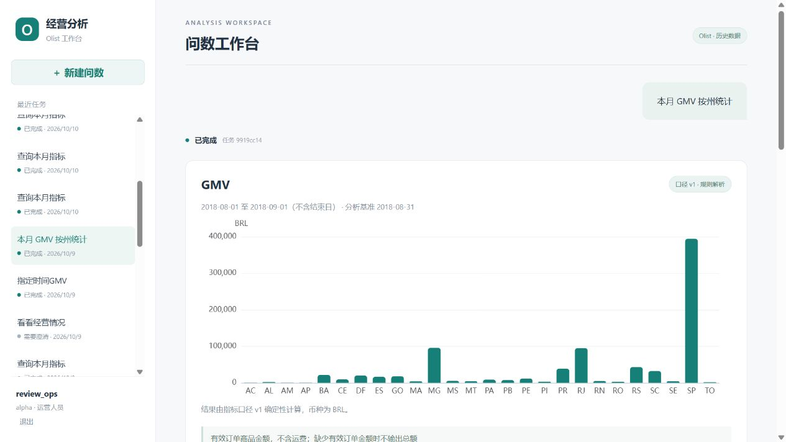

# M1 验证记录

日期：2026-10-09 至 2026-10-10。完成代码和测试后等待用户人工验收；不代表 M2/M3 或正式云上线验收完成。

## 环境与数据

Windows；Go 1.27.1、Python 3.12、Node.js 24。功能验收使用临时 PostgreSQL 18.4 与 MySQL 8.4.11，只监听本机，不安装系统数据库服务。随后在 Docker Linux 引擎 29.8.2 上验证本地 Compose 启动，数据库镜像为 PostgreSQL 17 与 MySQL 8.4。

从官方 Olist 下载并真实导入 99,441 笔订单。两个独立租户 schema；alpha 全范围，beta 的查询视图仅允许 SP 州。真实 CSV/数据库文件、密码和测试运行配置均在 Git 忽略目录。

下载包 SHA256：`967e41e04fc306fe604e2a693f488995a8b41e5047418f8a5c8e4abd6deca784`。

## 已通过

| 检查 | 结果与边界 |
| --- | --- |
| Go vet / 测试 / 构建 | 通过；5 项 API 测试、6 项真实 PostgreSQL 集成测试 |
| Python 测试 | 60 passed，含真实 MySQL 导入/只读权限测试与模型 HTTP mock 契约 |
| 前端 | npm ci、TypeScript、Vite 生产构建通过；npm audit 显示 0 漏洞 |
| 真实 HTTP 链路 | Go→Python→MySQL；六指标与独立原始 CSV 计算核对通过 |
| 权限 | 跨租户详情/SSE/停止 404，运营管理接口 403；撤权后历史 404、停用后会话 401 |
| 请求安全 | 客户端伪造 tenant_id 被拒，非同源写请求被拒，SQL AST 攻击集被拒 |
| 任务协议 | 单用户并发、并发抢占、租约过期、旧版本写回隔离、停止、累计重试预算与事件续传 |
| 数据语义 | 金额避免联表倍增、评价稳定去重、有效时间、歧义澄清、无数据与真实零区分 |
| 迁移 | 重复执行幂等；改写已应用 SQL 校验值时拒绝迁移 |
| 部署模板 | 官方 Docker Compose 5.6.0 校验本地及云配置；Kubernetes 9 个资源 YAML 解析通过 |
| 本地容器部署 | API/迁移/agent/web 镜像完整构建通过；两个数据库 healthy，迁移 Exited (0)，应用服务运行；:8088 页面与 /healthz 返回 200 |
| 浏览器 | 本地登录、问数、历史回查、真实州分组图表显示通过 |

验收脚本 `scripts/verify.ps1` 已实际执行通过。Windows 验证前应停止 Vite，避免 npm ci 遇到 esbuild 文件锁。

## 黄金结果

基准 2018-08-31；区间 [2018-08-01, 2018-09-01)。`scripts/smoke.py` 独立读取原始 CSV 计算结果，没有复用运行时 SQL。

| 指标 | 实际查询结果 |
| --- | ---: |
| GMV | 848860.10 BRL |
| 有效订单 | 6421 |
| 客单价 | 132.200607 BRL/单 |
| 取消率 | 1.28993% |
| 平均交付时长 | 7.73278000 天 |
| 平均评分 | 4.2561 分 |

金额和计数要求精确一致；除法/平均允许绝对误差 0.0001，覆盖 MySQL 整数 AVG 默认四位小数的舍入。NULL 单独核对，不当作零。

## 未验证与后续

本地 Linux 镜像构建与 Compose 启动已验证；容器环境的数据导入、登录问数和完整集成测试尚未执行。CI 工作流已配置测试和镜像构建，但尚未在远端运行。Compose 校验和 YAML 解析不能代替 Kubernetes server dry-run。

没有调用真实付费模型；仅验证模型请求格式、响应 schema、无 SQL 输出、失败不回退编造结果、手动输入规则解析。模型准确率、费用预算与 300+ 独立验收集未完成。

未在云账号部署，TLS/Ingress、数据库私网权限、多副本滚动发布、50 并发压测、备份恢复、P95/99.9% 未验收。代理下登录 IP 限速需完善；长任务主动取消、节点 checkpoint、完整恢复、归因及报告属于 M2/M3。详见 [云部署边界](deployment.md)。

测试有一条 Starlette TestClient 使用 httpx 的弃用警告，不影响 60 项通过；升级测试客户端需单独验证兼容性。测试数据库与服务完成验收后关闭，忽略目录保留数据供后续复测。
